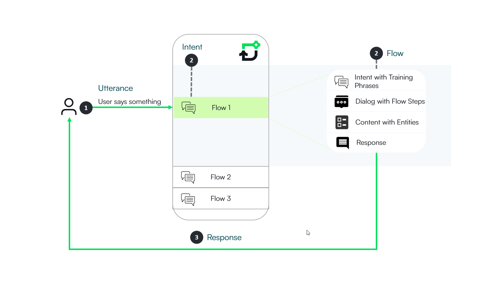

---
layout:
  title:
    visible: false
---

# Conversational Flows

Conversational flows define the configuration of dialogs between the end-user and the AI Agent on a specific topic (intent). When a user initiates a conversation (utterance), the AI Agent identifies the intent and directs the user to a specific dialog.

A flow comprises the following elements:

- **Intents** / **Training Phrases for NLU**: Example phrases representing what a user might say. These phrases help the AI Agent match the intent, leveraging its built-in ML engine to understand not only exact utterances but also similar phrases.
- **Descriptions for NLU**. Technical or long descriptions for NLU classification when using LLM as classification model type (**NLU** > **Intents** > **Classification Model Type**).
- **Dialog**: A series of steps triggered when the intent is matched. The AI Agent executes actions on third-party systems integrated with your AI Agent. For example, in a banking AI Agent, when a user requests to update account personal data, the AI Agent triggers specific actions to update the user's account information in the banking system.
- **Conversation Context**: Upon matching the intent, the AI Agent extracts values from the utterance (using expressions) and stores them in the conversation context. Entities, structured data sets, facilitate logic execution or response generation by the AI Agent.

You can easily create conversational flows using the Flow Designer in either of the two view modes:

- **Using List View**. Navigate to the Flow Designer in list view and click the **New Flow** button located at the top-right corner of the page.
- **Using AI Agent Diagram Designer**. Access the AI Agent Diagram Designer and click the **Add flow** icon () on the Toolbar.

Upon selection, the New Flow modal opens, where you'll need to populate the following mandatory fields:

| Field | Mandatory | Description |
| --- | --- | --- |
| Name | Yes | Unique flow name visible only to authors, used for identification within the Flows list and analytics.  **NOTE:** A naming convention is an important part in a well-built dialog; therefore, we recommend you to use lowercase words separated by "-". Use the following naming format: **area-action-task**. E.g., authenticate-hr-user, balance-not-updated-after-bank-transfer, card-about-to-expire, card-payment-fee-charged. |
| Display Name | Yes | Brief description of the flow. This field is intended for user-facing text and may appear in the chat when the AI Agent asks users to choose between similar intents (used within the Intent-not-recognized flow).  **Info:** In Druid versions prior to 9.18, this field was named **Description**.  **NOTE:** While your existing data from the previous **Description** field has been preserved in the **Display Name**, we strongly recommend that you review these values. Ensure the text is short, clear, and professional, as it might be visible to the end user during chat interactions.  **IMPORTANT!** For AI Agents using NLU with LLM, do not include technical or long descriptions in the **Display Name**. Instead, use the dedicated section **Training Description & Phrases** > **Description for NLU** section. The Large Language Model uses the Flow Name, and Description for NLU (Training Description & Phrases for classification), allowing you to keep the Display Name concise for the chat interface. |
| Utterances | No | First utterance displayed in the flow training phrases. |
| Commands | No | Technical utterances (structured or system-level inputs ) that bypass natural language processing (NLP). For more information, see [Commands](Adding%20Technical%20Intents.md). |
| Category | Yes | Category for filtering purposes. |
| Alert | No | Marks the flow as an alert flow. |
| Authentication Required | No | Indicates if flow execution requires user authentication. |
| Special flow type | No | If the new flow is a special flow type supported by Druid, select the appropriate type from the list. |
| Description LLM | No | **NOTE:** Starting with version 9.21, this field has been renamed to 'Description for NLU' and it is available under the section 'Training Description & Phrases' in the flow configuration.  Provides the Large Language Model with detailed context for accurate intent classification. Unlike the **Display Name**, content entered in this field is strictly for backend processing and is **never visible** to the end user in the chat interface.  This field displays within the flow configuration only when the AI Agent has [NLU intents classification with LLM](../Conversational%20AI/NLU%20Intents%20Classification.md) enabled.  **NOTE:** This field is available starting with Druid 9.18. For AI Agents that had NLU intents classification with LLM enabled prior to version 9.18, the value from the previously named Description field has been automatically migrated into this field to ensure classification continuity. |

After completing the fields, save the flow. It will be added to the current solution, and the flow configuration page will open on the **Roles** tab.

Select the role(s) to associate with the flow. The flow will execute only if the NLP engine matches the flow training phrases with user input from users assigned one of the associated roles. Click **Save** to save the changes and remain on the page, or click **Save and close** to save the changes and return to the Flow Designer listing page.

You can then proceed to define the intent and dialog.

## Best practices for adding new intents

Here are some best practices for adding new intents to ensure NLP correction:

- Ensure the new flow does not already exist. Use domain-specific keywords to search within the flows that already exist for your use case or similar to other use cases.
- Make sure the user intention is distinct from others.
- Provide sufficient training phrases (at least 10-20).
- If the new flow is similar to an existing one, consider grouping them under an umbrella, using child intents, or alternatively, using entities (E.g., Error flows).

By adhering to these practices, you can effectively create and manage conversational flows within Druid for optimal performance and user experience.

## Related Topics

- [Conversation Lifecycle](Conversation%20Lifecycle.md)
- [Defining the Dialog](Defining%20the%20Dialog.md)
- [Defining the Intent](Defining%20the%20Intent.md)
- [NLP Best Practices](../Conversational%20AI/NLP%20Best%20Practices.md)
- [Using NER in Dialogs](../Conversational%20AI/Using%20NER%20in%20Dialogs.md)
