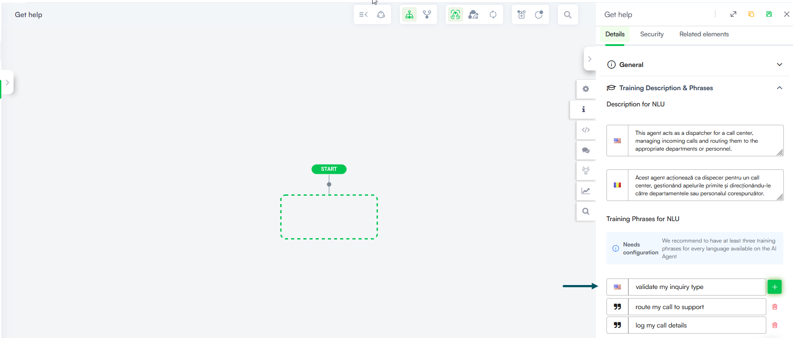

# Defining the Intent

An intent represents what the user wants to accomplish and is the trigger that starts a conversational flow. When creating a flow, you provide training phrases — examples of what users might say — so the AI Agent can recognize and match the user's intent.

Druid supports three types of intents:

* **Natural language intents** — Training phrases that the NLP model uses to recognize user input. The more training phrases you provide, the more accurately the AI Agent recognizes what the user means.
* **Technical intents** — Exact-match phrases that bypass NLP processing entirely. These are defined as Commands to avoid polluting the language model with non-conversational inputs. For more information, see [Adding Technical Intents](<Adding Technical Intents.md>).
* **Long intents** — Detailed context for accurate intent classification when using LLM as classification model type (**NLU** > **Intents** > **Classification Model Type**).
* **Intent variations** — Secondary flows triggered when the user's intent changes while already engaged in a conversation. These are defined as Child Intents and allow the AI Agent to handle topic shifts without disrupting the main flow. For more information, see [Adding Intent Variations](<Adding Intent Variations.md>).

This topic covers how to define and manage natural language intents by adding training phrases to your flow and training the AI Agent to recognize them.

### Add Training Phrases

#### Step 1. Access the flow settings

To access the flow settings, use one of the following two options:

* Using the Flow Diagram, click the **Info** icon in the **Actions** menu.
* In the Flow Designer list view, navigate to the Flows page and click the **Edit** icon next to the desired flow, then click the **Details** tab.

#### Step 2. Add training phrases and description 

In the right-side editor click on **Training Description & Phrases**. Druid groups training phrases and descriptions by language, displaying the AI Agent default language first. To view or manage training description and phrases in a different language, select the desired language from the **Languages** field. This field is available when more than two language are configured on the AI Agent.

**Description for NLU**

This section provides detailed context to ensure accurate intent classification when using a LLM as the **Classification Model Type** (found under **NLU** > **Intents**).


**NOTE:** This section is editable only if the **Classification Model Type** is set to **LLM**.


Enter a clear, descriptive summary of the intent for all supported languages.

**Training Phrases for NLU**

To add a new training phrase:

1. Place the cursor inside the **Add new training phase** field.
2. Enter the desired training phrase.

For technical phrases such as `__update_db_parameters__` or `#CreateNewFlowFromBot`, do not add them here. Instead, define them as Commands to keep the NLP model clean and accurate. For more information, see [Adding Technical Intents](<Adding Technical Intents.md>).

3. Click the **Add** icon. Follow the [Best practices for adding new intents](<Conversational Flows.md#Best>).
4. Save the flow.

#### Step 3. Train the AI Agent

After adding training description and phrases, train the AI Agent. You can do this directly from the Flow Designer in list view list by clicking the **Train** button.

The training model includes all training phrases defined on all flows associated with the AI Agent.

Training can take a few minutes depending on the number of flows. During training, the AI Agent remains fully functional using the last trained model. The new model goes live only after training completes successfully.

### Edit Training Phrases

To edit an existing training phrase, modify the text directly and save the flow.

### Delete Training Phrases

To delete a training phrase, click the Delete icon displayed inline with the phrase and confirm.

### Related Topics

* [Explainability and Utterances Annotation](<../Governance & Security/Explainability and Utterances Annotation.md>)
* [NLU Model Evaluation](<../Data Analytics & Insights/NLU Model Evaluation.md>)
