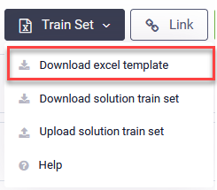
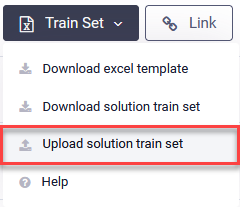
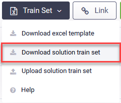

Flows Train Set is designed to simplify the business user experience creating simple conversations so that no chat AI Agent technology understanding is required.

This feature allows authors to train the AI Agent NLP model within the current solution with train phrases, intents and responses to deliver to chat users. For more complex responses, like getting the info from an application or having multiple variants for the response, you can trigger specific flows that best suit your needs.


**NOTE:** The Flows Train Set feature is available in the Flows list view.


## Importing train sets in bulk

This feature works with bulk data sets, using template based import / export of flows train sets in Excel file format.


**IMPORTANT!** The upload process will **REPLACE** the current matching train set for this AI Agent with those in the excel file. The other non-matching trains sets remain unchanged. Make sure that you download a copy of the existing train set before processing. To do so, click the **Train Set** button and click **Download solution train set**. Based on your browser settings, the flows train set file is either automatically saved to your default Download folder or you need to save it.


You can import a new solution train set or [update the existing one](#Updating).

### Importing a new solution train set

To import a new solution train set:

1. Download the solution train set template. To do so, click the **Train Set** button and select **Download excel template**.

Based on your browser settings, an excel file template containing the supported Flows Train Set format is either automatically saved to your default Download folder or you need to save it.

2. Fill in the excel template following the supported format and save the file with a different name. For reference on the solution train set format, see [Solution Train Set Format](Flows%20Train%20Set%20Template.md).
3. Click the **Train Set** button and select **Upload solution train set**.

The UploadTrainSet pop-up appears.

4. Browse for your train set file and select it.
5. Click the **Upload** button. Based on the file size, it might take a few seconds for the file to upload.

If you upload a wrong extension file or the file format is incorrect, an error message appears notifying that the import was unsuccessful.

If there are any warnings during the import, you can check the import log by clicking the **Download Log** button.

### Updating an existing solution train set

To update an existing solution train set:

1. Download the current flows train set file by clicking the **Train Set** button and selecting **Download solution train set**.

2. Store this file for backup purposes.
3. Copy and paste the file and rename it.
4. Open the renamed file and update it to accommodate your needs. For reference on the file format, see [Solution Train Set Format](Flows%20Train%20Set%20Template.md). After you finish updating the file, save it.
5. Click the **Train Set** button and select **Upload solution train set**.

The UploadTrainSet pop-up appears.

6. Browse for the updated train set file and select it.
7. Click the **Upload** button. Based on the file size, it might take a few seconds for the file to upload.

If you upload a wrong extension file or the file format is incorrect, an error message appears notifying that the import was unsuccessful.

If there are any warnings during the import, you can check the import log by clicking the **Download Log** button.
