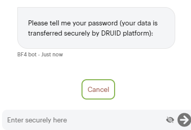

Use Prompt steps when you want the AI Agent to ask users for input and capture their responses in an entity or local variable.

## Adding and configuring Prompt steps

To add and configure a Prompt step:

1. Open the desired flow in Flow Diagram view.
2. Expand the Flow Palette, then drag the **Prompt** step from the Dialog category into the main flow window and drop it onto the step you want to link it to.
3. Select the step on the diagram, then click the **Settings** icon from the Actions menu.
4. Set the General parameters:

- **Step name**: Give the step a descriptive name that helps you remember its purpose.
- **Step message**: Enter the message that the AI Agent will display to the user before prompting the user to input information.
- **Input mapping**: Specify where to store the user’s response. You can map the input to an entity or a variable. For more information, see [Set Variable](Set%20Variables.md).

5. Click **Save** to save the step configuration.

When the AI Agent reaches this step, it will display the message specified in the **Step message** field, wait for the user’s input, and store the response in the entity or variable provided in the **Input mapping** field.

Example: The figure below shows how a Prompt step configuration might look like. This step will prompt the user to provide the correct series of their identity card which has been extracted from a document scans in a previous step using the DRUID API OCR services. What the user will type will be stored in entity [[OCRExtracted]].SerieCI overwriting the previous value.

### Additional configuration options

- **Skip if known**: Enable **Skip if known** to allow the AI Agent to bypass the step if the requested information is already available in the conversation context. Skipped steps are logged in the Conversation History with a message indicating the reason for the skip.
- **Disable intent switch**: You can prevent the AI Agent from switching intents during this step. This keeps users in the current flow, even if data validation fails or if no conditions are met after the step is executed.

## Define training phrases on Prompt steps

You can define training phrases on the Prompt step to handle variations in user responses. This ensures the AI Agent can capture information even when the user’s input doesn’t exactly match the expected format.

Each training phrase on the step should contain the entity provided on the step in the **Input mapping** field.

To test the training phrases on the step, enter an expression, click the **Test** icon and select the desired AI Agent language.

Below the test area, you'll see the information the AI Agent extracted based on the entity specified in the **Input mapping** field and the step's training phrases.

## Sensitive data handling on Prompt steps


**NOTE:**  Sensitive data manipulation is only available on prompt steps on both direct line and MS Teams channel.


If you want to capture user sensitive data and send it to third-party systems via connectors, in input mapping use entity fields which have **Holds Sensitive Data** enabled.

The figure below provides a Prompt step example where the user is asked to provide the password (that is, sensitive data).

When a step is configured to handle sensitive data, the AI Agent will display a **Cancel** button in the chat, allowing users to opt out. If the user cancels, the entity field specified in **Input mapping** will store the value "UserCanceledInput". You can use this value to create alternative conversation paths.

## Sensitive data manipulation in MS Teams channel


**NOTE:** This feature is only available for AI Agents using Bot framework version 4. Sensitive data manipulation is only available on Prompt steps on both direct line and MS Teams channel. For sensitive data manipulation in MS Teams channel, an additional configuration step is required. For more information, see [Configuration for Sensitive Data Manipulation](../Channels/MS%20Teams/TeamsChannel_SensitiveDataManipulation.md).


For AI Agents deployed in the MS Teams channel, additional configuration is required to securely handle sensitive data. When the AI Agent prompts for sensitive information, MS Teams generates a built-in card for user confirmation.

Once confirmed, a DRUID page is rendered for secure data entry.


**IMPORTANT!**  The sensitive data passes directly to DRUID platform, always encrypted, bypassing the MS Teams channel. After the user sends the sensitive data in the DRUID built-in page, the data is not shown in the chat.


## Related Topics

- [AI Agent Informational Model](../5_Entities/AI%20Agent%20Informational%20Model.md)
- [Common Flow Settings](Common%20Flow%20Settings.md)
- [Handling Input Mapping Exceptions](Handling%20Input%20Mapping%20Exceptions.md)
- [Improving AI Agent NER](../Conversational%20AI/Improving%20AI%20Agent%20NER.md)
- [Using NER with Intent Recognition](../Conversational%20AI/Using%20NER%20with%20Intent%20Recognition.md)
