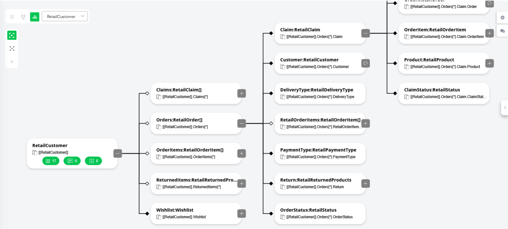

Druid AI employs a distinctive approach to structuring conversation context and integrating information from third-party systems, facilitated by robust data structures known as entities. These entities, designed as relational business objects, serve as the cognitive core of the AI Agent. They not only shape the AI Agent understanding but also enable training of the Natural Language Processing (NLP) model with specific data from clients' systems, ensuring the AI Agent converses fluently in the language of the company.

Entities encapsulate data in a structured manner, dynamically populated from user inputs, connected applications, or predefined values by the author. They provide a contextual framework for intents and conversation flows, featuring fields of various types, including relational connections between entities. For those new to AI Agents, comprehensive terminology and concepts are covered in section [Concepts and Terminology](../1_Druid%20AI%20Platform/Concepts%20and%20Terminology.md).

Entities play a pivotal role within Druid AI, serving various purposes such as:

- Maintaining conversation context.
- Incorporating dynamic fields within conversation flows.
- Facilitating data transportation via integrations.
- Mapping user input from expressions.
- Automating document generation.

The collection of entities within the AI Agent constitutes its Informational Model, which defines the structure and relationships crucial for effective conversational interactions. As an illustration, let's examine the Retail Customer Informational Model as displayed in the Druid Portal:

The tree shows how related business objects branch from the root entity through relational fields. Each node in the tree represents an entity or a relational field on an entity. The label uses the format FieldName:EntityType, and the path below it (for example, [[RetailCustomer]].Orders[\*]) shows how the field is referenced in flows, integrations, and expressions.

| Visual element | Description |
| --- | --- |
| White diamond (◇) at the start of a branch | A collection relationship — the field is an Entity List (one parent record can relate to many child records). |
| Black diamond (◆) at the start of a branch | A single lookup relationship — the field is an Entity (one parent record relates to one child record) |

The tree shows how Druid AI organizes retail conversation context around a single customer record:

- A RetailCustomer can have multiple Orders, Claims, and OrderItems over time.
- Each RetailOrder is a self-contained business object with its own line items, payment and delivery details, and status.
- A RetailClaim links back to the specific Order, OrderItem, and Product involved, so the AI Agent can reason about post-sale issues in full context.
- The same entities (for example, RetailCustomer, RetailProduct, RetailStatus) appear at different points in the tree, reflecting how they are reused across the informational model.

This structure allows the AI Agent to maintain context throughout a conversation — for example, when a customer asks about an order, a claim on a product, or items on their wishlist — without treating each question in isolation.

In the Druid AI Platform, entities are classified into:

- System entities – Predefined entities supplied by the system.
- Custom entities – Entities tailored to specific AI Agent requirements.

With entities at the core, Druid AI empowers AI Agents comprehend and interact seamlessly within diverse contexts, ensuring enriched user experiences.

## Related Topics

- [Mapping Input Fields in User Expressions](../Conversational%20AI/Mapping%20Input%20in%20User%20Expressions.md)
- [System Entities](System%20Entities.md)
