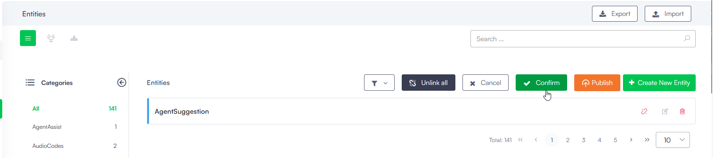

Druid empowers you to tailor the entity model according to your requirements by providing options to edit, remove, unlink, and link entities within your solution effortlessly. By effectively managing entities, you can fine-tune your solution's structure and enhance its functionality to meet your specific needs.

> **NOTE:** You can manage and adjust your entity configurations efficiently using AI Authoring Agents. By launching the Data Modeler from the Page Help icon, you can describe your business requirements in natural language to automatically fine-tune your existing data models. For more information, see [AI Authoring Agents](../2_AI%20Agents/AI%20Authoring%20Agents.md#Create).

## Edit entities

You can refine an entity's details by adjusting its name, category, or modifying its fields.

To edit an entity using the Entity Designer in list view, click the Edit icon displayed in line with the entity. In list view, click the **Edit** icon aligned with the entity.

In diagram or tree view, simply click on the entity (node).

Regardless the Entity Designer view you're using, the Entity Editor opens, facilitating desired updates.

You can also provide for an entity the **Plural Name** and **Icon URL**, which have effect in the workspaces menu (whenever that entity is added as a workspace link).

## Delete entities

> **IMPORTANT!** Exercise caution when deleting entities as the action is irreversible and removes all associated fields and relations. You might want to unlink it from the solution instead. If you try deleting an entity that is referenced by another entity / other entity fields, a warning message will display the list of entity fields referencing it and you cannot delete it.

To remove an entity:

- In list view, click the **Delete** icon beside the entity, followed by confirming the action in the dialog.
- In diagram or tree view, select the entity (node), then click the **Delete** icon in the right-side editor, and confirm the deletion.

## Unlink entities from a solution

Druid allows you to dissociate an entity from the current solution without eliminating it from the AI Agent informational model, facilitating future utilization.

> **NOTE:** Unlinking entities from a solution is available exclusively in list view.

To unlink an entity from the selected solution, click the Unlink icon displayed in line with the entity.

The entity no longer displays in the solution entities list.

## Link entities to a solution

You can integrate entities that are currently unused within the solution for potential future utilization.

To view the list of entities that are unused within the current solution, click the **Link** button at the top-right corner of the Entities list page.

From the list, you can link specific entities by clicking the corresponding **Link** icon displayed in line or link all entities by clicking the **Link all** button at the top-right corner of the page.

> **Info:** If the list of entities which are not used by the AI Agent within the current solution is too long, use the **Search** feature to quickly spot the desired entity and all the entities referenced / referencing it.
>
> 

To ensure that the linked entities will be available within the current solution, click the **Confirm** button at the top-right corner of the page.

When linking an entity to a solution and the entity includes a field of type entity referencing another entity, the Parent Name column within Solution References will present the complete entity path. This path will be displayed in the format of "linked entity -> entity field referencing the entity in the 'Name' column".

## Related Topics

- [Field Types](Field%20Types.md)
- [Managing Entity Fields](Managing%20Entity%20Fields.md)
- [Using NER with Index Entities (DRUID versions prior to 5.15)](../Conversational%20AI/Using%20NER%20with%20Index%20Entities%20%28DRUID%20versions%20prior%20to%205.15%29.md)
