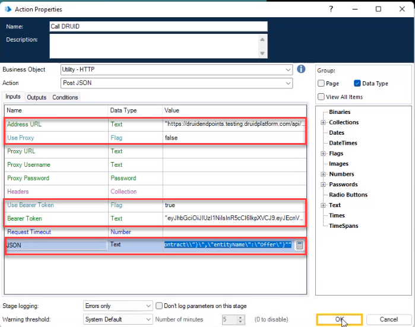

<a id="AddingItemtoBluePrismQueue"></a>


The role of this connector task is to create a new queue item in a UiPath Orchestrator Queue with data mapped from DRUID Entities.

<a id="Prerequisites"></a>

## Prerequisites

- You configured RabbitMQ.
- In BluePrism, you installed the following two BluePrism assets: [Utility - RabbitMQ](https://digitalexchange.blueprism.com/dx/entry/9648/solution/utility---rabbitmq) and [Utility - HTTP](https://digitalexchange.blueprism.com/dx/entry/3439/solution/utility---http).
- You created BluePrism processes and configured triggers on RabbitMQ queues to start specific BluePrism processes.
- You created a [BluePrism connection strings](Creating%20the%20BluePrism%20Connection%20Strings.md).

<a id="Step1AddStartBluePrismProcessintegrationstep"></a>

## Step 1. Add **Start BluePrism Process** integration step

To add items to a RabbitMQ queue which triggers a BluePrism process, on the desired flow, use the Flow Palette and from **Integration - BluePrism** section, drag and drop the **Start BluePrism Process** integration task.

When you add a flow step of type BluePrism to a flow, the flow step automatically has four child steps, providing you with all possible flow exits:

- **Request successful**. DRUID successfully sends the “Add item to queue” request to the RabbitMQ.
- **Error sending the request**. An error occurred while DRUID tried sending the request to the RabbitMQ.
- **After Process Completes (Success)**. The BluePrism process completed successfully.
- **After Process Completes (Error)**. An error occurred during the BluePrism process execution.


The conditions set on child steps are read-only making the flow configuration simple.

With this new BluePrism flow step, there is no need to create a different, dedicated callback flow because the DRUID platform knows to resume the flow to the corresponding exit endpoint: either the BluePrism process completes successfully or it completes with errors.

The events following the process completion can be designed in the same flow from where the process is initiated. After the process completes, the conversation will begin in the same flow, but not from its first step, but directly from one of the two “After process completes…” steps.

This conversation can be initiated either to the same AI Agent user who added items to RabbitMQ queues (tap on the **Use current user for callback** option), or to a certain user (tap on **Automatically add integration to this step (after Save)** option), specified on the dedicated field on the BluePrism step (when the option is disabled). In that field, provide the MasterId of the required user in one of the following formats:

- “<user masterId>” (directly a string)
- @<masterId> (DRUID local variable)
- [[<Entity>]].<masterId> (DRUID entity field of type string).

<a id="Step2Configuretheconnectoraction"></a>

## Step 2: Configure the connector action

To define the connector action, double click on the flow step of type **BluePrism**and click on the Post Actions section header. The section expands.

The Post Actions section contains a connector action and an integration task which you need to configure.

Click on the connector action. In the Connector Action editor, provide the mandatory information (**Name**and **Description**) and select the entity which will be both request and response entity and mark the action as being active (tick **Is Active** option).

Optionally, from the **Icon** field, select the BluePrism icon to easily identify the integration action in the list of integrations. If no icon is selected, DRUID default icon per selected app type will be shown in the apps list.

Save the configuration by clicking the **Save** icon () at the top-right corner of the right-editor.

<a id="Step3ConfiguretheAddItemToBluePrismQueueintegrationtask"></a>

## Step 3: Configure the AddItemToBluePrismQueue integration task

To configure the integration task, in the Post Actions section, click on the **AddItemToBluePrismQueue** integration task. The Integration Editor opens on the right on the **General** tab.

Provide a suggestive **Description** for the integration task and from the **Connection Code** field, select the BluePrism connector app (the one you created following the procedure described in [Creating the BluePrism Connection Strings](Creating%20the%20BluePrism%20Connection%20Strings.md)).


Click on the **Request** tab.

In the **Exchange/Queue** field, enter the name of your RabbitMQ exchange and in the **Routing Key** field, enter the routing key that binds the queue to the exchange you specified.



**NOTE:** In DRUID 7.11 onwards, you can place an item directly on a queue. In the **Exchange/Queue** field enter the name of the queue and leave the **Routing Key** field empty.


In the **Routing Key** field, enter the routing key that binds the queue to the exchange you specified above.

Select the **Request type** and use the **Body** tab to map the fields you want to include within the body call. Mapping fields is similar to the REST Connector - request mapping.

Save the configuration by clicking the **Save** icon () at the top-right corner of the right-editor.

Whenever the flow step is executed, a new item that contains a JSON object (an object that contains all the data you mapped in the request) is placed on the RabbitMQ queue.

<a id="Step4Publishtheintegrations"></a>

## Step 4. Publish the integrations

You can either publish integrations one by one at creation time by clicking the **Publish** icon () at the top right-corner of the editor or publish or publish the integrations in bulk. To do so, on the main menu, click **Integrations** and at the top-right corner of the Integrations page, click the **Publish** button ().

<a id="Step5ConfigureDRUIDcallbackdetailsinBluePrismStudio"></a>

## Step 5. Configure DRUID callback details in BluePrism Studio


**NOTE:** To configure DRUID callback details in BluePrism Studio, you need the StartFlow token and DRUID Endpoint URL for BluePrism integration. To have the StartFlow endpoint active on your tenant and have access to the bearer token, get in touch with [DRUID Support](<mailto:support@druidai.com?subject=BluePrism integration - I need Start Flow bearer token>).


Once DRUID Support activates the StartFlow endpoint on your tenant, on the Administration menu, click DRUID Services. Copy the token of the StartFlow endpoint.

In DRUID, go to the integration task editor, click the **Response** tab and copy the **DRUID Endpoint URL**.


In BluePrism Studio, go to your process, and add a POST JSON action for calling back DRUID. Configure the action as follows:



- **Address URL**. Enter the **DRUID Endpoint URL** you copied from DRUID (from teh BluePrism integration task, Rest tab).
- **Use Bearer Token**. Enter **true**.
- **Bearer Token**. Enter the token of the StartFlow endpoint you copied from DRUID.
- **JSON**. The stringified JSON object the BluePrism process sends to DRUID. The JSON should have the following structure:

```
{
    "executionId": "<GUID>",
    "error": "<string>",
    "contextData": "<stringified JSON>",
    "entityName": "<string>"
}
```

- **executionId**. When DRUID adds an item to a RabbitMQ queue, it also sends an execution id, which is a GUID. Based on the **executionId**, the callback identifies the AI Agent, the flow and the conversation from which the BluePrism process was triggered and restarts the flow within the same conversation and goes to evaluating the conditions after the **Start BluePrism Process** flow step which triggered the process.
- **error**. The business error message (if any).
- **contextData**. The stringified JSON of the request entity containing the values of the fields mapped in DRUID on the BluePrism integration request.
- **entityName**. the name of the DRUID response entity.


**NOTE:**  The BluePrism process should create the **contextData** and the **JSON** object and use the `toString()` function to stringify them both.



**Info:** This JSON fields are saved in DRUID in system entity [[BPAutomation]].


## Related Topics

- [System Entities](../../5_Entities/System%20Entities.md)
