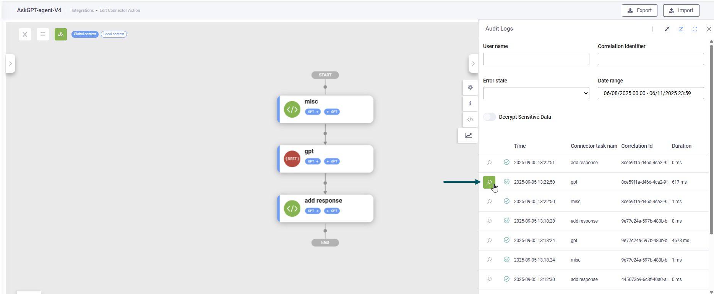

# Debugging Integrations

The Connector Audit Logs provide detailed, step-by-step information to help you debug integration failures and review successful runs.

### Accessing Integration Audit Logs

To access the Audit Logs for an integration, follow these steps:

1. On the main menu, click **Solution Contents** and select **Integrations**.
2. Select your integration. The integration displays in **Connector Diagram** view.
3. Click the **Analytics** icon on the diagram toolbar.

[\<https://druiddocs.file.core.windows.net/docs-shares/Rebranded/REST Connector\_20260730.pdf?sv=2025-07-05\&spr=https\&st=2026-07-30T05%3A45%3A07Z\&se=2030-07-31T05%3A45%3A00Z\&sr=f\&sp=r\&sig=bHgWRzuktYoWcfaEk9vlXCS3IJ61YQxXphn0%2FwnX6is%3D>](https:/druiddocs.file.core.windows.net/docs-shares/Rebranded/REST%20Connector_20260730.pdf)

The Audit Logs pane appears.

4. Select the **Date range** to filter the logs and click **Refresh**.

5. To view the details of a specific log entry, click the magnifier icon in front of the log record you want to debug.

The **Integration log detail** modal appears.

### Understanding the Integration Log Detail

The modal provides general information about the user and connector action, along with four key diagnostic sections. It is recommended that you debug the integration by reviewing these sections in the following order, which simulates the execution path:

| Review Order | Section Name    | Purpose                                                                                                                                                                                                                                                                                                                                                                                                                                                                                          |
| ------------ | --------------- | ------------------------------------------------------------------------------------------------------------------------------------------------------------------------------------------------------------------------------------------------------------------------------------------------------------------------------------------------------------------------------------------------------------------------------------------------------------------------------------------------ |
| 1            | Request entity  | The integration execution begins with the request entity. This section shows the complete entity definition.                                                                                                                                                                                                                                                                                                                                                                                     |
| 2            | Request task    | This section displays the actual API call being made. While the request entity may contain additional data, only specific fields are used in the API call based on your integration mappings. The Request task displays in JSON format (similar to Postman), making it easy to verify that your integration mappings are correct. **Info:** In Druid versions prior to 9.9, the request body was included as an escaped stringified JSON property, requiring external tools to view it properly. |
| 3            | Response task   | This section contains the raw response, including content and headers, returned by the external API endpoint or by Druid Data Service (from the Request task).                                                                                                                                                                                                                                                                                                                                   |
| 4            | Response entity | This section shows how the entity has been modified after the integration execution completes. Compare this with the original Request Entity to understand what data transformations occurred.                                                                                                                                                                                                                                                                                                   |

By reviewing the logs in this order, you can debug how the entity context changes based on the data sent in the **Request task** and what was received and mapped from the **Response task**.
