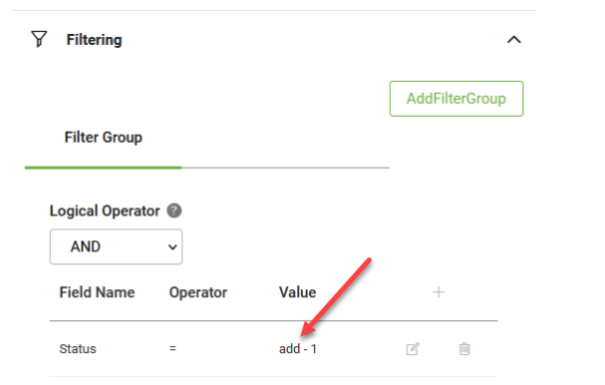

# Query Related Entity

Queries the request entity's records and returns a collection. For example, there is a list of contracts for account John. To get the list of contracts for a 360 account form, use DRUID Data Service Query related entity task which uses a child-parent entity relationship (Contract - Account)

### Prerequisites

* There should be a bi-directional relationship between the child and parent entities. In the example provided above, the entity "Account" has a field "Contracts" of type Entity list referencing the "Contract" entity. The "Contract" entity has a field "Account" of type Entity referenced by the "Account" entity.
* In the list of integration tasks, first use the DRUID Data Service Get entity task to read the parent entity (in our example, the "Account" entity) and then use the Query related entity task to get the records of the child entity (in our example, the "Contract" entity to get the list of contracts).

### General Settings

The Edit Connector Task page appears by default on the **General** tab. Provide a brief relevant description of the task.

For optimal execution time and to conserve database resources, we recommend you select **Disable Connector Audit Logging** when the integration task involves handling substantial payloads.

### Request

Click the **Request** tab. Select the **Related Entity Name** (the child entity). In our example, the "Contract" entity.

The Request page provides you with options to define the request body:

* [set the context / scope](Query_Related_Entity.md#Define_the_context2) (optional)
* [filter the query](Query_Related_Entity.md#Filter_the_query_\(mandatory\)) (mandatory)
* [set records pagination](Query_Related_Entity.md#Set_records_pagination) (optional)
* [set records sorting order](Query_Related_Entity.md#Set_records_sorting_order) (optional)

#### Define the context 

If you want to perform the integration task in the context of the Request entity set on the connector action, than leave the **Scope** field set to **Global**.

If you want to perform the integration task on a context different from the global context set on the connector action, than from the **Scope** field, select **Local** and from the **Request entity** field, select the desired entity.

Using the **Local** scope, you do all related queries directly inside the connector action instead of building a larger context outside the connector action via additional queries within the Flow Designer to put data inside the request entity and then send the data back to the connector action.

#### Filter the query 

You have two options to filter the query:

* by using the standard query.
* by using DRUID custom query. Use custom query to interrogate entities other than the request entity. For more information, see [Filter data using DRUID custom query](<Filter using DRUID custom query.md>).


**Info:** If you don’t provide filtering parameters, the response retrieves all records in the collection.


To filter the query using the standard query, in the Filtering section, **Filter Group** tab, set the filtering properties for the query. You can use the following properties:

* **Logical Operator** (optional) - A property of type int32 that specifies if all the filters and filter groups apply to the query. Use AND (0) to apply all the filters and filter groups. Use OR(1) to apply any of the filters and filter groups. Default value is AND (0).
* **Filter**(mandatory) - helps you define the filtering expression. It has the following properties:

| Filter Property | Data Type | Description                                                                                                                                                                                                                                                                                                                                                                                                                                                                                                                                                                                                                                                                                                                                                                                                                                                                                                                                   |
| --------------- | --------- | --------------------------------------------------------------------------------------------------------------------------------------------------------------------------------------------------------------------------------------------------------------------------------------------------------------------------------------------------------------------------------------------------------------------------------------------------------------------------------------------------------------------------------------------------------------------------------------------------------------------------------------------------------------------------------------------------------------------------------------------------------------------------------------------------------------------------------------------------------------------------------------------------------------------------------------------- |
| Field Name      | string    | From the drop-down, select the field to be filtered.                                                                                                                                                                                                                                                                                                                                                                                                                                                                                                                                                                                                                                                                                                                                                                                                                                                                                          |
| Operator        | string    | Specifies the filter operator. Supports the following: contains, not contains, startswith, endswith, =, !=, >, <,>=, <=, in, not in, exists, not exists. Use the adequate operator for the corresponding field type. **IMPORTANT!** When using the **in** or **not in** operators to filter by multiple values, provide the values as a JSON array using square brackets, with each value enclosed in double quotes and separated by commas. **Example**: \[ "New", "Confirmed" ] **NOTE:** The operators **exists / not exists** allow you to validate that a field of type entity is instanced within the actual entity object. For example: \[\[Account\[\[.Contact.Id **not exists** means that \[\[Account]].Contact has not been instanced (the property Contacts does not exist in the actual \[\[Account]] entity object.                                                                                                             |
| Function        |           | Functions you can use to filter data of type string and date, as follows: - **Case Insensitive** - Filter data of type string to ensure that results being returned by the query are case-insensitive. Using this function you can enrich the quick search views to enable searching for case insensitive terms.  **Info:** If you want the query to return both case sensitive and case insensitive results, add filters with and without the **Case Insensitive** function. - **Date filtering functions** - Filter data of the following types: Date, DateTime, InvariantDateTime and InvariantDate to ensure that results being returned by the query are from a specific day or within a specific time range. For more information, see [Standard Query Date Functions Reference](<Standard Query Date Functions Reference.md>).  |
| Value           | string    | Specifies the filtering value. **IMPORTANT!** **DO NOT** provide the value between quotes (e.g., **add - 1** instead of **"add - 1"**). If you want to query for null, then provide **null** (lowercase, no quotes "").                                                                                                                                                                                                                                                                                                                                                                                                                                                                                                                                                                                                                                                                                |

To set another filtering option to the query, click the **AddFilterGroup** () button. Another filtering group tab appears that contains the filtering properties described above.

#### Set records pagination (optional) 

| Pagination Property               | Data Type | Description                                                                                                                                                                                                                                                                                                                                                 |
| --------------------------------- | --------- | ----------------------------------------------------------------------------------------------------------------------------------------------------------------------------------------------------------------------------------------------------------------------------------------------------------------------------------------------------------- |
| Start at record number            | int32     | Specifies the number of records to skip before starting to return records from the query. Use it with the **Limit number of retrieved records** property to implement pagination. Default value is 0 if not specified. The records are ordered ascendingly by the Id field. To change the records sorting order, set the properties in the Sorting section. |
| Limit number of retrieved records | int32     | Specifies the maximum number of records to read from DRUID Data Service. Use it with the **Start at record number** property to implement pagination. Default value is 100 if not specified. The maximum value can be 1000.                                                                                                                                 |
| Expansion level                   | int32     | Specifies the depth of the related records to be retrieved                                                                                                                                                                                                                                                                                                  |

#### Set records sorting order (optional) 

By default, all records are ordered ascendingly by the Id field. You can sort the returned records by one or multiple fields. To change the records sorting order, in the Sorting section, set the following properties:

| Pagination Property          | Data Type | Description                                                                                                                                          |
| ---------------------------- | --------- | ---------------------------------------------------------------------------------------------------------------------------------------------------- |
| Field Name                   | string    | Specifies the field used to sort the returned records. The name must correspond to a valid field, and it is case-sensitive.                          |
| Sort in descending direction | boolean   | By default the records retrieved from the query are ordered ascendingly. To sort the records descendingly, set the value of this property to "true". |

### Response

Click the **Response** tab.

By default, the integration task output will be saved in the global context, that is, the Response entity set on the connector action. If you want to save the response in an entity different from the global one set on the connector action, than from the **Scope** field, select **Local** and from the **Response entity** field, select the desired entity. If the response is a collection, select **Is Response Collection**.

From the **Project result to Entity path** drop-down, select the field of type Entity list whose records you want to return.

DRUID displays the entity schema tree mapping (the request entity and its child fields) in a single table with nested rows based on the  **Expansion level** set on the request (pagination section).

You can map in the response all entity fields existing on the request entity by tapping on **Map All Fields**.

If you choose to map only specific entity fields in the response, additional field mapping actions are available:

The following field mapping actions are available:

* **Refresh fields** - If you added new entity fields to the request entity, this action will load all entity fields.
* **Select all fields** - Selects all existing entity fields to be included in the response. Use it when you want to map many entity fields and exclude the desired entity fields from the response by clicking the check mark in front of the entity field(s).
* **Deselect all fields**. Deselects the entity fields mapped in the response. Use it when you want to manually select a few entity fields in the response.
* **Show all mapped fields**. Only displays the list of entity fields mapped in the response.

Click the **Save** button to save the integration task and remain on the page or the **Save & Close** button to save and return to Connector Steps.
