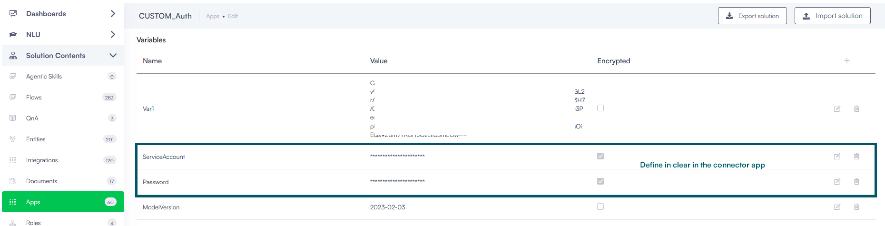

# Advanced Dynamic Authentication

Use this guide to handle complex, multi-step credential lifecycles, such as token generation and automatic refresh patterns. This configuration establishes a background loop that logs in to an identity service, passes the temporary token to your endpoints, intercepts token expiration errors, and triggers automatic refreshes.


**Info:** If your target API uses a permanent key or static token that does not expire, see the [Standard API Authentication](<Standard API Authentication.md>).


### How the dynamic token lifecycle works

The platform manages temporary tokens using an automated three-part background loop. Understanding this cycle helps you map connector actions to your API configuration:

1. **Authentication Request**. The platform requests a short-lived token using your credentials or a refresh token.
2. **Token Injection**. The platform stores the token in a dynamic context variable and injects it into outbound business requests.
3. **Error Interception**. When the token expires and causes a failure, the platform captures the error, requests a new token, and automatically retries your original request.

#### Detailed token exchange and refresh sequence

The sequence below describes how the platform coordinates token requests, resource access, and expiration recovery with external identity and resource servers:

1. **Access token request**. The platform makes an initial API call to request an access token by authenticating with the authorization server and presenting an authorization grant (such as a user name and password, organization key, or API key and secret).
2. **Access token issuance**. The authorization server authenticates the platform and validates the authorization grant. If the grant is valid, the server issues an access token and, if requested, a refresh token.
3. **Protected resource request**. The platform makes a request to the protected resource server by presenting the access token.
4. **Resource server response**. The resource server validates the access token. If the token is valid, the server processes the request.
5. **Request repetition**. The request and validation steps repeat until the access token expires. If the platform detects that the access token has expired before sending a request, it skips to the refresh request (step 7); otherwise, it sends another protected resource request.
6. **Token expiration error**. If an expired access token reaches the resource server, the resource server validates the token, identifies it as invalid, and returns an invalid token error.
7. **Refresh token presentation**. The platform requests a new access token by authenticating against the authorization server and presenting the refresh token instead of the original credentials. The specific authentication requirements depend on the client type and the authorization server policies.
8. **New access token issuance**. The authorization server authenticates the platform and validates the refresh token. If the refresh token is valid, the server issues a new access token and optionally generates a new refresh token.

### Step 1: Get the security context 

You must define the login request that generates temporary access and refresh tokens.

First create the authenticate client action:

1. In your REST app configuration page, locate the **Authenticate client connector action** field and select the **+** icon.
2. Complete the mandatory fields in the **Connector general** tab: **Name**, **Description**, **Category**, **Is Active**.

2. Click **Save**, and click the **Connector steps** tab.
3. Click **Create task** and choose **Authenticate Client**.


**NOTE:** The **Authenticate Client connector action** supports custom code execution. This capability enables advanced server-to-server authentication scenarios. You can use the Custom Code task to perform advanced processing directly before triggering the Authenticate Client integration task—such as [JWT Assertion Authentication via Custom Code](<JWT Assertion Authentication Examples via Custom Code.md>) by locally generating a signed, short-lived cryptographic assertion using custom claims, RSA signatures, or custom JWT headers, storing the assertion in a context variable, and passing it to the authentication endpoint.


#### Define the Authenticate Client integration task

1. In the **General** tab, enter a clear, descriptive name (for example, Authorize Action).
2. Select the matching **Connector Code** from the dropdown.

3. Select **Save**.

Click the **Request** tab and configure the request.

If you want to authorize subsequent REST API calls using refresh tokens instead of using credentials, you can do so by selecting **Use refresh token pattern** and then configuring the authentication call following the steps below. If you don't want to use refresh tokens, do not select **Use refresh token pattern** and follow only steps 1 and 2.

**Step 1. Configure the main authentication call request (Authenticate Client Request)**

Druid makes an initial API call (main authentication call) and requests an access token by authenticating with the authorization server and presenting an authorization grant (user name & password or organization key, API key & API Secret, etc.).

To configure the main authentication call, click the **Authenticate Client Request**. If you are not using the refresh token pattern, the tab displays by default.

Make a request to your authentication endpoint (as required by the API). Set the Parameters, Headers or Body with the values appropriate to your authentication API. Use integration context variables to securely refer credentials, like username, API keys, passwords etc., using the “@” symbol.


**NOTE:** Define the integration context variables in clear on the connector app and refer them on the integration tasks using the "@" SYMBOL.

 


**Step 2. Configure the response of the main authentication call (Authenticate Client Request)**

The authorization server authenticates the client and validates the authorization grant, and if valid, issues an access token and (if requested) a refresh token.

To configure the response of the main authentication call, click the **Response** tab. Click the **Authenticate Client Request** tab. If you are not using the refresh token pattern, the tab displays by default. Map the received access token / key within a variable. This new variable (e.g., @ApiToken) is automatically defined by simply mentioning it in the response mapping table; there is no need to define it somewhere else.


**IMPORTANT!** Druid will keep this variable in-memory until it will be used in Step 2 (authorization) and it must not interfere with other connector task variables; therefore, make sure that you provide an unique variable name (a name different than the integration context variables set at Step 1).


If you're using the refresh token pattern, in the response mapping table, edit the first table entry by mentioning the **Connector field name** that holds the refresh token. Druid Connector will store the refresh token in a dedicated asset storage and will automatically set the value of the refresh token at runtime, when needed. That is why the first row in the mapping table is generated automatically, cannot be deleted and is mandatory to be filled in (in Connector field name) for this pattern.

If the token is returned as a string, in the **Connector field type**, specify **text**. You should let the **Connector field name** field empty.

**Step 3. Configure the refresh token request**

Druid requests a new access token by authenticating with the authorization server and presenting the refresh token.

To configure the refresh token request, click the **Request** tab, then click the **Refresh Token Request** tab.

Configure a request to your refresh token  endpoint (or authentication endpoint as required by the API). Set the Parameters, Headers or Body with the values appropriate to your refresh token API.

In the mapping table, click the Edit icon displayed in line with the first row and in the **Connector field name** field, provide the name of the field indicated by the API endpoint where Druid will automatically set at runtime the refresh token obtained after executing the first authorization call (step 2). This way all API calls will be authorized using the refresh token instead of the access token.

**Step 4. Configure the refresh token response**

The authorization server authenticates Druid and validates the refresh token, and if valid, issues a new access token (optionally, as per authorization server policy, generates a new refresh token as well).

To configure the refresh token response, click the **Response** tab, then click the **Refresh Token Response** tab.

Map the access token / key within a variable. This new variable (e.g., @ApiToken) is automatically defined by simply mentioning it in the response mapping table; there is no need to define it somewhere else. Use the variable you use in general to hold the access token.

If Authorization Server also returns a new refresh token, select **Response contains a new Refresh Token** and in the response mapping table, edit the first table entry by mentioning the **Connector field name** that holds the new refresh token. Druid Connector will automatically set the new value of the refresh token at runtime (the value of the refresh token obtained after executing the first authorization call).


**NOTE:** If the authorization server does not generate a new refresh token (meaning the **Response contains a new Refresh Token** option is unselected) and the current refresh token expires or becomes invalid, you can configure the connector to recover automatically. Select the corresponding error code in the **Invalid Refresh Token HTTP Code** field. When the authorization server returns this error code during an API call with an invalid or expired refresh token, the platform connector intercepts the code and automatically obtains a new access token and refresh token by executing [Step 1](<Advanced Dynamic Authentication.md#Step_1.>) again.


Click the **Save & Close** twice to save the integration task and the connection action.

#### Select the connector action for getting the security context

Go to **Solution Contents** > **Apps** and click on the REST connector app you want to configure. From the **Authenticate client connector action** dropdown, select the call for getting the security token.

Click the **Save** button to save the connector configuration.

### Step 2: Define authorization template for all API calls

Once you capture the dynamic token in [Step 1](<Advanced Dynamic Authentication.md#Step_1:_Get_the_security_context>), you must tell the connector how to apply it to all subsequent integration calls.

Create and configure an **Authorize request connector action** by following the procedure in the Standard API Authentication Guide. In the authorization header or Body mapping table, map the dynamic token variable name declared in the response map of [Step 2](<Advanced Dynamic Authentication.md#Step_2._>).

Select the connector action for API calls authorization.

### Step 3: Set responses when authentication is required 

You must configure the platform to detect an expired session token so it knows when to trigger the automatic re-authentication loop.

**Create the error interception task**

In the REST app configuration page, locate the **Check not authenticated connector action** field and click the **+** icon.

Complete the mandatory fields in the **Connector general** tab: **Name**, **Description**, **Category**, **Is Active**.

Select Save, and then open the ConnectorSteps tab.

* Click **Save**, and click the **Connector steps** tab.
* Click **Create task** and choose **Check If Not Authenticated**.

Enter a suggestive description and click **Save**.

**Define unauthenticated triggers**

Open the Response tab and define how the platform identifies an expired session using one of these strategies:

* HTTP status codes: Select the target error code (typically 401: Unauthorized) from the HttpStatusCode drop-down field.
* Custom response body: If the API provider returns an HTTP 200 success code but describes authentication failures inside a custom JSON payload, select the Body sub-tab and input the failure JSON schema condition.

Select **Save & Close** twice.

**Link the error interception action to the connector app**

1. On the app configuration page, locate the **Check not authenticated connector action** dropdown.
2. Select the newly created error interception integration task.

3. Click **Save & Close** to save the app.


**NOTE:** This action will only be executed if the response of the main integration task returns an error or a specific response body, as defined here. If the error code or response body returned is the same with the ones defined in [Step 3](<Advanced Dynamic Authentication.md#Step_3>), then the Authentication Action will be automatically called again to get a new authentication context and it will be re-used in step 2, until a successful response is obtained from the main integration task.

