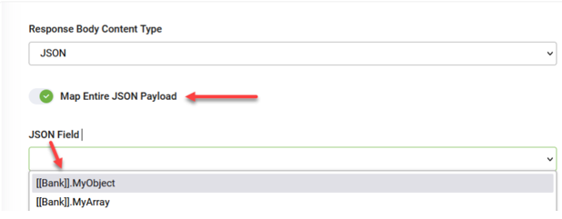

In some integrations, you may not need to map individual fields from a JSON response. Instead, you might want to capture the entire JSON object or array as-is and store it in a single field for further processing, logging, or passing to external services.

This is especially useful when:

- You want to forward the raw JSON to another system.
- You plan to process the JSON content in a Custom Code integration or external script.

To support this use case, DRUID allows you to map the full JSON payload directly into a jObject (for JSON objects) or jArray (for JSON arrays) field in your entity.

To map the entire JSON payload:

1. Toggle on **Map Entire JSON Payload**.
2. From the **JSON Field** drop-down, select the appropriate jObject or jArray field in your Druid entity.

3. Save and publish the integration.
