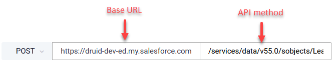
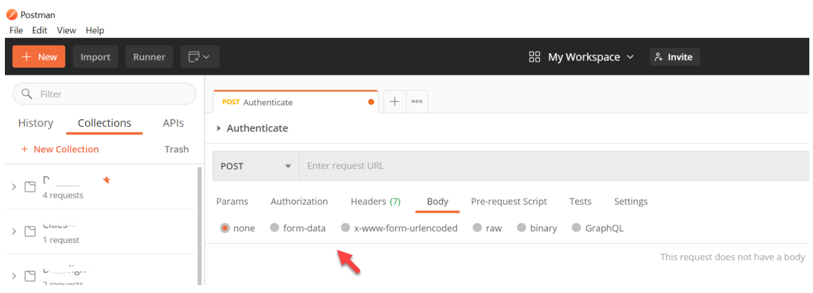
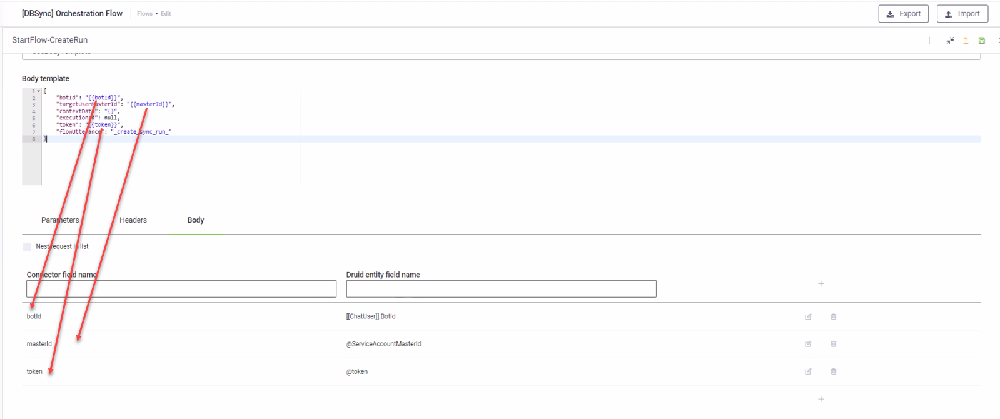

# REST request settings

Click the **Request** tab and set the request details.

| Setting                           | Description                                                                                                                                                                                                                                                                                                                                                                                                                                                                                                                                                                                                                                                                                                                                                                                                                                                                                                                                                                                                                                                                                                                                                                                                                                                                                                                                                 |
| --------------------------------- | ----------------------------------------------------------------------------------------------------------------------------------------------------------------------------------------------------------------------------------------------------------------------------------------------------------------------------------------------------------------------------------------------------------------------------------------------------------------------------------------------------------------------------------------------------------------------------------------------------------------------------------------------------------------------------------------------------------------------------------------------------------------------------------------------------------------------------------------------------------------------------------------------------------------------------------------------------------------------------------------------------------------------------------------------------------------------------------------------------------------------------------------------------------------------------------------------------------------------------------------------------------------------------------------------------------------------------------------------------------- |
| API Resource URL                  | The resource path to be called. It is comprised of a base URL (the URL of the REST App) and the API method. The base URL (not shown in the interface) is automatically included based on the settings in the Apps for the selected Connection Code. The base URL is set within the Apps settings and automatically used in all the integration calls. When you will move the settings to a different environment, you will need to change just once the base URL. Each third party API has specific method and resource URL for specific actions. In the Druid AI Platform, the REST endpoints include the HTTP verb (GET, POST, PUT, DELETE, HEAD, OPTIONS, PATCH, MERGE, COPY) to perform the task and the location (URL) from which the third-party API can access the resources they need to carry out their tasks. Select the HTTP verb and enter the endpoint.  If the URL is dynamic, use parameters. Example: https://base-url/{OrderId}/payments. Map the parameter OrderId in the **Parameters** tab, with run time values from the chat conversation. If you want to get the value of a specific parameter dynamically from within the conversation, include the parameter in the endpoint (E.g., **\&status={StatusName}**) and make sure to map it in the **Field Mappings** > **Parameters** table. |
| RemoveBaseUrl                     | Removes the BaseURL which is automatically included based on the settings in the Apps for the selected Connection Code. Toggle on when you want to overwrite the BaseURL.                                                                                                                                                                                                                                                                                                                                                                                                                                                                                                                                                                                                                                                                                                                                                                                                                                                                                                                                                                                                                                                                                                                                                                                   |
| Scope                             | Allows you to define the context for the integration task. Global means that the integration will be performed on the Request entity set on the connector action. If you want to perform an integration task on a context different from the global context set on the connector action, than from the **Scope** field, select **Local** and from the **Request entity** field, select the desired entity. Using the Local scope, you do all related queries directly inside the connector action instead of building a larger context outside the connector action via additional queries within the Flow Designer to put data inside the request entity and then send the data back to the connector action. **NOTE:** The **Scope** field is available in DRUID 5.23 and higher.                                                                                                                                                                                                                                                                                                                                                                                                                                                                                                                                                                         |
| Request entity                    | DRUID uses it to pass input data to the REST call. This field is automatically fill-in with the request entity specified on the Connector Action if the **Scope** is Global. You refer this entity in all the Fields mapping on the **Request** tab.                                                                                                                                                                                                                                                                                                                                                                                                                                                                                                                                                                                                                                                                                                                                                                                                                                                                                                                                                                                                                                                                                                        |
| Iterate By (JSON PATH Expression) | Use it when you want to iterate the request for each element in the request entity. For example, you have all leave requests for a certain employee stored in \[\[Employee]].LeaveRequests (“Entity List” type field), and you want to insert the leave request in 3rd party tool (one by one, not by using bulk insert). Using the JSON Path Expression $.\[\[Employee]].LeaveRequests\[\*] in this field will make the connector run the task for each element in the $.\[\[Employee]].LeaveRequests collection. You can check your JSON Path expression using the [JSON Path online evaluator](https://jsonpath.com/).                                                                                                                                                                                                                                                                                                                                                                                                                                                                                                                                                                                                                                                                                                                                   |
| RequestType                       | The type of request the integration call will make. For more information on the request types, see [Request Body Types](<Request Settings.md#Request_Body_Types>).                                                                                                                                                                                                                                                                                                                                                                                                                                                                                                                                                                                                                                                                                                                                                                                                                                                                                                                                                                                                                                                                                                                                                                                          |

Based on the selected **RequestType** and the parameters expected by the third-party API, you need to provide the parameters by using one of the following sections: Parameters, Headers or Body, and map the request parameters with the conversation context available in the Request Entity.

#### Make request using Parameters

If your endpoint contains path parameters, represented through curly braces {param1}&{param2} use the **Parameters** tab to map parameters within the URL with values in the Request Entity.


#### Make request using Headers

Use the Headers tab and table to add specific keys expected by the API in the Header section, typically to provide additional metadata about the operation you are performing.


**NOTE:** Usually the API headers contain authorization parameters. For security reasons, the DRUID platform provides you with a custom authentication method in Apps settings, which If done properly automatically adds the security context on the headers of all the integration calls, even if not visible in the Druid AI Platform. Username, passwords or keys defined in Apps settings are encrypted. So, there is no need for you to add the security context here.



**NOTE:** If your integration task uses an OAuth2 app, then in the Header of the request, the request will inherit the header key(s) configured on the Sign in action that was set on the OAuth2 app. The Header, however, can be modified for each integration, specifically. An example is shown in the figure below.





**Info:** If you're using Postman to test a third-party API and you're looking at Postman requests and responses to accommodate DRUID integrations, make sure that you ignore the headers Postman automatically generates based on your request selections and settings, e.g., Host, User-Agent, Accept, Accept-Encoding and Connection.


#### Make request using Body

Use the **Body** tab to map the fields you want to include within the body call.

If your request type is Body Template (**UseBodyTemplate** option selected as Request Type) and the body is a nested JSON, click the **Body** tab and map the fields provided in the request (**BodyTemplate** field) to the DRUID fields which will store the values returned by the API.

### Request Body Types <a href="#request_body_types" id="request_body_types"></a>

The Druid AI Platform allows authors to send various types of requests based on the data source they integrate with and the type of parameters (query or body). You can send the following types of request body types:

* [Set request using Field Mapping](<Request Settings.md#Field_Mapping>)
* [Set request using Body Template](<Request Settings.md#Body_Template>)
* [Set request using Form Data](<Request Settings.md#Form_Data>)
* [Set request using Binary](<Request Settings.md#Binary>)
* [Set request using www Form Url Encoded](<Request Settings.md#Use_www_Form_Url_Encoded>)
* [Set request using Custom Code](<Request Settings.md#Set>)

For request types, we are following Postman best practices.



### Set request using Field Mapping <a href="#field_mapping" id="field_mapping"></a>

Use **Field Mapping** when the REST API expects the parameters as a JSON-formatted in the request body.

The DRUID Connector automatically generates a JSON based on the structure defined in Field Mapping.

By default, the Druid AI Platform generates a flat JSON object with the fields you define in the **Body** tab.

If you have a object in object data structure to send within the body (Body tab), you can use field mapping on level one and child mapping to indent fields and make a nested JSON objects data structure.


**NOTE:** Prior to using field mapping, make sure that you created the needed DRUID entities and fields and the relationships between the entities. If the request data is has an object in object data structure, your DRUID entities should reflect the structure of all objects (parent object and subsequent child objects). In this regard, make sure that you properly create DRUID entities and their relationships. For more information about entities, see [Entities](<../../5_Entities/AI Agent Informational Model.md>).


If your REST API endpoint expects data as collection, you have to set your request as a collection, as follows:

* When you want to send multiple repetitive objects of the same type as a collection directly in the root of the body payload (the request object is a collection), select **Request body is a collection**. This option is available for DRUID version 1.59. In previous versions, you cannot send a collection of objects in the request body root.

The request body of the REST API call will have the following format:

**Request body is a collection - Example**

```
[
    {
        "HolidayStartDate" : "2021-10-12",
        "HolidayEndDate" : "2021-10-15",
        "HolidayType" : "Leisure"
    },
    {
        "HolidayStartDate" : "2021-05-08",
        "HolidayEndDate" : "2021-05-11",
        "HolidayType" : "Medical Leave"
    },
    {
        "HolidayStartDate" : "2021-11-20",
        "HolidayEndDate" : "2021-11-30",
        "HolidayType" : "Leisure"
        }
] 
```

* When you want to send a single object, but nested inside a collection, select **NestRequestInList**. Use this option when your request entity is NOT a collection.

The request body, in this case, will have the format as in the example below:

**Example when request entity is NOT a collection**

```
[
    {
        "EmployeeName" : "John Doe",
        "EmployeeRole" : "Database Administrator",
        "EmployeeDepartment" : "IT"
    }
]
```


Choosing one option will make the other one disappear from the UI.

#### How to map fields for object in object request data structure

While mapping fields for requests that have an object in object data structure might seem difficult, it is straightforward. The mapping depends the data structure and the object level.

Throughout this section, we will use as example the use case for sending an offer with the list of brands and their details to a REST API endpoint.

To understand how fields mapping is working, let’s take a look on how the object in object request might look like for the use case above:


We reflect this data structure in DRUID:

* The \[\[Offer]] entity some static fields (flat data type) and it also contains a field of type entity list, ListDubla that references the \[\[BrandNew]] entity


* The \[\[BrandNew]] entity has a field of type entity list, ListOfBrands referencing the \[\[Brand]] entity.


* The \[\[Brand]] entity contains only flat data type.


If you’ve properly set the data structure in DRUID (DRUID entities, their fields and relationships), all you have to do is to map the fields of the request entity in the request Body, as follows:

1. Map the fields of the root (level 0) object (in our example, \[\[Offer]]).
2. On the row where you map a field of type entity list, in the column DruidChildMappingCode, enter a unique identifier for the child mapping (child object mapping).


**NOTE:** Use a unique identifier for the child object on the parent object; otherwise, the integration task publishing will fail.





**NOTE:** To send a decimal value, enclose it in square brackets (e.g., \[2.1]).




3. Click the  button.
4. In the **NameOfChildMapping** field, enter the unique identifier you provided when mapping its parent object (in our case, “child1)”.
5. In the **Request entity** field, enter the name of the entity referenced by the parent object, referenced by the field of type Entity List (in our case, the \[\[BrandNew]] entity is referenced by the \[\[Offer]].ListaDubla field).
6. Map the fields of the child object (in our case, the fields of the \[\[BrandNew]] entity).
7. For any subsequent child objects, you need to add the child mapping code on the parent mapping and map the fields of the child object.

If the child object is a collection, in the child mapping page, select **RequestDruidEntityIsCollection**.


You can now set the response.

The Druid AI Platform enables you to do enhance fields mapping by using expressions. For information on how to use expressions in requests field mapping, see [Using Expressions in Request mappings](<../../4_Flows/Dialog Expressions Reference  .md>).

If you need a JSON with a complex structure, use **Body Template** instead.

### Set request using Body Template <a href="#body_template" id="body_template"></a>

Use **Body Template** when you want to send complex JSON structure to the external data source.

In the **Body Template** field, enter the data you want to send making sure to provide the fields of the request entity between double curly brackets (**\{{ \}}** ), then map the fields of the request entity in the request Body.



### Set request using Custom Code <a href="#set" id="set"></a>

Select **CustomCode** when you need to construct a request JSON payload dynamically at runtime based on conditional logic, variable user input, or optional entity fields.

Rather than maintaining a separate Custom Code task prior to the REST request, you can script the payload logic directly within the REST request code editor. Write JavaScript code to construct the required JSON object, convert it to a string on the request entity, and assign it to **RestContext.RequestBody**.


**Info:** Custom Code is available on REST requests starting with Druid 9.28.


#### Example

In this example, an outgoing REST request requires a JSON array containing audience member names filtered specifically for the "North Campus" location. The target API endpoint expects the request payload to match the following schema:

**Expected request payload**

```
[
 {
  "memberName": "John Doe"
 },
 {
  "memberName": "Alice Smith"
 }
]
```

.

**Example script**

```
(function mapRestRequest(){
//EXAMPLE SCRIPT
const requestEntity = Context.GetRequestEntity();

let reqBody = [];
// adding to request body only members from "North Campus"
if (requestEntity != null && requestEntity.Members.Count >0){
    for (let i=0; i<requestEntity.Members.Count; i++){
        if (requestEntity.Members[i].Campus == "North Campus"){
            reqBody.push({memberName: requestEntity.Members[i].Name})
        }
    }
} else {
    reqBody = ["No members in North Campus"]
}
//request body needs to be a stringified Json object
RestContext.RequestBody = JSON.stringify(reqBody);
})() 
```

### Set request using Form Data <a href="#form_data" id="form_data"></a>

Use this type of request to send a file to the REST service. E.g., to perform Optical Character Recognition (OCR) and data extraction from an identity card.

Postman example


_Setting the Request in DRUID_


Setting the Response


### Set request using Binary <a href="#binary" id="binary"></a>

Use **Binary** when you want to send information you can't enter manually in your request body, such as image, audio, and video files (you can also send text files).

### Set request using www Form Url Encoded <a href="#use_www_form_url_encoded" id="use_www_form_url_encoded"></a>

Use this type of request when the API requires url-encoded data in the request body.

### Cookie-based Authentication

Some REST APIs can be called directly from the browser using cookie-based authentication instead of a bearer token or basic authentication in the request header. The browser automatically attaches the cookie to the API call, allowing you to authenticate the request using the browser's cookie.

To configure a cookie for a REST call:

1. In the request settings, click the **Cookie** tab.


2. In the mapping table, map the cookie name (key) and its value. You can set the cookie value as a static string or retrieve it from a DRUID variable or entity.



**Info:** The domain name for the cookie is automatically pulled from the request’s Base URL.


### Related Topics

* [Configuring OAuth v2 Authorization](<../OAuth2/Configuring OAuth v2 Authorization.md>)
* [REST Calls](<REST Calls.md>)
* [REST Response General Settings](<Response Settings.md>)
