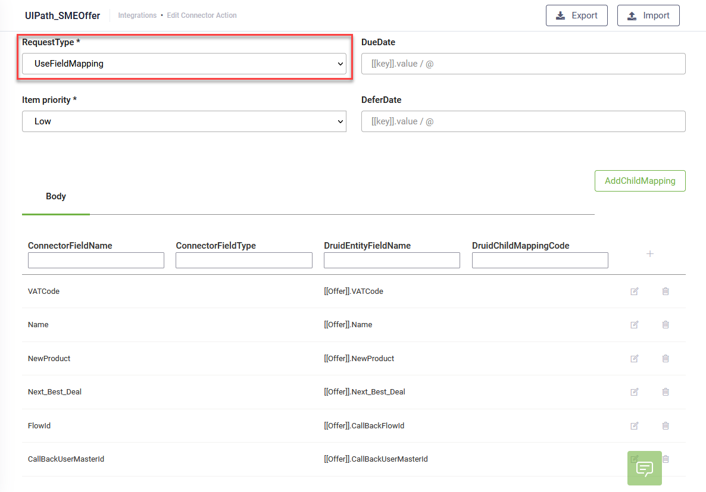

<a id="AddingItemtoUiPathQueue"></a>


The role of this connector task is to create a new queue item in a UiPath Orchestrator Queue with data mapped from DRUID Entities.

Check out Lesson 9 of the Technical Intermediate Course on DRUID Academy for a detailed video tutorial on how to create a new queue item in a UiPath Orchestrator Queue.

[Watch video](https://academy.druidai.com/mod/resource/view.php?id=58)

<a id="Prerequisites"></a>

## Prerequisites

- You created the queue.
- You created the UiPath process.
- You created a [UiPath connection string](Creating%20the%20UiPath%20Connection%20Strings.md).

To add an item to UiPath Queue, follow these steps:

<a id="Step1CreateanAddItemToUiPathQueuetask"></a>

## Step 1: Create an “Add Item To UiPath Queue” task

You have two options for creating an Add Item To UiPath Queue” task:

- Using the Connector Designer (integration action editor). At the top-right corner of the Edit Connector Action page (ConnectorSteps tab), click Create Task and from the drop-down select Add Item To UiPath Queue.
- Using the Flow Palette.
  From the Integration - UiPath
  section, drag the **Add item to queue** integration task and drop it where you want to place it within your flow. The integration step contains a dummy integration action and task.. Double-click the step, click on the connector action and define it, then click on the integration task and define it

Set up the following parameters:

| Parameter | Description |
| --- | --- |
| Description | A name or description of the task |
| ConnectionCode | In order for the task to connect to the right Orchestrator configuration, choose the corresponding Connector App from the drop-down.  **NOTE:** If the ConnectionCode list is empty, it means you didn’t define an Apps Connection string with type UiPath. From the left menu, click **Apps** and create one. For information on how to create a UiPath connection, see [Creating the UiPath Connection Strings](Creating%20the%20UiPath%20Connection%20Strings.md). |

Click Save to save the settings and stay on page, or click Save & Close to save and exit the page.

<a id="Step2ChoosetheQueuerobotandprocess"></a>

## Step 2: Choose the Queue, robot and process

Click the LoadOrchestratorData button, wait for the data to load and choose the right parameters described below:


| Parameter | Description |
| --- | --- |
| QueueName (optional) | Select the corresponding Orchestrator queue where the item needs to be placed. |
| RobotName (optional) | Select the UiPath robot to be used for processing the queue item. |
| ProcessName (optional) | Select the UiPath process to be started, for the corresponding queue item. |

The following combinations are available:

- Select **Queue Name** and leave Robot Name and Process Name empty. The AI Agent will only create a new item within the queue. You need to have your process always running and checking for new items in the queue. This is the recommended option.
- Select all (**Queue Name**, **Robot Name** and the **Process Name**). The AI Agent places the item in the queue and starts the process with the robot.

Click **Save** to save the settings, then click the **Request** tab where you will map the data to the queue item.

<a id="Step3MapdatatotheQueueitem"></a>

## Step 3: Map data to the Queue item

On the **Request** tab, you can specify optional parameters for the items DRUID will add to the UiPath queue.

| Parameter | Description |
| --- | --- |
| Priority | The processing priority level of the queue item. This property is a criterion for the prioritization of queue items. It can be set to Low, Normal, or High.  **NOTE:** The field is available in DRUID version 1.58 and higher. In previous DRUID versions, the default priority of queue elements was “Low”. |
| Reference | An identifier of the item placed in the queue. You can use this field to link your transactions to other applications used within an automation project. You can use it in Orchestrator to search for specific transactions.  **NOTE:**  The field is available in DRUID version 1.59 and higher. In previous DRUID versions, DRUID automatically generated a unique identifier to reference the item placed in queue. |
| DueDate | The date and time before which the queue item should be processed.  **NOTE:**  The field is available in DRUID version 1.59 and higher. |
| DeferDate | The date and time after which the queue item may be processed.  **NOTE:**  The field is available in DRUID version 1.59 and higher. |

In the **Request** tab, authors can map data from DRUID Entity to queue item fields.

To do that, from the **RequestType** field, select the type of request. Two options are available:

- **Use Body Template**. Use it when you want to pass complex json objects (nested level) into the queue. In this case, make sure to tick the **NestRequestInList** check box. If you select this option a new field appears, **BodyTemplate**. In the **BodyTemplate** field, paste the content of the JSON object which contains merge fields that will be linked with the mapping table set in the Body section.
- **Use Field Mapping**. Select this option if you want to define one by one the fields you want to transfer into the queue item.



In the **Body** section, add a new line in the mapping table and write the name of the queue field in the ConnectorFieldName column and select the corresponding DRUID entity field in the **DruidEntityFieldName** column.

In order to properly fill in the **Druid Entity** field, type “[[“, in the “DruidEntityFieldName”, choose the Request entity from the drop-down, type “.” after the closing brackets ]] and choose the correct entity field from the new drop-down that appears. Click the Save icon displayed inline.

You can add as many fields as you need to send to the Orchestrator queue item.

> **NOTE:** Make sure that you add the **FlowId** field, otherwise the robot will not be able to [trigger the Callback flow](Triggering%20the%20Callback%20Flow.md).

Click the **Save** button to save the fields mapping.

The Request tab will automatically form a JSON object with the mapped data from the DRUID entity fields and send it as body request to the Orchestrator queue, in the **DruidData Object** field.

**DruidData Object - Example**

```
{
   "FirstName": "John",
   "LastName": "Doe",
   "JobTitle": "Dept. Manager",
   "FlowId": "18c5b6ce-d1f6-449d-94be-48a959b94db0",
   "ExecutionId": "00000000-aaaa-aaaa-000000000000",
   "TenantId": <tenantId>,
   "TenantName": "<tenancyName>",
   "DruidBaseURL": "http://<tenancyName>.Druidplatform.com"
}
```

The queue item contains standard fields which are automatically added by the Druid AI Platform and custom fields which map in the Body section.

The fields **ExecutionId**, **TenantId**, **TenantName** and **DruidBaseURL** (highlighted in green in the example provided above) are standard fields which are automatically added by the system to the queue item (in the JSON object sent to the Orchestrator queue).

When the connector action is run, a new item will be placed in the corresponding Orchestrator Queue, with the status “New”.


You can see the JSON in the DruidData object in the item’s details page.


<a id="Advancedconfigurations"></a>

### Advanced configurations

Mapping an Entity List type field in the request of a UiPath connector action (AddItemToUiPathQueue task) is available by using the Child Mapping functionality, similar to the REST tasks.

Let’s suppose we need to send the following data structure to the Orchestrator:

- [[Employee]].FirstName -- string
- [[Employee]].LastName -- string
- [[Employee]].HolidayRequests -- EntityList

where **HolidayRequests** is a field of type Entity List, referring to entity **[[Holiday]]**, having the structure below:

- [[Holiday]].StartDate -- Date
- [[Holiday]].EndDate -- Date
- [[Holiday]].Status -- string

We need to define and set a child mapping for the HolidayRequests field, inside which we will map the fields of the referred entity [[Holiday]]


**Example JSON object sent to the UiPath Orchestrator Queue**

```
{
   "FirstName": "John",
   "LastName": "Doe",
   "HolidayRequests": [
                       {
                                
                            "StartDate": "2020-03-03",
                            "EndDate": "2020-03-08",
                            "Status": "Approved"
                        },
                        {
                            "StartDate": "2020-05-01",
                            "EndDate": "2020-05-02",
                            "Status": "Approved"
                        },
                        {
                            "StartDate": "2020-07-01",
                            "EndDate": "2020-07-06",
                            "Status": "Approved"
                        }
                        ]
  }
```

The DRUID UiPath Connector only adds items to an Orchestrator queue and triggers a UiPath process.

To see how the data sent to the queue is used inside a UiPath process and how the process calls back the AI Agent, see the dedicated sections [Using UiPath Integration Data](Using%20UiPath%20Integration%20Data.md) and [Triggering the Callback Flow](Triggering%20the%20Callback%20Flow.md).

<a id="Step4Settheresponse"></a>

## Step 4: Set the response

The operation also returns a status code and message. If you want to capture this information for error exception troubleshooting, in the Response tab, you have to map the following fields to the dedicated DRUID entity field:

- ErrorCode
- ErrorMessage


Use **<a id="kanchor12"></a>ProjectResultToEntityPath** when you want to map to the response directly to an Entity List type field.

The Response entity is automatically selected (non-editable). From the drop-down, select the desired field. The drop-down displays the list of fields of type Entity List that exist on the response entity.

Save the integration task.

Publish the connector action. On the main menu, click **Integrations** and at the top-right corner of the Integrations page, click the **Publish** button.


To publish an integration action or task in the Flow Diagram, at the top-right corner of the editor click the **Publish** icon ().

## Related Topics

- [Defining the Integration Actions](../Defining%20the%20Integration%20Actions.md)
