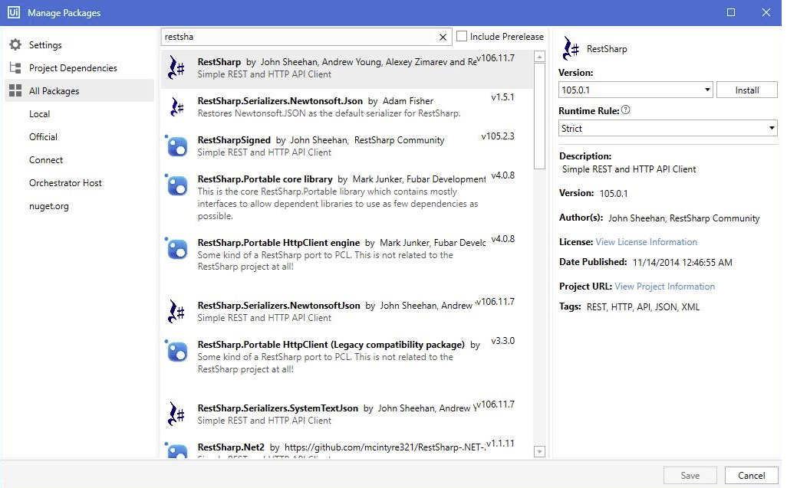

# Triggering the Callback Flow

An UiPath process can call the AI Agent at any point during the process (either for intermediary status updates or for process end notification), by using the “Trigger Conversation” UiPath custom activity which has been developed to start a AI Agent conversation.

You can use the DRUID Callback activity in these two situations:

* to follow up triggered unattended processes
* as a standalone alert.

### Prerequisites

* **UiPath.Web.Activities** package
* Dedicated DRUID user to be used by the UiPath Process.
* The security role associated with your DRUID account must have the permission to “Start Flow”.


* The Druid.UiPath.Activities package needs to be installed in UiPath Studio.


* For on-premise robot installation, if the robot which runs the process has no access to the Internet, in order to load DRUID UiPath Activity dependencies, make sure that you install RestSharp version 105.0.1.



### Configure the Callback

The Trigger Conversation component performs the following functions:

* Starts a certain DRUID Flow (as conversation) for a specific AI Agent user.
* Transfers data from UiPath process variable to DRUID Entities, within the conversation context.


**IMPORTANT!** In case there is no data to be sent from the UiPath process to the DRUID Conversation, the DruidData file must contain an empty string:  “” .




In order to use this component, in the **Trigger Conversation** activity set up the following parameters:

| Parameter                                                                                                                                                                         | Description                                                                                                                                                                                    |
| --------------------------------------------------------------------------------------------------------------------------------------------------------------------------------- | ---------------------------------------------------------------------------------------------------------------------------------------------------------------------------------------------- |
| DruidData                                                                                                                                                                         | Variable where the callback data (DRUID Entity) is stored, in a specific format. See below how the callback DRUID Data object is formed.                                                       |
| ExecutionId                                                                                                                                                                       | Parameter used for log purposes. The DRUID connector action sends it by default, when placing the item in queue (DruidData object, field “ExecutionId”).                                       |
| FlowId                                                                                                                                                                            | The Id of the DRUID Flow to be started. You need to sent this parameter with the DRUID connector action, when placing the item in the queue.                                                   |
| TargetUserMasterId                                                                                                                                                                | The MasterId value of the user for which the conversation will be started (can be taken from \[\[ChatUser]].MasterId).                                                                         |
| Response                                                                                                                                                                          | Jobject variable to store the DRUID Callback API Response.                                                                                                                                     |
| AuthenticateResource                                                                                                                                                              | DRUID External Authentication API Address: "/api/services/app/WebAPIService/ExternalAuthenticate".                                                                                             |
| The following parameters are credentials used to call the DRUID API **NOTE:** In order to use the callback, use a service DRUID user account, DO NOT use a personal user account. |                                                                                                                                                                                                |
| Password                                                                                                                                                                          | DRUID User Password (the dedicated user, created for UiPath process callback).                                                                                                                 |
| Tenant                                                                                                                                                                            | DRUID Tenancy Name. The DRUID connector action sends it by default, when placing the item in the queue (DruidData object, field “TenancyName”).                                                |
| UserNameOrEmailAddress                                                                                                                                                            | The username or email address of the dedicated DRUID user.                                                                                                                                     |
| BaseServicesUrl                                                                                                                                                                   | DRUID platform Base URL (in the format _https://.Druidplatform.com_). The DRUID connector action sends it by default, when placing the item in queue (DruidData object, field “DruidBaseURL”). |
| StartFlowResource                                                                                                                                                                 | DRUID Start Flow API Address: "/api/services/app/Flow/StartFlow"                                                                                                                               |

You can store the other parameters directly in the **Trigger Conversation** activity.

### DRUID Entity Metadata Format

In order to send values from UiPath process variable to a DRUID Entity, you need to create a special JObject containing the respective data.

**DRUID callback JObject Format**

```
{
    "$entityTypeName$": "<Druid Entity Name>",
    "<Entity Field Name 1>":"value",
    "<Entity Field Name 2>":"value",
    .......
    "<Entity Field Name n>":"value"    
}
```

To create a DRUID callback JObject in UiPath Studio, follow these steps:

1. Create a new JObject variable (i.e. DruidEntity).
2. Create a new JProperty variable for the DRUID Entity Name (i.e. DruidEntityName).
3. Create new JProperty variables for each field from the DRUID Entity (i.e. DruidFirstName).
4. Assign a new JObject to the DruidEntity ( DruidEntity = new JObject() ).
5. Assign a new JProperty with the entity name for DruidEntityName field (DruidEntityName = new JProperty (“$entityTypeName$”,”Employee” ) ).
6. Assign new JProperties for each DRUID Entity filed variable ( i.e. DruidFirstName = new JProperty(“FirstName”,”John”) ).

Repeat step 6 for all entity fields.


7. Using the **InvokeMethod** activity, assign each JProperty to the DruidEntity Jobject. Set up the following:

* **MethodName**: Add
* **Parameters**: JProperty variables (elements to be added)
* **TargetObject**: JObject variable (destination element)


8. Create a new string variable (i.e. DruidCallbackDataSerialized) and assign the serialized result of the **JsonConvert.SerializeObject** function applied to the DruidEntity object:


Now the DRUID Entity metadata is created and you can provide it as parameter to the **Trigger conversation** activity (DruidData field).

### Related Topics

* [Endpoint Logs](<../../Data Analytics & Insights/History & Logs/Endpoint Logs.md>)
