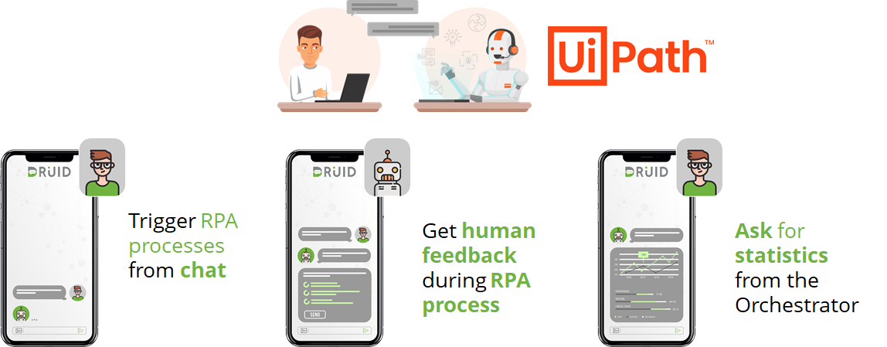

DRUID - UiPath integration brings the RPA into your front office, allowing both customers and employees to benefit from the robot’s help. Streamline the customer and employee experience and help them fulfill their needs across the entire journey.

DRUID brings to bear for the entire business environment of an organization the full power of native integration with both unattended and attended UiPath robots.

DRUID - UiPath connector is built base on a deep knowledge and understating of RPA and AI Agent authoring technologies. DRUID knows to embed asynchronous RPA within chat conversations and can intelligently continue the conversation with a user while the RPA process is executed in the back-end, resuming the previous conversation flow once the RPA process is completed.

AI Agent features are natively integrated with UiPath Studio, UiPath Orchestrator, and attended robots to support triggering automation directly from the chat requests. The integration enables natural language handling of user requests with chat providing seamless bidirectional communication between robots and humans. It uses powerful natural language processing (NLP) technology to interpret and provide information contextually.

Business data can be collected from the AI Agent and shared bidirectionally with automation enabling precise data driven actions and notifications.

Robotic Process Automation (RPA) can allow AI Agents to move from simple interactions to handling advanced service requests.

You can use the DRUID - UiPath integration to streamline the customer experience by helping them fulfill their needs across the entire customer journey and also improve the employee experience. With the combination of automation and AI Agents, employees can use the AI Agent interface to get information or post data into applications without needing to switch from screen to screen. This way, your employees can focus on getting work done instead of focusing on tedious processes and apps.

The Druid AI Platform provides integration with both [unattended](Starting%20UiPath%20Unattended.md) and [attended](Running%20UiPath%20Attended%20Processes.md) UiPath robots.

The DRUID - UiPath integration supports three use cases, as follows:

- Human and AI Agent trigger the RPA process.
- UiPath robot alerts the human and asks for help.
- The manager of the robots' team asks the AI Agent for activity reports.

## UiPath DRUID Starter

The UiPath DRUID Starter is meant to help you get started with the DRUID UiPath integration.

1. From the [Solutions Library](../../Solution%20Library/Solutions%20Library.md), import the DRUID Starter solution template.
2. From the [Solutions Library](../../Solution%20Library/Solutions%20Library.md), import the UiPath Starter solution template corresponding to the processes you want to run (UiPath Starter Attended / UiPath Starter Unattended).
