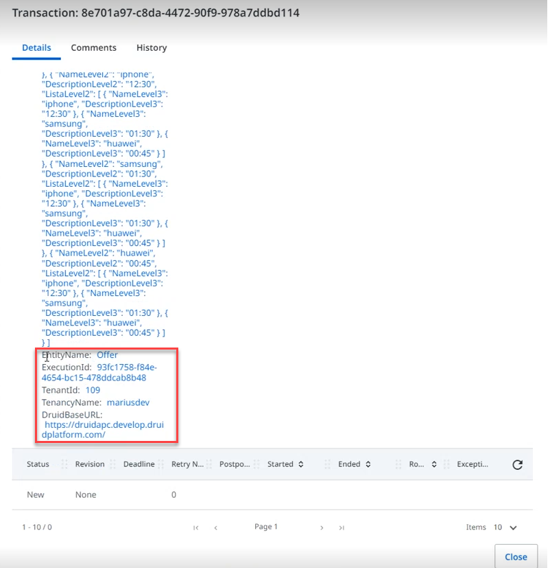

---
layout:
  title:
    visible: false
---

# Using UiPath Integration Data

Once an item is placed in a queue and its status is “New”, it is ready to be used by the UiPath process.

For DRUID version 1.59 or higher, the AddItemsToUiPathQueues task sends DRUID context data objects properties expanded inside the Specific Data (root) object, so that RPA developers will find it easier to extract the payload of the transaction item, without needing to process and deserialize the DruidData object.

For backwards compatibility, it also sends DruidData as a stringified object.

To use the AI Agent data in an UiPath process, follow these steps:

## Step 1: Get item from the queue

In UiPath Studio, use the **Get Transaction Item** activity to read the data from the first queue item in status “New”. To do that, configure the following parameters:

| Parameter | Description |
| --- | --- |
| Input > QueueName | Fill in the queue name defined in the DRUID connector action. |
| Output > TransactionItem | Fill in the variable used to store information from the queue item. Variable type: “UiPath.Core.QueueItem” |

## Step 2: Extract data from the transaction item

To extract the “DruidData” JSON object that stores the data transferred from the AI Agent , follow these steps:

1. Import the “Newton.Json” and “Newton.Json.Linq” libraries from the UiPath.Web.Activities package, otherwise errors might occur.

2. Create the “DruidData” JSON object by using the **Deserialize json** activity from the **Newtonsoft.Json.Linq** library, setting up the following parameters:

| Parameter | Description |
| --- | --- |
| Input -> JsonString | Fill in the specific content DruidData from the transactionItem. |
| Output -> JsonObject | Fill in an Jobject type variable (i.e. DruidData) |

3. Extract all data from every field within, and store its local variables, using the following syntax in the Assign activity:
`<variable> = Druidata(“<field name>”).ToString()`

## Step 3: Use the data inside UiPath Process

Now data from the DRUID Entity [[Employee]] is stored in corresponding UiPath variables and is ready to be used within the process.
