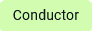
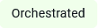

---
layout:
  title:
    visible: false
---

# AI Agent Orchestration

Orchestrate multiple specialized AI Agents through a single, intelligent conversation layer — powered by context-aware routing, seamless hand offs, and unified user experience.

## What is Druid Conductor

Druid Conductor is an orchestration AI Agent that acts as the primary interface in any conversation. It owns the conversation end-to-end — handling requests it can answer directly, and silently triggering specialized AI Agents when needed. The user always talks to one AI Agent. The complexity is invisible.

Think of a healthcare company where Mary is the primary AI Agent that patients always talk to. When a patient needs to book an appointment, Mary delegates to the Appointment Scheduling agent. For a billing question, she routes to the Billing agent. For general support, she calls on the Support agent. The patient just talks to Mary — she handles the rest.

Orchestrated AI Agents work like specialized teams within your organization. Each one is an expert in its own domain. Druid Conductor knows when to handle something itself and when to call in a specialist — preserving full context across every hand off so the conversation always feels continuous.

## Benefits of Multi-AI Agent orchestration

- **Unified User Experience**. Users interact with one AI Agent, that is, the Druid Conductor. It silently routes to the right specialist. No need for users to know which AI Agent handles payments, appointments, or HR. They just ask.
- **Role-Based Content Segregation**. Assign specific orchestrated AI Agents to specific user roles. An HR team member sees only HR agent capabilities; Finance sees only Finance. Druid Conductor enforces these boundaries automatically at routing time.
- **Higher Performance**. Specialized AI Agents are trained on narrower domains, producing higher accuracy within their scope. Together they outperform any single general-purpose AI Agent.
- **Infinite Scalability**. Need to add a new capability? Build a new specialized AI Agent and link it to your Druid Conductor. The existing setup is untouched — the orchestration layer adapts automatically.
- **Better Authoring Governance**. Druid Conductor authors control routing, dialogue management, live chat, and authentication in one place. Orchestrated AI Agents authors focus purely on their domain — clear separation of duties, no duplication.
- **AI Agents That Collaborate, Not Just Operate**. Your AI Agents don't work in silos. Each one can hand off tasks, trigger workflows in other AI Agents, or pass control back to Druid Conductor — enabling multi-step tasks that span domains, like booking an appointment that also verifies insurance eligibility.

## Understanding Agentic Skills

Agentic Skills are operational capabilities that enable a Druid AI Agent to perform business tasks autonomously, reliably, and contextually within enterprise environments.

An Agentic Skill is not a simple prompt, script, or isolated action. It packages the instructions, knowledge, tools, functions, integrations, business rules, and supporting artifacts an **AI Agent** needs to perform a set of tasks repeatedly and reliably.

In Druid, Agentic Skills are designed for enterprise execution. They help an AI Agent understand a user request, reason over business context, select the right functions, interact with enterprise systems, apply rules and constraints, orchestrate actions, validate results, and deliver a business outcome.

Agentic Skills are built from Druid artifacts, such as entities, flows, integrations, functions, data models, forms, views, dashboards, notification templates, workspaces, and business logic. Together, these elements give the AI Agent the operational competence required to complete tasks inside real enterprise processes.

An Agentic Skill typically combines:

- **Context awareness** — conversation context, user intent, entities, data models, and retrieved enterprise data that help the agent adapt to the current situation.
- **Reasoning** — the ability to evaluate context, determine the next best action, and select the appropriate capability or function.
- **Business rules** — configured policies, validations, constraints, and decision logic that guide what the AI Agent can do and under which conditions.
- **Enterprise integrations** — APIs, connectors, and system integrations that allow the agent to interact with enterprise applications such as CRM, ERP, HR, ticketing, finance, document repositories, databases, or other backend systems.
- **Functions and actions** — operations that allow the agent to create, read, update, approve, submit, trigger, or complete actions in connected systems.
- **Action orchestration** — flows, conditions, loops, and process logic that coordinate multiple steps to complete a task reliably.

For example, an Appointment Management Agent can use multiple Agentic Skills to manage appointment requests. Depending on the user’s request, the AI Agent may use skills for booking, confirming, cancelling, rescheduling, updating patient details, checking provider and facility availability, applying scheduling rules, creating or updating appointments in connected systems, and sending confirmation or reminder notifications.

To do this, the Agentic Skills use Druid artifacts such as conversation flows, patient and appointment entities, data models, scheduling rules, integration functions, notification templates, workspaces, and knowledge base content. Together, these artifacts allow the agent to guide the conversation and execute appointment-related processes end to end.

Compared to traditional agentic skills that mainly provide reusable instructions, tools, or artifacts for automations, Druid Agentic Skills go further by combining those artifacts with enterprise context, governance, integrations, and orchestration. They enable the AI Agent not only to perform a task, but also to operate inside the enterprise and deliver outcomes across real business processes.

## AI Agents Org Chart

The AI Agents Org Chart gives you a visual view of your multi-AI Agent setup. Once an AI Agent has linked AI Agents, it appears at the top of the chart with the Conductor badge. All orchestrated AI Agents appear beneath it — like a team org chart, with Druid Conductor as the primary AI Agent and each specialist in their own domain.

Each card in the Org Chart displays the AI Agent name, its status (Active / Inactive), and its role label:

| Label | Meaning |
| --- | --- |
|  | This AI Agent is the orchestrator — the primary interface for the user and the routing hub for all other AI Agents. |
|  | This AI Agent is managed by a Druid Conductor. It handles specialized domain tasks when invoked. |

## View AI Agents orchestration on your tenant

To view all AI Agents defined on your tenant — including Druid Conductors and their orchestrated AI Agents — go to **All Settings >** AI Agents. AI Agents without a label are standalone AI Agents.

