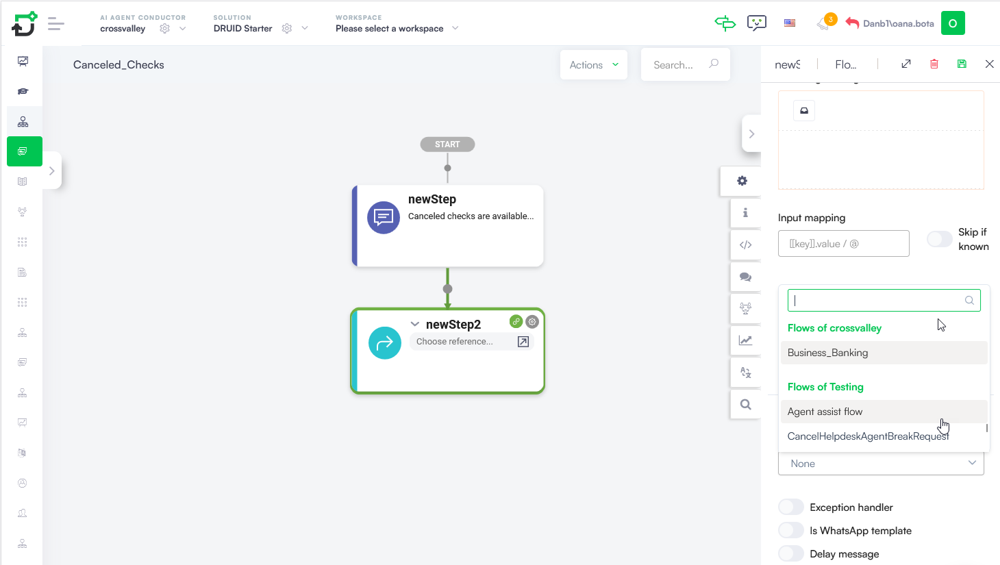
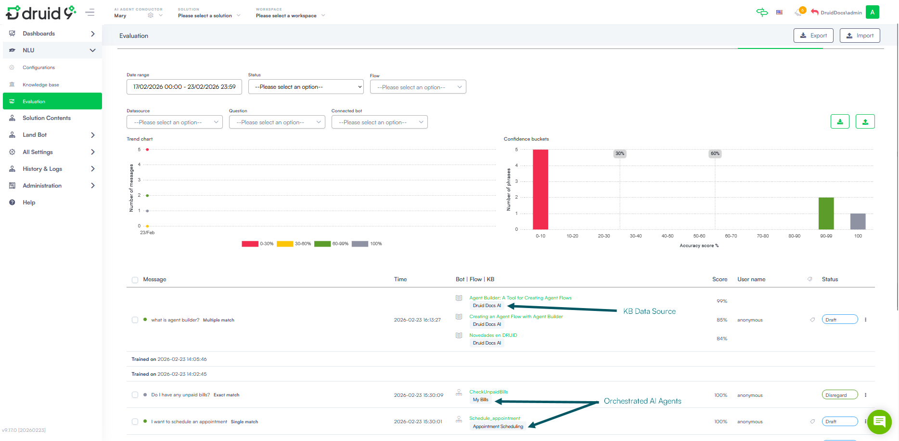

---
layout:
  title:
    visible: false
---

<a id="SetUpMultiAIAgentOrchestration"></a>

# Set Up Multi-AI Agent Orchestration

Configuring a Druid Conductor involves establishing a hierarchy between your primary conversational AI Agent and your specialized AI Agents.

<a id="Prerequisites"></a>

## Prerequisites

Before beginning the orchestration process, ensure that:

- You created and deployed the AI Agent that will serve as Druid Conductor.
  This AI Agent must be configured with the DRUID Starter solution (ensure the "Intent not recognized" flow is correctly set in Dialogue Management to allow intent delegation).
- You have created independent, domain-specific AI Agents to orchestrate (e.g., one for appointments, one for billing, one for FAQ).
  These AI Agents have been trained.

<a id="LinkingAIAgentstoDruidConductor"></a>

## Linking AI Agents to Druid Conductor

Once you have individual AI Agents, you can link them within the AI Agent Org Chart to activate the orchestration layer:

1. From the top navigation, select the AI Agent you want to designate as Druid Conductor, then select its solution from the **Solution** dropdown.
2. From the **Solution Contents** menu, click **AI Agents Org Chart**. The canvas is empty by default until you add your first orchestrated AI Agent.
3. Click **Add new** in the top-right corner. A modal opens.
4. Select the desired AI Agent from the dropdown.
5. Toggle **Enable** off if you want to orchestrate the AI Agent but temporarily exclude it from routing.



6. Click **Save & Close**.

Add as many orchestrated AI Agents as you have use cases. Each one appears in the AI Agent Org Chart beneath Conductor.


> **IMPORTANT!** After adding AI Agents, train your Druid Conductor to ensure it can understand user intent and delegate tasks to the appropriate specialized AI Agent.

> **NOTE:**
>
> - A Druid Conductor cannot itself be orchestrated by another Druid Conductor.
> - An AI Agent can be orchestrated by multiple Druid Conductor simultaneously.

<a id="ManuallyControlDruidConductorRouting"></a>

## Manually Control Druid Conductor Routing

By default, Druid Conductor automatically routes user utterances to the most suitable orchestrated AI Agent. In some scenarios, you may want to override this behavior and direct the conversation to a specific AI Agent manually.

You can do this by setting **[[ChatUser]].PredictTargetBot** in the conversation context during the Intent rephrase flow. This is the only point at which the routing prediction can be modified.

<a id="RoutingtoaspecificAIAgent"></a>

### Routing to a specific AI Agent

You can force the Druid Conductor to perform the routing prediction against a specific AI Agent by setting **[[ChatUser]].PredictTargetBot** before the prediction is performed.

The value must be the AI Agent name (not the AI Agent ID).

> **IMPORTANT!**
>
> - The value must match the AI Agent name exactly.
> - AI Agent names must be unique within the tenant.
> - If **[[ChatUser]].PredictTargetBot** is not set or is null, the Druid Conductorperforms the prediction against all eligible orchestrated AI Agents.
> - The Druid Conductor itself can also be specified as a target AI Agent.

*Example Scenario*

Assume the following orchestrated AI Agents are available:

- HR Agent
- Finance Agent
- IT Support Agent

If [**[ChatUser]].PredictTargetBot = "Finance Agent"** the prediction will be executed only against the Finance Agent, and no other AI Agent will be considered during routing.

> **NOTE:** Use **[[ChatUser]].PredictTargetBot** when you want to restrict prediction to a single known AI Agent. This differs from **[[ChatUser]].RestrictedTargetBots**, which excludes AI Agents from consideration while still allowing prediction across the remaining eligible AI Agents.

<a id="RestrictingroutingtoasubsetoforchestratedAIAgents"></a>

### Restricting routing to a subset of orchestrated AI Agents

You can prevent the Druid Conductor from considering specific orchestrated AI Agents during routing by setting **[[ChatUser]].RestrictedTargetBots** before the prediction is performed.

[[ChatUser]].RestrictedTargetBots is a JSON array containing the names of AI Agents that must be excluded from the routing prediction.

**Example**

```
[[ChatUser]].RestrictedTargetBots = [
  "HR Agent",
  "Finance Agent"
];
```

In this example, the Druid Conductor will perform the prediction against all orchestrated AI Agents except HR Agent and Finance Agent.

> **IMPORTANT!**
>
> - **[ChatUser]].RestrictedTargetBots** is an exclusion list (blacklist).
> - AI Agents listed in [ChatUser]].RestrictedTargetBots are ignored during routing prediction.
> - All other orchestrated AI Agents remain eligible for prediction.
> - If the array is empty or not set, the prediction is performed against all orchestrated AI Agents.

> **NOTE:**  If you need to route only to a specific AI Agent, use targetChildBot . **[ChatUser]].RestrictedTargetBots** only removes AI Agents from consideration; it does not define the set of AI Agents against which prediction is performed.

*Example Scenario*

Assume the following orchestrated AI Agents are available:

- HR Agent
- Finance Agent
- IT Support Agent
- Knowledge Base Agent

If:

```
[[ChatUser]].RestrictedTargetBots = [
    "HR Agent",
    "Finance Agent"
];
```

the prediction will only consider:

- IT Support Agent
- Knowledge Base Agent

and will never return HR Agent or Finance Agent as routing candidates.

<a id="TriggerCrossAIAgentsflows"></a>

## Trigger Cross-AI Agents flows

Druid Conductor supports triggering flows between orchestrated AI Agents (using Trigger flow steps), or from an orchestrated AI Agent back to Druid Conductor — enabling sophisticated, multi-step workflows that span domain boundaries.

*For example, a healthcare scenario: the Appointments Scheduling agent can trigger a flow in the Insurance & Eligibility agent mid-conversation to verify coverage, then pass control back — all within a single seamless user interaction.*

> **NOTE:**
>
> - Cross-AI Agents flow triggering only works within an active Druid Conductor-managed conversation.
> - If an orchestrated AI Agent is removed from Druid Conductor, any flows referencing it will stop triggering.
> - When an AI Agent is orchestrated by multiple Druid Conductor, the flow list shows all flows across all sibling AI Agents— grouped by AI Agent. Select carefully to avoid misrouting.

<a id="KnowledgeBaseMultiAIAgentPredict"></a>

## Knowledge Base — Multi-AI Agent Predict

In the Knowledge Base Predict panel (when operating within Druid Conductor), you can test questions against all knowledge indexes across every orchestrated AI Agent simultaneously — giving a unified view of what your entire AI Agent network knows.


<a id="DruidConductorEvaluation"></a>

## Druid Conductor Evaluation

The Druid Conductor Evaluation provides a comprehensive picture of conversation quality across the entire multi-AI Agent network. For each message, the evaluation panel shows:

- Flow Triggered — identifies messages that initiated a flow directly from Conductor.
- Knowledge Base Response — highlights messages answered via a KB article (indicated by a book icon).
- Orchestrated AI Agent Interaction — shows the name of the AI Agent that handled each response, making it easy to audit routing decisions and track performance per agent.


