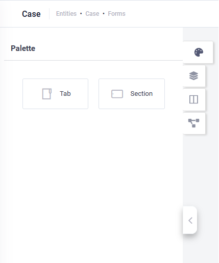

Authors can define simple forms that only show specific entity record data, and complex forms that enable business users to manipulate the data (add new record details, attach files, etc.).

The first form you create for an entity is set as default form for entity records. You can always set another form the default one for a specific entity. The default form will be used both on record entity creation and editing.

> **Info:** If you want to create a form that consumes data from the DRUID Data Services, use the CRUD Template. For more information, see [CRUD Template](Entity%20Data%20Integration.md).

To create a form for an entity, follow these steps:

## Step 1. Add form on entity

1. From the **Solution** drop-down, select the desired solution and on the **Solution Contents** menu, click **Entities**. The page displays the list of entities linked to the current solution.

2. Select the entity for which you added a link in the workspace. The entity configuration page appears on the **Details** tab.
3. Click the **Forms** tab. The list of views created for the current entity appears. If there haven’t been defined any views, the page is empty.

4. At the top-right corner of the page, click the **CreateNewForm** button (). The CreateNewForm pop-up appears.
5. Enter the form name and a brief description. The description will help you easily identify what data the form contains.

6. Click **Save**.

> **Info:** The first form you add on an entity is marked as default; when clicking on a record in one of the entity’s views, DRUID will show record details defined in the default form.

## Step 2. Define the form properties (optional)

On the entity’s forms page, click the Edit icon () displayed in line with the form you want to define. The Form Designer appears. The right side editor displays by default on the **Form properties** ().

If you create forms which contain multi-lingual entity fields, you might want to provide the form **Display name** and **Details** in all languages set on the AI Agent. This way, business users accessing the form in a specific language set on the AI Agent will see the form information (both the form name and description) in that language.

You can also set the form to Open in full screen or make it Read-only (not editable).

After you set the view properties, click the **Save** icon () at the top-right corner of the editor.

## Step 3. Define the form

On the entity’s forms page, click the **Edit** icon () displayed in line with the form you want to define. The Form Designer appears showing a form on the Form Diagram. The form contains a tab (formatted with one column) with an empty section (also formatted with one column).

> **Info:**  The Form Editor has the Palette and right editor collapsed.

A form is comprised of tabs which contain sections. Both tabs and sections can have a column layout (one or multiple columns).

Defining a form means designing the form layout and defining the data that goes into each section (add fields to sections).

> **Info:** For higher efficiency when creating forms, we recommend you to think about how you want to organize the data in the form before defining it.

### Design the form layout

Click the Palette icon (). The Palette contains two elements: **Tab** and **Section**.

The tab element allows you to organize the form data in a way that enables the business users easily navigate through the data that is more relevant for them.

From the Palette, drag the **Tab** element and drop it on the Form Diagram. After adding a tab, design its layout. Click on the tab and in the settings editor, set the tab **Name** and **Display Name**.

If you want to format a tab in a newspaper-style column layout from the **Layout** field, select the desired number of columns.

After you finish adding the form tabs, in each tab, add sections to accommodate your form needs. From the Palette, drag the **Section** element and drop it within the tab(s).

For each section in the tabs design the section layout. In the Form Diagram, click the section and in the settings editor, set the section **Name** and **Display Name**.

If you want to format a section in a newspaper-style column layout from the **Layout** field, select the desired number of columns.

After you finish the sections, you need to define which data goes into each section.

You can reorder sections in a tab by using drag and drop.

### Add fields to sections

To define which data goes into sections means adding fields and relations to sections. You can add multiple fields to a section.

You can add fields and relations to sections:

- Fields of the current entity. To see the current entity fields, on the left pane click the Fields icon ().

- Fields of entities that are referenced by fields (of type Entity) of the current entity. To see the list of entities referenced by fields of type Entity defined on the current entity, click the **Relations** icon (). The list of referenced entities appears. To see an entity’s fields, click the **Plus** icon () in front of it.

To define which data goes into each of the form fields, navigate through the form tabs and follow the procedure described herein to define the sections data:

1. Click on a section.
2. From the left side, based on your needs, click either the **Fields** icon or the **Relations** icon.
3. Drag the desired field from the fields /relations selector and drop it in the section. By default, the data that comes in the field on the form section will be displayed in one column and one row. Also by default, it is available on both desktop and mobile devices and business users can edit the data.
> **Info:** To provide you with a seamless authoring experience, once you add a field to a form section view, it becomes gray in the entity fields and relations editor. Also, if you click on a field in a section (in the Form Diagram), the field is highlighted in green in the fields’ selector.

4. In DRUID 8.18 and higher, you can add a small icon next to a field name or its value in web forms. Choose from a predefined set of icons and customize their color to enhance visual clarity and user experience.

5. You can set the field layout, make it read-only and show on mobile devices or not. For that, in the Form Diagram click on the field and in the right editor set the desired properties.

#### Field Property Description

| Field Property | Description |
| --- | --- |
| Preview file in form (image/video) | **NOTE:** This parameter is available in DRUID 8.6 onwards only for fields of type File.  Select to enable a preview for image and video files directly within a form. Users can preview an image or play a video file without needing to download or open it in a separate application. This enhances usability and improves the user experience when working with file uploads in forms.       |
| View | Select the special view you created to provide your users with more information when clicking on the entity field.  **NOTE:** The **View** field displays on the field layout editor only if the **Data Type** is 'Entity' or 'Entity list'. This field is available in DRUID 5.16 and higher. For backwards compatibility, if you leave this field empty, DRUID will use the default entity view. |
| Column span | Select in how many columns you want to display the field data. The maximum is 3 columns and the default is 1. |
| Row span | Select on how many rows you want to display the field data. The maximum is 3 rows and the default is 1. |
| Control type | The ControlType field property is visible in the field layout editor exclusively when the Data Type is 'String'. This property allows you to configure fields of type String to accommodate input in various languages including HTML, JavaScript, JSON, Markdown, XML, and SQL.  **Info:** If opting for a control type other than the default String, ensure to adjust the Row span accordingly for optimal form display.  **NOTE:** The ControlType is available in DRUID 7.3 and higher.  For fields with the Control Type **HTML**, users can preview the executed HTML code on the forms.     |
| isEditModeDefault | This option is accessible exclusively when the Control Type is set to a value other than 'String'. Selecting **isEditModeDefault** grants users default editing privileges for the field, eliminating the need for them to manually click the Edit icon to input data.   |
| Readonly | Prevent business users from editing the data in this field on the form. For example, the fields of type GUID should be read-only in forms. |
| Hide on mobile | Hide the field on the form when business users access the form on mobile devices. |
| Disable add new record | This setting prevents users from adding new records when they navigate to views by clicking on entity fields of type Entity or Entity List. It’s useful for scenarios where you want users to select from a predefined list (e.g., a drop-down menu) without allowing them to create new records. |
| Disable navigation | Prevent users from navigating to special views when clicking on entity fields of type Entity or Entity List. |

> **NOTE:** In order to nicely render fields on forms by properly setting the fields’ layout, you might want to check [how the different fields are rendered on the views and forms](Fields%20rendering%20on%20views%20and%20forms.md) at usage time.

6. Save the field settings in the section by clicking the **Save** icon at the top-right corner of the right editor.

> **NOTE:**  You can add multiple fields to a section.

> **Info:** You can design forms to provide your business users with the possibility to chat with the AI Agent in the context of the current entity record and also trigger the execution of a specific conversational flow from a set of recommended automations available on the entity form. For information on how to design forms to enable the two features for your business users, see [Enable chat in forms](Enable%20chat%20in%20forms.md) and [Recommend automations on forms](Recommend%20automations%20on%20forms.md).

## Step 4. Define the form data by adding integrations

**Prerequisites**

- In the solution for which you want to get an aggregated view on data coming from various data sources, make sure that you defined integrations with external data sources as best suits your needs.
- As the form provides the details of a record in a view and the view provides a list of records, make sure that on the integrations tasks you define, the entity for which you will define the views are set as response entity and it is a collection (in the integration task, Response tab, **IsResponseCollection** is checked).

Once you defined the form, you need to fetch entity data that will be displayed on the form, by adding integrations with external data sources. This way, your form is populated with the details of a specific entity record.

To define the form data follow these steps:

1. At the top side of the Form Diagram, click the Add Integrations icon ( ). A pop-up appears. The pop-up contains four sections:

- **Create Data** – allows the creation of new entity records (to views).
- **Read Data** – enables data display for specific record ID.
- **Update Data** – allows updating the entity record data.
- **Delete Data** – allows you to define what happens when records are deleted from the form.

> **NOTE:**  If you don’t add an integration to the sections above, users will not able to perform that action on entity records.

2. For all four sections or for the section(s) specific to the action you want to allow on the form, add an integration, following the steps below:

1. Add the integration action by using of the two options below:

- Search for an existing integration action defined in the current solution and press **Enter** on the keyboard.

- Add a new integration action. Click the **Add new** button () and define the connector action using the right editor. Make sure to select the current entity as Response entity and select **Is Response Collection** and **Is Active**.

Save the integration action by clicking the **Save** icon () at the top-right corner of the editor.

> **IMPORTANT!** You can add only one connector action per Integration section and multiple integration tasks to aggregate data coming from various data sources.

2. Add integration tasks. In the section, click on the **Add task** icon and select the desired integration task from the list where the current entity is Response entity and **Is Response Collection** is selected.

3. Click the section and select the integration from where you want to data. This functionality is similar to defining integrations on flows.

You can select from the list of integrations where the current entity is set as response entity and it is a collection (**Response** tab, **IsResponseCollection** is checked).

3. Save the integration(s).

You can now preview the form and make further adjustments if needed.

## Prevent users from editing records

To prevent users from editing records, make the form read-only. In the form configuration page, select **Readonly**.

When viewing a record, all buttons in the form are non-clickable.

## Step 5. Optionally, preview and check the form

The authors can preview a form by clicking on the **Preview** icon displayed at the top side of the Form Diagram.

The form in preview mode opens in a new browser page.

> **Info:** If at the time of the preview, entity records do not exist, or Read Data integration has not been set yet on the form, some fields on the form might be empty or the preview might render null data in preview mode. You can preview the form tabs (if the form has more than one tab) by clicking on them.

Authors and business users can filter the form and see only the fields that are hidden on mobile devices by tapping on **FieldsOnMobile** the at the top-right corner of the page and then clicking **Refresh**.

## Minimize forms while an automation executes in the chat

Users can use the **Minimize form** icon to hide the active form window while a long-running automation executes in the chat. This allows you to monitor real-time updates in the background view without interrupting the automation process.

> **NOTE:** Minimizing the form while an automation is running in the chat is available in Druid 9.17 and higher.
