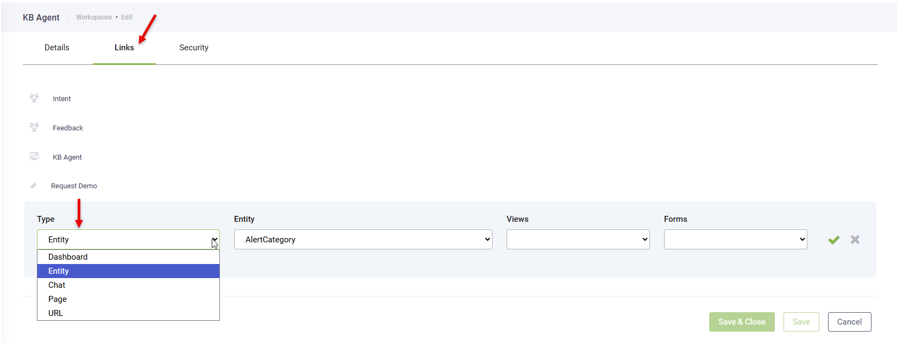


**NOTE:** Users with permissions to create and edit workspaces can create workspaces. For more information, see [Define Security Roles for Business Users](Define%20Security%20Roles%20for%20Business%20Users.md).


This section provides the procedure for creating workspaces as a AI Agent author. The steps might be slightly different based on the security role assigned to your user.

## Step 1. Add workspace

To create a workspace, In Druid Portal follow these steps:

1. From the **AI Agent** menu, select the AI Agent.

2. From the **Workspace** menu, select **Create new workspace**. The Create new workspace page appears.

3. Provide a **Name** and **Initials** for your workspace. Both fields are mandatory. The **Initials** will be used for the workspace icon.
4. Click **Save**. The workspace configuration page appears on the **Details** tab.

5. You can set the style of the workspace icon (background color and font color) using the color selectors.
6. Control the visibility of the webchat widget on web views and forms by using the **Show webchat icon** setting. By default, it is enabled.
7. Save the changes.

## Step 2. Define the workspace menu

Click the **Links** tab. From this section you define your workspace main menu and thus the information that will be accessible to the business users in the workspace. The items within the workspace are subsets of items in the Druid Portal menu. You can add the following items to a workspace:

| Type | Item |
| --- | --- |
| Dashboard | You can add the AI Agent Summary (Dashboard), Live Chat dashboard or a custom dashboard you created.    **NOTE:** The business users who are granted access to the workspace should have read privileges to the Dashboard; otherwise, they won’t be able to see it. |
| Entity | Select a specific entity to make it accessible from the workspace menu. Customize each workspace with a specific view and form to align with different business needs.   |
| Chat | Choose the live chat version to be available in the workspace. Options include Chat and Live Chat. |
| Page | Select the page to be accessible in the workspace. Available pages include:   - LiveChatAgents - LiveChatQueues - Translations     **NOTE:** The business users who are granted access to the workspace should have read privileges for these pages to view them in the workspace. |
| Url | - In DRUID 9.7 and higher, you can add URLs to workspaces.    When business users click a URL in the workspace menu, the corresponding web page opens in their browser. This makes it easier for users to quickly access relevant resources, tools, or documentation directly from the workspace, improving workflow efficiency.   |

Click **Save**.

## Step 3. Define your workspace security

Click the **Security** tab. This page displays only the security roles who have at least one permission to Workspaces. Click the **Used By** section and select the desired security roles.

Druid Portal users who have been assigned with the security roles you select here, will have access permissions to the workspace based on their security role permissions. For information on how to grant access to Workspaces, see [Define Security Roles for Business Users](Define%20Security%20Roles%20for%20Business%20Users.md).
