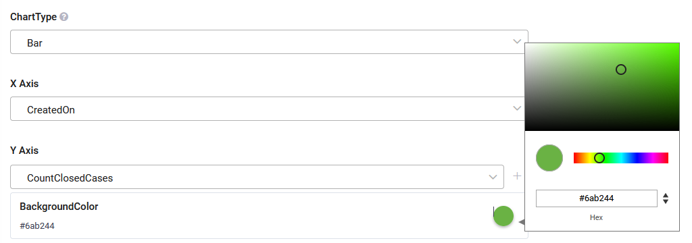
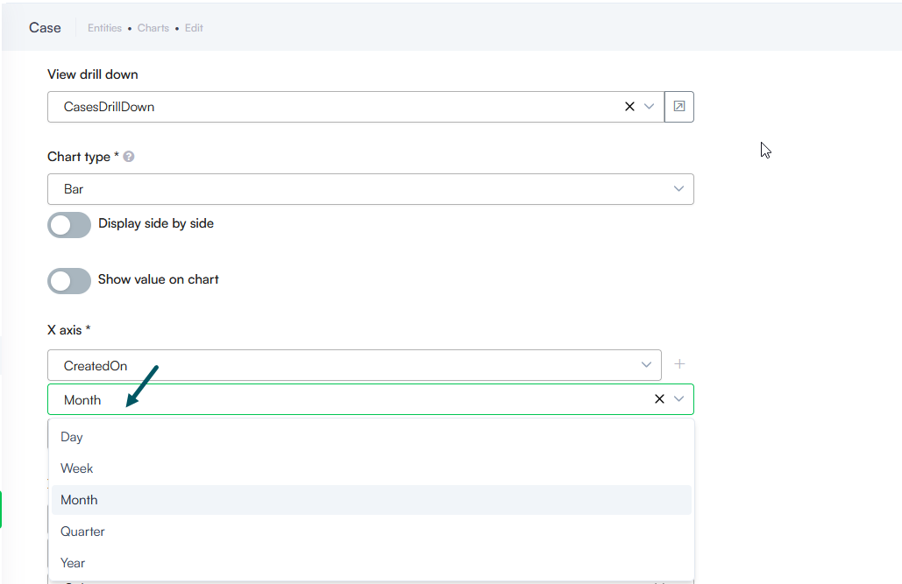

Dynamic charts let you visualize and analyze entity data directly in the Druid Portal, without requiring external tools or custom development.

You can group data across one or multiple dimensions, apply aggregations such as count or percentage, and control how results are filtered and sorted.

This flexibility allows you to build interactive charts that reflect real-time data and support deeper analysis, even for complex scenarios with multiple grouping levels.

## Create dynamic charts

This section outlines the prerequisites and steps for creating dynamic charts.

### Prerequisite

- Ensure that your entity contains a field of type Entity that references the [[PageInfo]] system entity.

### Step 1. Configure the integration for fetching the business entity records

Ensure that the grouping performed in the UI is integrated into the payload. This requires configuring the integration responsible for fetching the business entity records.

Create the integration designated for gathering data for the chart. In the Request section, click **Custom Query** and input the following: **@QueryParam**. Map QueryParam to [[<your request entity>]].PageInfo.QueryText.


**NOTE:** Rather than building dynamic charts from scratch, you can leverage AI Authoring Agents. By launching the Workspace Designer from the Page Help icon, you can describe your chart requirements in natural language to automatically create charts following the Workspace Designer guidance in the chat. For more information, see [AI Authoring Agents](../2_AI%20Agents/AI%20Authoring%20Agents.md#Create3). If you want to manually create a chart, follow the subsequent steps described below.


### Step 2. Create the chart

1. Go to the entity configuration page and click the **Charts** tab. The list of charts created for the current entity appears. If there haven’t been defined any charts, the page is empty.

2. At the top-right corner of the page, click the **Create new chart** button. The Create new chart pop-up appears.
3. Provide a chart name, add a comment and from the **Chart type** drop-down, select the desired chart type.

4. Click the **Save** button.

### Step 3. Configure chart data

In the Charts list, click the edit icon displayed in line with the desired chart. The chart configuration page appears. Its content varies based on the chart type. The configuration page contains chart settings on the left and a chart preview at the right.

Configure the parameters described in the table below.

| Parameter | Description |
| --- | --- |
| Display Name | The Title of the chart, localized. |
| Details | The Subtitle of the chart, localized. |
| Integration | Select the integration you configured at [Step 1](#Step_1). |
| View drill down | Select the special view you created (if any) to allow users click on the chart to get more insights about the information presented in the chart. For information on how to create a special view for this, see [Create special views to drill-down info in Forms and Charts](<https://docs.druidai.com/docs/Content/CBA/Create%20special%20views%20to%20drill-down%20info%20in%20Forms%20and%20Charts.htm>). |
| Chart type | The current chart type. You can change the type. |
| Show value on chart | Toggle this option on to display data labels directly on chart elements, ensuring key values are visible at a glance without requiring a mouse hover. |
| Apply Dashboard Date Filter | Filters data in dynamic charts on the custom dashboards by dashboard date filter. For more information, see [Custom dashboards](../Data%20Analytics%20%26%20Insights/Track%20Business%20KPIs.md)..  **Info:** In Druid versions prior to 9.31, this field name is **Filter By**. |

For chart type specific parameters, refer to the sections below.

#### Defining bar charts and line charts

Bar and line charts have the same specific parameters.

| Parameter | Description |
| --- | --- |
| X Axis | Select the entity field whose values will be shown on the chart’s X axis. |
| Y Axis | Select the entity field whose values will be shown on the chart’s Y axis. |
| BackgroundColor | Set the bars / dots color. To pick up a color, click on the color icon and either use the color picker or enter the color in hex format.  **NOTE:**  If you change the bars/dots color using the Advanced Editor, this color will be overwritten. |
| Function | Select the function you wish to use for grouping the data in the chart. |
| Field | Choose the field by which to group (apply the function to). |

#### Defining pie charts

To define data for a pie chart, follow these steps:

1. In the Legend section, choose the field(s) storing the data to be displayed as the chart legend.
2. In the Data Labels section, select the entity field that serves as the label title when hovering over the pie chart slices.
3. Choose the function for grouping the data in the chart(Count, Sum, Average, Min, Max).
4. Choose the field by which to group (apply the function to).
5. Specify the field for sorting the data.
   When grouping your chart's X-axis by a field of type Entity, you can select exactly which field on the related entity determines the sort order.

#### Configure Chart Filters

The Filters section allows you to narrow down the data displayed in the chart by applying specific condition rules on entity fields, similar to filtering data service integration responses.


**Info:** Filters on dynamic charts are available starting with Druid 9.31.


To add a filter:

1. Scroll to the Filters section at the bottom of the chart configuration page.
2. Click **+ Add**. A new filter row appears.
3. Configure the filter criteria:

- **Field Name**: Select the entity field (or related entity field, e.g., [[Case]].Account.Active) to filter on.
- **Operator**: Select the comparison operator.
- **Value**: Specify or select the target value to compare against.

[<https://druiddocs.file.core.windows.net/docs-shares/Rebranded/DRUID Release Notes_20260910.pdf?sv=2025-07-05&spr=https&st=2026-09-10T08%3A04%3A43Z&se=2030-09-11T08%3A04%3A00Z&sr=f&sp=r&sig=1ewFowo0wiSuEyXdBA8XBpl1WBxoPWd%2FEUfvny8Cr5Q%3D>](<https://druiddocs.file.core.windows.net/docs-shares/Rebranded/DRUID Release Notes_20260910.pdf?sv=2025-07-05&spr=https&st=2026-09-10T08%3A04%3A43Z&se=2030-09-11T08%3A04%3A00Z&sr=f&sp=r&sig=1ewFowo0wiSuEyXdBA8XBpl1WBxoPWd%2FEUfvny8Cr5Q%3D>)

4. Save the chart configuration.

You can add multiple filter conditions to further refine the chart data. To remove a condition, click the delete icon next to the corresponding filter row.

## Create dynamic bar charts with two X-axes

The use of dynamic charts with two X-axes enhances data visualization and analysis capabilities, empowering users to gain deeper insights, make more informed decisions, and effectively communicate findings to stakeholders.

### Benefits of using dynamic charts with two X-axes

- **Comprehensive Analysis**: By plotting data on two x-axes, users can conduct thorough analysis that consider the influence of multiple factors on a given outcome, leading to a deeper understanding of complex relationships within the data.
- **Effective Communication**: Dynamic charts with two x-axes aid in effectively communicating insights to stakeholders by visually presenting the relationships between data in a clear and intuitive manner, facilitating informed decision-making processes.
- **Time-Saving Analysis**: By visualizing two datasets simultaneously on a single chart, users can streamline the data analysis process and save time compared to analyzing each dataset separately, enabling quicker identification of insights and trends.

### Prerequisite

Ensure that your entity contains a field that stores colors.

### Create dynamic charts with two X-axes


**NOTE:** Rather than building dynamic charts from scratch, you can leverage AI Authoring Agents. By launching the Workspace Designer from the Page Help icon, you can describe your chart requirements in natural language to automatically create the chart following the Workspace Designer guidance in the chat. For more information, see [AI Authoring Agents](../2_AI%20Agents/AI%20Authoring%20Agents.md#Create3).


To create a dynamic bar chart with two axes, create a dynamic chart of type bar following the procedure described above. In addition, click the **Plus** icon next to the X axis. Another X-axis section appears that allows you to select the field and function for grouping the data for the second X-axis.

For the second X-axis, select the field that stores colors.

If you opt for a field of type DateTime, you can group the data by a specific time range: Day, Week, Month, Quarter, or Year.

You can apply multiple sorting based on the number of X-axes as you have.


**Info:** Starting with Druid 9.27, when grouping your chart's X-axis by a field of type Entity, you can sort the data by any field of the related entity.



*Example:* A chart displaying the number of cases per status per month.

