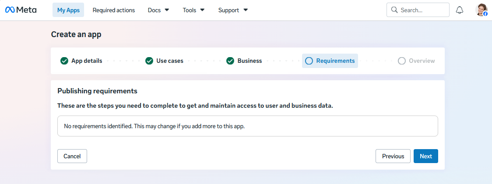

---
layout:
  title:
    visible: false
---

# Instagram

Integrate your Druid AI Agent with Instagram via Facebook. This integration allows you to build an AI Agent once in the Druid Portal and seamlessly deploy it to handle customer interactions on Instagram.

## Prerequisites

Before integrating your AI Agent with Instagram, ensure you have set up the required accounts, assets, and network rules based on your deployment type.

### Accounts & Permissions

- **Facebook page**: You have administrative access to one or more Facebook Pages.
- **Instagram account**: An Instagram Professional account (Creator or Business).

### AI Agent Setup & Data

- **Published** AI Agent: An active, published AI Agent built within the Druid Portal.
- **Facebook page ID**: Locate your Facebook page ID and write it down as you will need it to activate the Instagram channel in the Druid Portal:

1. Open the Facebook page in a browser.
2. Check the browser address bar:

- If the URL contains profile.php?id=123456789, those numbers at the end represent the page ID.
- If the URL includes a username along with numbers (e.g., https://facebook.com/yourname-123456789), the string of digits at the end is the page ID.

### Network Configuration (On-Premises Deployments Only)

**IMPORTANT!** Cloud and hybrid deployments use the Microsoft Bot Framework for Instagram routing. You can configure the channel only if the Bot Framework is enabled on your tenant. If the channel configuration is unavailable – the Post Office is set to BotService (AI Agent Details → General) – contact Druid Support to enable the Microsoft Bot Framework on your tenant. On-premises deployments connect directly to Facebook endpoints.

If running Druid on-premises, ensure your firewall permits traffic to and from the following endpoints:

|  |  |
| --- | --- |
| Outbound | graph.facebook.com |
| Inbound | Druid.BotApp |

## Integration procedure

To integrate an AI Agent with Instagram via Facebook, follow these steps:

### Step 1. Link your Instagram professional account to a Facebook page

1. Log into Facebook and go to your Facebook page.
2. Click the page icon at the top-right corner of the page and select **Settings & Privacy** > **Settings**.
3. On the page menu, scroll down to **Permissions** and click **Linked accounts**.

4. Select **Instagram**.

5. Click **Connect account**.

6. In the Connect to Instagram modal, click **Connect**.

7. Choose Instagram message settings and click **Continue**.

8. Log in with your Instagram account.

9. Add your Instagram profile to your Facebook account.

10. If your Instagram profile is already connected to a different Facebook page, select the new page and click **Confirm**. An Instagram profile can only be connected to one Facebook page at a time.

    
11. Instagram is successfully connected to your Facebook page.

12. Click **Done**.
13. Turn on the **Allow access to Instagram messages in Inbox** toggle.

14. Login using the Instagram account and confirm when prompted.

Continue with creating a Facebook app.

### Step 2: Create a Facebook app

> **NOTE:** The Facebook UI may appear slightly different depending on which version you are using.

1. In your browser, navigate to [Facebook for Developers](https://developers.facebook.com/) and log in.
2. On the toolbar, click **My Apps**. Your Apps page appears.
3. Click the **Create App** button.

The Create an app wizard appears.

4. Enter an **App name** and **App contact email**. Meta uses this email address to send important updates about your application. By default, this field pre-fills with the email address linked to your Meta developer account, but you can change it if needed.

5. Click **Next**.
6. Filter use cases by **Business messaging** and select **Engage with customers on Messenger from Meta**.

7. Click **Next**.
8. Select your business portfolio.

9. Click **Next**.
10. If no publishing requirements are identified, click **Next**; otherwise, follow the on screen instructions.

11. In the Overview step, click **Create app**.

> **Info:** For security reasons, you might be required to re-enter your Facebook password.

After the app creation process completes, the App Dashboard appears.

### Step 3. Get Facebook app details

Get these Facebook app details as you will need them to configure the Instagram channel in the Druid Portal:

1. On the menu, go to **App settings** > **Basic**.
2. Click the **Show** button next to the **App secret**.

3. Enter the password associated to your Facebook account and click **Confirm** twice. The App secret is showed in the field.
4. Copy the **App secret** and the **App ID** and keep them in a safe location as you will need these details later to configure the channel in the Druid Portal.

5. Find out the API version of your app. Go to the **App settings** > **Advanced**and check what the API version is.

Continue the integration setup following subsequent steps.

### Step 4. Customize your app

This section describes how to customize your app:

1. Go to app Dashboard and click **Customize the Engage with customers on Messenger from Meta use case**.

2. Add the following permissions: **instagram\_basic** and **instagram\_manage\_messages**.
> **IMPORTANT!** **instagram\_manage\_messages** subscription is required for handling Instagram user story mentions. Mentioning an Instagram account linked to a AI Agent in a user's story triggers the Welcome flow. The event "story\_mention" is logged in a new system entity field, **[[ConversationInfo]].InstagramEvent**, providing authors with control over subsequent actions by evaluating the condition **[[ConversationInfo]].InstagramEvent == "story\_mention"** within the Welcome flow.

> **Info:** If you encounter an error, attempt to add them a second time.

Wait until permissions are added.

Continue with generating Facebook page access token.

### Step 5. Generate Facebook Page access token

To generate a Facebook page access token:

1. On the app customization page, click **Add or remove Pages** under section **Access tokens**.

2. Confirm that you want to continue with the Facebook account (the one with administrative access to the Facebook page) or log in using another account.

3. Select the target Facebook Pages for app access and click **Continue**.

4. Choose the Instagram accounts for app access.

5. Review app access and click **Save**.

6. Wait until you get confirmation that your Facebook account has been connected to the app, then click **Got it**.

The pop-up closes and the Facebook page appears under the **Access tokens** section.

7. Click **Generate token**.

8. Select **I understand**, then copy the token and keep it in a safe location as you will need it to configure the channel in the Druid Portal.

9. Click **Done** to close the modal.

You can now configure the channel in the Druid Portal.

### Step 6: Activate the Instagram channel in the Druid Portal

1. In the Druid Portal go to your AI Agent settings.
2. Click the **Channels** tab, then search for **Instagram** and click on the card.

The channel configuration modal appears.

3. Enter the **Facebook App ID** and the **Facebook App Secret** (details you copied at [Step 3](#Step_3._Get_Facebook_app_details)).
4. In the **Facebook API Version** field, enter the API version your Facebook app is using (version you checked at [#Step_3._Get_Facebook_app_details](#Step_3._Get_Facebook_app_details)[Step 3](#Step_3._Get_Facebook_app_details)).
   Use the following format: vxx.x (e.g., **v26.0**).
5. Click **+Add page** to add the Facebook page details.
6. Enter the **Facebook Page ID** and **Page Access Token** and click **Save Page**.

> **Info:** If you host the AI Agent (via Facebook app) in multiple Facebook pages, click **+Add page** and enter the Page ID and access token for any subsequent Facebook pages.

7. Copy the **Callback URL** and **Verify Token** and save them in a safe location as you will need them to configure the Facebook app webhooks.

8. Optionally, customize channel display settings as follows:

- **Alias**: Enter a clear, business-friendly display name (e.g., Interactive Messaging). This value is stored in**[[ChatUser]].ChannelDisplayName**, which appears in reporting tools like AI Agent Summary dashboard - Engagement KPIs and can also be referenced in flow business logic.
- **Description**: Enter a brief description. This is particularly helpful when using an alias, as it helps identify the channel's specific purpose within the Druid Portal.
- **Channel Icon**: Upload a custom icon to display on the channel card within the Druid Portal.

9. Click **Publish** to activate the channel. The channel activation might take up to 1 minute.

After the channel activates, the following fields are available in Druid:

- **[[ChatUser]].ChannelId** = "instagram"
- **[[ChatUser]].UserId** - Stores the unique identifier of the Instagram user account.
- **[[ChatUser]].ChannelDisplayName** - Stores the Alias which is used in AI Agent Summary Dashboard > Engagement KPIs > Channel chart.

### Step 7. Configure Facebook app webhooks

To send messages from your AI Agent to Instagram Messenger, you must enable webhooks:

1. Go to the web page with your Facebook app configuration.
2. Under section **Webhooks**, click **Add callback URL**.

3. Enter the **Callback URL** and **Verify Token** you copied when activating the channel (at [Step 6](#Step6ActivatetheInstagramchannelintheDruidPortal)). If you didn't save them, take them from the Druid Portal, Instagram channel configuration modal.

4. Click **Verify and Save**.
5. The Facebook page appears in the Webhooks section but it has no webhook events selected. Click the **Edit Subscriptions** button.

The Edit Instagram Webhook Subscriptions page appears.

6. Select **messages**, **messaging\_postbacks**, **messaging\_handover** and **messaging\_optins** and click **Save**.

7. Click **Subscribe** to activate the webhook subscription for the Facebook page.

Once activated, the webhook events display in the table.

### Step 8. Check your app subscription status to the pages (Optional)

To check your Facebook app subscription status to your Facebook page, under section **Webhook Debugger**, enter your Facebook page ID and click **Submit**.

### Step 9. For testing purposes, add Tester role (Optional)

While your Facebook app is in Development roles, you can test the integration directly in Instagram only by using an account who has been granted the Tester role.

> **Info:** For testing purposes, an account other than the admin account is required to interact with the channel and chat with the AI Agent.

Before testing the integration from Instagram, assign the Instagram Tester role to a Facebook test account:

1. In the main menu, go to **App roles** > **Roles**.
2. Click **Add People**.

3. Select **Tester** and enter the Email / username / Facebook ID of a Facebook account that has been linked to an Instagram account (ensure you have access to this account), then click **Add**.

To get the Facebook ID:

1. Open [Facebook](https://www.facebook.com/) in a web browser and log into your account.
2. Click your profile picture icon in the top-right corner and select your personal profile.

3. Look at the address bar at the top of your browser:

- If the URL displays a username: Copy the text after facebook.com/ (e.g., facebook.com/john.doe).
- If the URL displays a numeric ID: Copy the number after id= (e.g., facebook.com/profile.php?id=1000123456789).

Once added, the account status will show as Pending.

4. To accept the pending invite:
   1. Open [Facebook](https://www.facebook.com/) in a web browser and log into your test account.
   2. Check the **Notifications** bell icon, click on the invite request notification and accept the invite.
   3. Close Facebook web page.
5. Return to the Meta Developer Portal and refresh the Roles page. The status of the Tester account is no longer **Pending**.

You can now test the Instagram integration.

## Test the Instagram Integration

1. Log into Instagram using the personal / tester account you authorized at [Step 9](#Step).
2. Search for your Business Instagram Account (the profile connected to your Facebook page).
3. Send a direct message to the business profile.

The AI Agent will reply with the message set on the **Welcome flow**.

## Publish the Facebook App (Switch from Development to Live Mode)

When your app is in Development mode, only designated Testers can message your AI Agent. To allow any public Instagram user to send direct messages to your AI Agent, you must publish your app.

### Prerequisites before requesting app review

Before submitting your app for review or toggling to Live mode, ensure the following basic app configuration is complete in the Meta Developer Portal:

- **Privacy Policy URL**. Go to **App Settings** > **Basic** and enter a valid, publicly accessible **Privacy Policy** link.
- **Data Deletion Instructions**. In **App Settings** > **Basic**, provide a **Data Deletion Callback URL** or clear instructions page.
- **App Icon & Category**. Add a square app icon ($1024 \times 1024$ px) and choose a category under Basic Settings.
- **Business Verification**. Go to Verification (or Meta Business Suite) to complete Business Verification for your organization. Meta requires this for apps requesting advanced messaging capabilities.

### Official Meta developer documentation references

For further details and direct guidance from Meta, refer to these official resources:

- [Meta App Review Overview](https://developers.facebook.com/docs/app-review). Guides on preparing, submitting permissions, and meeting policy criteria.
- [App Modes & Roles Guide](https://developers.facebook.com/docs/development/build-and-test/app-modes). Explains differences between Development and Live modes, access restrictions, and tester limits.
- [Permissions & Features Reference](https://developers.facebook.com/docs/permissions). Direct specification details for **instagram\_manage\_messages** and related platform permissions.
- [Meta Business Verification Docs](https://developers.facebook.com/docs/development/release/business-verification). Instructions for verifying your Business Manager profile in Meta Business Suite.

## Handle story reactions

To process user reactions to Instagram stories (such as applause or heart reactions), you must configure the **Social media reactions flow** for your AI Agent. If the flow is not assigned, all story reactions are ignored by default. For step-by-step setup details, see [Social Media Reactions Flow](../../4_Flows/Social%20media%20reactions%20flow.md).

## Related Topics

- [Channels](../Channels.md)
