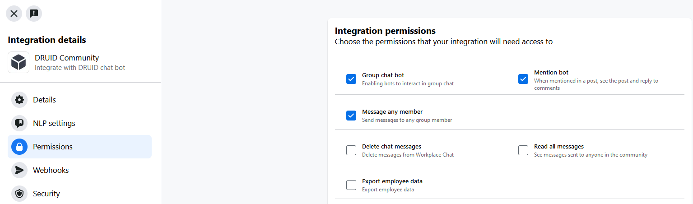

# Workplace

The Druid Portal allows you to create the AI Agent once and deploy it on Workplace by Meta.

### Prerequisites

* You built and published an AI Agent.
* You are the system administrator of a Workplace community account. If you'd like to set up Workplace for your company, you can sign up [here](https://www.workplace.com/).
* For DRUID on premise deployments, make sure that you provide access to/from the necessary messaging endpoints as follows:

|          |                    |
| -------- | ------------------ |
| Outbound | graph.facebook.com |
| Inbound  | DRUID.BotApp       |

To integrate a AI Agent with Workplace, follow these steps:

### Step 1: Create Workplace app and generate access token


**NOTE:** Only System Administrators of a Workplace community can create apps and generate access tokens in that community.


To create a Workplace app, follow these steps:

1. Log in to Workplace using an admin account.
2. From the main menu, click **Admin Panel**. From the **Admin Panel** menu, click **Integrations** and in the Integrations page, click the **Create custom integration** button.

.png>)

A pop-up opens.

3. Enter a name and a brief description for the integration, then click the **Create** button.

.png>)


**Info:** The name you provide your custom integration will be visible to your community users chatting with the AI Agent.



The integration details page appears.

4. Click the **Create access token**. A pop-up appears that contains the access token.

.png>)

5. Click the **Copy** button to copy the access token and save it as you will need it to configure your AI Agent.
6. Read the terms, check **I understand** and click **Done**.
7. Click the icon  to view the App ID and App Secret and copy their values as you will need them to configure your AI Agent.

### Step 2: Configure the AI Agent

1. Log in the Druid Portal and from the main menu, select your AI Agent. The AI Agent configuration page appears by default on the **Details** tab.
2. Click the **Channels** tab, then click **Workplace (by Meta)**. The Workplace Channel Info section expands.
3. Enter the **App ID** , **App Secret** and token you copied from Workspace (the ones you took from your Workspace app available after you created the custom integration) and click **Publish**.

4. Click the **Publish** button. The channel activation might take up to 1 minute. When the channel activation completes, copy the **Callback URL** and **Verify Token** and save them in a file, you will need them at Step 3.

After the channel’s activation, the following fields are available in DRUID:

* **\[\[ChatUser]].ChannelId** = "workplace"
* **\[\[ChatUser]].UserId** - Stores an unique identifier of the Workplace user account.

### Step 3. Set Workplace app permissions

Go to your Workplace app integration details and from the main menu, click **Permissions** and on the Integration permissions page, select **Group chat bot**, **Mention bot** and **Message any member**.

### Step 4: Enable Webhooks

In order to send messages and other events from your AI Agent to Workplace, you must enable webhooks integration. To do so, follow these steps:

1. Go to your Workplace app integration details and from the main menu, click **Webhooks** .
2. On the Configure webhoooks right pane, click on **Page**.
3. Add the **Add Callback URL** and **Verify token** you copied from DRUID.
4. Select **messages** and **messaging\_postbacks**.

.png>)

5. Click the **Save** button.

Now the integration of the AI Agent and your Workplace community is complete.

### Step 5. Talk to your AI Agent

In Workplace, search for the app name and start talking to the AI Agent.

