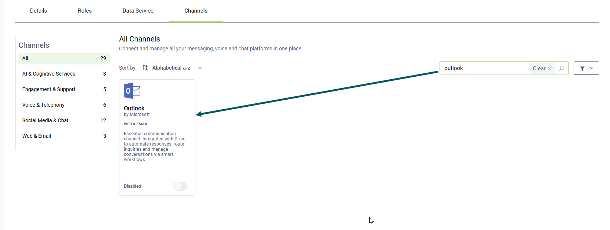
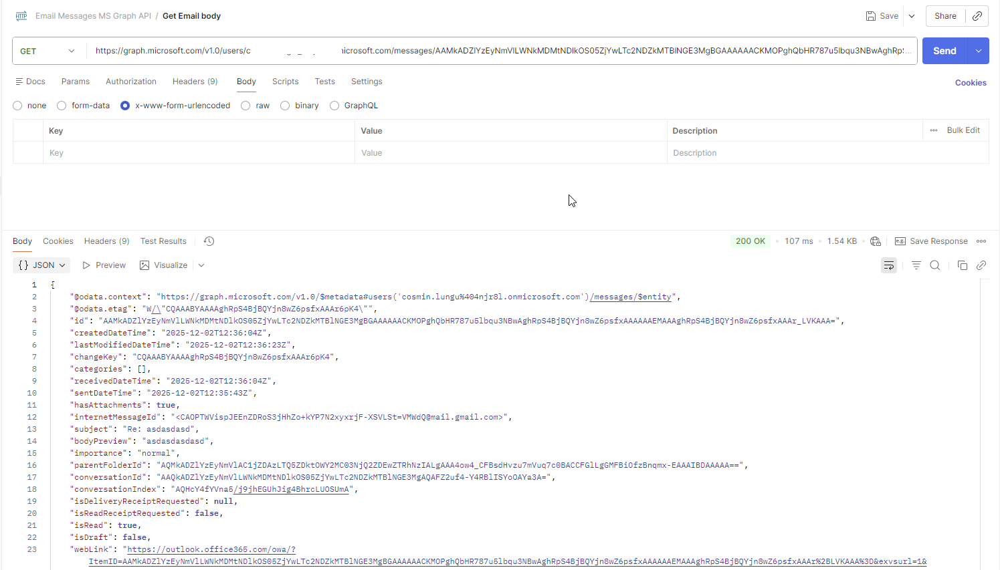

---
layout:
  title:
    visible: false
---

# Outlook

You can configure your AI Agent to communicate with users via email. By configuring your AI Agent to access an email account, it receives a message when a new email arrives. This enables the AI Agent to use email as a channel for responding to user inquiries. In response to a user's email message, the AI Agent could send an email reply.

> **NOTE:**
>
> - The Outlook channel works with Office 365 only. Other email services are not currently supported.
> - This channel is available only in cloud and hybrid Druid deployments. You cannot activate the channel in Druid on-premise deployments.
> - The Outlook channel only supports message steps. Rich content flow steps (such as hero cards or choice steps) are not supported.

> **Info:** The Outlook channel includes an email attachment antimalware scan. If an incoming email contains a corrupted or malicious file, the Flow Engine triggers the conversation using only the safe components (such as the email body and recipients). Details regarding the infected email and the malicious file names are logged in the Conversation History.

> **IMPORTANT!** Unlike chat-based channels (such as WebChat or MS Teams), the Outlook channel does not persist conversation context. Each incoming email starts a new, independent conversation. While the AI Agent can reply to the sender or all recipients, it treats each email as a fresh interaction, regardless of whether it is part of an ongoing email thread.

## Prerequisites

Before you begin the integration process, ensure you have the following:

- A published Druid AI Agent.
- A Microsoft Azure account with permissions to:

- Register applications.
- Grant API permissions.

- A dedicated user email account created in the Azure Portal for the AI Agent to use when sending and receiving emails.
  You can have multiple dedicated email accounts for the AI Agent.
> **IMPORTANT!** The dedicated email account(s) must have a Microsoft 365 license assigned. Without a license, the Outlook channel will not activate — and no error message will be displayed, making this issue difficult to troubleshoot. License assignment cannot be done from the Azure Portal; it must be done from the [Microsoft 365 Admin Center](https://admin.cloud.microsoft/). For instructions on how to assign a license to a user, refer to the [Microsoft documentation](https://learn.microsoft.com/en-us/microsoft-365/admin/manage/assign-licenses-to-users?view=o365-worldwide) on assigning licenses to users.
>
> 

## Configuring the Outlook channel

This section explains how to configure the Outlook channel.

### Step 1. Register Microsoft Azure app

1. Go to the [Azure portal](https://portal.azure.com/) and sign in.
2. In the left-hand navigation pane, select **Azure Active Directory** > **App registrations**.
3. Register an app responsible for the management of the Outlook channel.
4. Go to the app Overview page and copy the **Application (client) ID** and the **Directory (tenant) ID**. You will need them to configure the channel in the Druid Portal.

You can now generate a client secret for your app.

### Step 2. Generate client secret for your Azure app

1. On the main menu, click **Manage** > **Certificates & secrets**.
2. Click on the **Client secrets** tab.

3. Click **+ New client secret**.
4. In the **Description** field, enter a short label (for example, Email secret).
5. In the **Expires** field, choose an expiration period (for example, 6 months, 12 months, or 24 months).
6. Click **Add**. The new client secret will appear in the list.
7. Copy the client secret value immediately. Once you leave the page, the secret value will be hidden and can’t be retrieved again.

You can now configure the API permissions of your Azure app.

### Step 3. Configure the API permissions of your Azure app

1. On the main menu, click **Manage** > **API Permissions**.
2. Click **+ Add a permission**.
3. In the Request API permissions panel, choose **Microsoft Graph**.
4. Select **Application permissions**.
5. Select the following required permissions:

- Mail.Read
- Mail.ReadBasic
- Mail.ReadBasic.All
- Mail.ReadWrite
- Mail.Send
- User.Read
- User.Read.All

6. Click **Add permissions**.
7. The added permissions should now appear under Configured permissions.

If your app uses Application permissions or the permissions require admin consent, you should wait until your admin grants access permissions for your organization.

### Step 4. Configuring the Outlook channel in the Druid Portal

To configure the Outlook channel in the Druid AI Platform, follow these steps:

1. Log in to the Druid Portal and select your AI Agent.
2. Click the **Channels** tab.
3. Search for 'outlook' and click the **Outlook** card.

The channel configuration modal appears.

4. In the **Tenant Id** and **Client Id** fields enter the values you copied from your app Overview page.
5. Turn on the **Treat emails as separate conversations** toggle if you want the AI Agent to treat each incoming email as a new conversation even if the email is a reply to an existing email thread.

- Toggle enabled. Every email—including direct replies—starts a brand-new conversation with a unique Conversation ID.
- Toggle disabled (default). Druid automatically groups direct replies (emails with a "Re:" prefix) under the same Conversation ID to preserve context, while treating new, duplicate emails as separate conversations.

For more information, see [Email Threading and Conversation Grouping](#Email_Threading_and_Conversation_Grouping).

6. Because email interactions over the Outlook channel are naturally asynchronous and occur over longer intervals than chat, you can define independent, channel-specific thresholds for conversation cancellation and termination. These channel-level settings override the global defaults configured in Dialog Management.:

| Setting | Description |
| --- | --- |
| Inactivity cancel conversation flow | Select the flow that customizes the actions taken when a conversation is automatically canceled due to user inactivity. This flow is only triggered when the conversation remains inactive inside an active flow (i.e., at a flow step awaiting user input, such as Prompts, Hero Cards, Choices, etc.). |
| Flow timeout (min) | Specifies the exact number of minutes the system will wait for user input at a flow step before automatically canceling the active flow execution and triggering the Inactivity cancel conversation flow. |
| Inactivity end conversation flow | Select the flow triggered when prolonged inactivity occurs both inside a flow and in "idle" mode (outside any conversational flow). This can be used to automatically gather user feedback a certain time after a conversation has stalled, or to completely refresh and reset the conversation state. |
| Conversation timeout (min) | Specifies the total number of minutes of global inactivity (covering both active flow states and idle states) the system waits before declaring the session completely timed out and triggering the Inactivity end conversation flow. |

> **Info:** These channel-specific thresholds for conversation cancellation and termination are available starting with Druid 9.25.

7. In the **Email address** field, enter the dedicated email account created in the Azure Portal for the AI Agent. If you want to add multiple email addresses for the AI Agent, click the **+** icon and enter the email address.
> **IMPORTANT!** The email account(s) entered here must have a Microsoft 365 license assigned. If the license is missing, the channel will not activate, and no error message will be shown. License assignment is not available from the Azure Portal — it must be managed exclusively through the [Microsoft 365 Admin Center](https://admin.cloud.microsoft/). For instructions on how to assign a license to a user, refer to the [Microsoft documentation](https://learn.microsoft.com/en-us/microsoft-365/admin/manage/assign-licenses-to-users?view=o365-worldwide) on assigning licenses to users.

> **NOTE:** Do not enter your own personal email account, as every message sent to that email account will be forwarded to the AI Agent. This can result in the AI Agent inappropriately sending a response to a sender. For this reason, AI Agent should only use dedicated M365 email accounts.

8. Click the **Publish** button. The channel activation might take up to 1 minute.

After the channel activates, Druid automatically provisions the following [[ChatUser]] parameters in the conversation context:

- **[[ChatUser]].ChannelId** = "outlook"
- **[[ChatUser]].UserId** - Stores the email address of the sender.

The following metadata is available in the conversation context: **[[ConversationInfo]].Email.Id**, **[[ConversationInfo]].Email.DateTimeSent**, **[[ConversationInfo]].Email.From**, **[[ConversationInfo]].Email.To**, **[[ConversationInfo]].Email.Cc**, **[[ConversationInfo]].Email.Subject**, **[[ConversationInfo]].Email.Body** and **[[ConversationInfo]].Email.Attachments**.

## Control Email Reply and Forward Behavior

You can manage how the AI Agent replies to or forwards incoming emails using fields in the [[Email]] system entity.

### Reply Behavior

The **ReplyToAll** field controls whether the AI Agent replies to all original recipients or only to the sender.

By default, the reply is sent to everyone in the original To and Cc fields.

To send the reply only to the address in the **[[Email]].From** field, set `[[Email]].ReplyToAll = false`.

### Forwarding Emails

The **ForwardTo** field controls whether the AI Agent forwards the incoming email instead of replying.

To forward the email, populate **[[Email]].ForwardTo** with one or more destination email addresses. Separate multiple addresses with a semicolon (;) and no spaces.

> **NOTE:** When the **[[Email]].ForwardTo** field is populated, forwarding takes priority over the **[[Email]].ReplyToAll** setting. The AI Agent forwards the message and does not generate a reply.

When the AI Agent forwards an email:

- The subject is prefixed with FW.
- The forwarded message includes the original recipients, subject, and date and time at the top of the email body.
- A system entry appears in the conversation history (Email forwarded to <recipients>).
- Forwarding creates a new email thread. If someone replies to the forwarded email, a new Conversation ID is generated.

The **[[Email]].IsForwarded** field indicates whether the incoming email was originally forwarded.

## Move Emails to Specific Outlook Folders

By default, all emails received by the AI Agent are placed in the **Inbox** folder. To move an email message to a different Outlook folder, you must use the Microsoft Graph API via REST integrations. The process requires first obtaining an access token, then identifying the target folder, and finally executing the move operation.

The following steps outline the required REST API calls:

### Step 1. Get Access Token

Use a `POST` request to the Microsoft Online token endpoint to acquire an **access\_token**.

| Request | Detail |
| --- | --- |
| Method | POST |
| URL | https://login.microsoftonline.com/<TENANT\_ID>/oauth2/v2.0/token |
| Header | Content-Type: application/x-www-form-urlencoded |
| Body (Form Data) | **client\_id**=<CLIENT\_ID>  **client\_secret**=<CLIENT\_SECRET>  **grant\_type**=client\_credentials  **scope**=https://graph.microsoft.com/.default |

Copy the access token.

### Step 2. Get Folder List

Use a `GET` request to retrieve the mail folder list in the root folder for the AI Agent mailbox, **excluding hidden folders**. You need the unique **id** property of the target folder to use as the **destinationId** in the move request.

| Request | Detail |
| --- | --- |
| Method | GET |
| URL | https://graph.microsoft.com/v1.0/users/<AI Agent email address>/mailFolders |
| Header | Authorization: Bearer token <access\_token> |

> **NOTE:** You can also move emails to a hidden folder; however they are not listed by default in the response. To include hidden mail folders in the response, use the following URL in the request:
>
> https://graph.microsoft.com/v1.0/users/<email address>/mailFolder/?includeHiddenFolders=true.

Copy the id of the folder where you want to move the email(s).

> **Info:** If a collection exceeds the default page size (10 items), the `@odata.nextLink` property is returned in the response to indicate more items are available and provide the request URL for the next page of items.

### Step 3. Move Email to Folder

Use a `POST` request to move the message by providing the email's unique ID ([[Email]].Id) and the destination folder's ID.

| Request | Detail |
| --- | --- |
| Method | POST |
| URL | https://graph.microsoft.com/v1.0/users/<AI Agent email address>/messages/<MESSAGE\_ID>/move.  Replace <MESSAGE\_ID> with the ID of the email you want to move. This value is stored in **[[Email]].Id**. |
| Header | Authorization: Bearer token <access\_token>  Content-Type: application/json |
| Body (Json) | { "destinationId": "<FOLDER\_ID>" }  Replace <FOLDER\_ID> with the ID you copied at Step 2. |

## Get Extended Email Metadata to Use From Outside the Conversation

By default, the following [[Email]] metadata is available in the conversation context: **Id**, **DateTimeSent**, **From**, **To**, **Cc**, **Subject**, **Body** and **Attachments**. You can use this metadata in web views and forms (or third-party tools) to fetch, display, or manipulate the original email.

There are situations when you need to manipulate additional email metadata that is not available in the conversation context.

Typical use cases include:

- Displaying the full message or attachments in a web view/form.
- Populating form fields with the message content.
- Automating message classification or tagging.
- Downloading, modifying, or re-uploading attachments.

To retrieve all available email metadata from the Microsoft Graph API, you can use a `GET` request by providing the email's unique ID (stored in [[Email]].Id).

| Request | Detail |
| --- | --- |
| Method | POST |
| URL | https://graph.microsoft.com/v1.0/users/<AI Agent email address>/messages/<MESSAGE\_ID>.  Replace <MESSAGE\_ID> with the ID of the email you want. This value is stored in **[[Email]].Id**. |
| Header | Authorization: Bearer token <access\_token>  Content-Type: application/json |

You can use the returned JSON data in your integrations to accommodate your needs.

## Email Threading and Conversation Grouping

> **Info:** This feature is available starting with Druid 9.27.

To align with standard Microsoft Outlook behavior, the Druid Outlook channel intelligently analyzes incoming emails to determine whether they belong to an ongoing thread or represent a brand-new inquiry.

This grouping logic depends on the state of the **Treat emails as separate conversations** setting:

### When "Treat emails as separate conversations" is OFF (Default)

Druid automatically preserves the conversational context of ongoing exchanges while keeping unrelated emails isolated:

- **Email replies (grouped)**. If an incoming email is a reply to an existing exchange—indicated by a case-insensitive "Re:" prefix in the subject line—Druid strips the "Re:" prefix. It then checks the database for an existing message with the same cleaned subject, sender, and recipient. If a match is found, the new email is placed under the same Conversation ID, preserving the context of the original email.
- **New duplicate emails (separated)**. If a sender sends multiple completely new emails with the exact same subject line to the AI Agent(without replying to an existing message), they are treated as entirely different threads. Each message receives a unique Conversation ID in the Conversation History.

### When "Treat emails as separate conversations" is ON

- **No thread grouping**. Every single incoming email—including direct replies—is treated as an isolated, independent interaction.
- **Fresh context**. A new Conversation ID is generated for every incoming message, and context is not carried over from previous emails.

Regardless of your threading settings, platform inactivity management rules (such as the cancel inactivity flow and end inactivity flow) will continue to trigger and execute as expected across email sessions.
