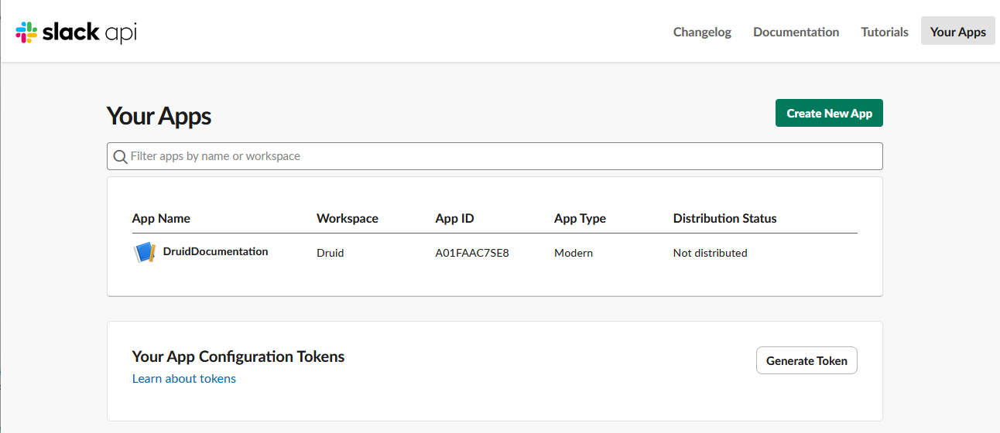
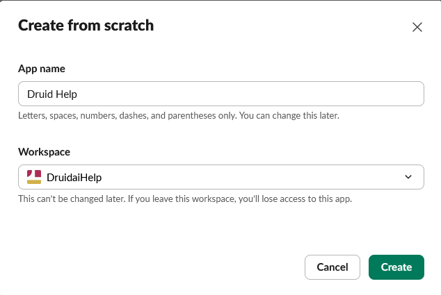
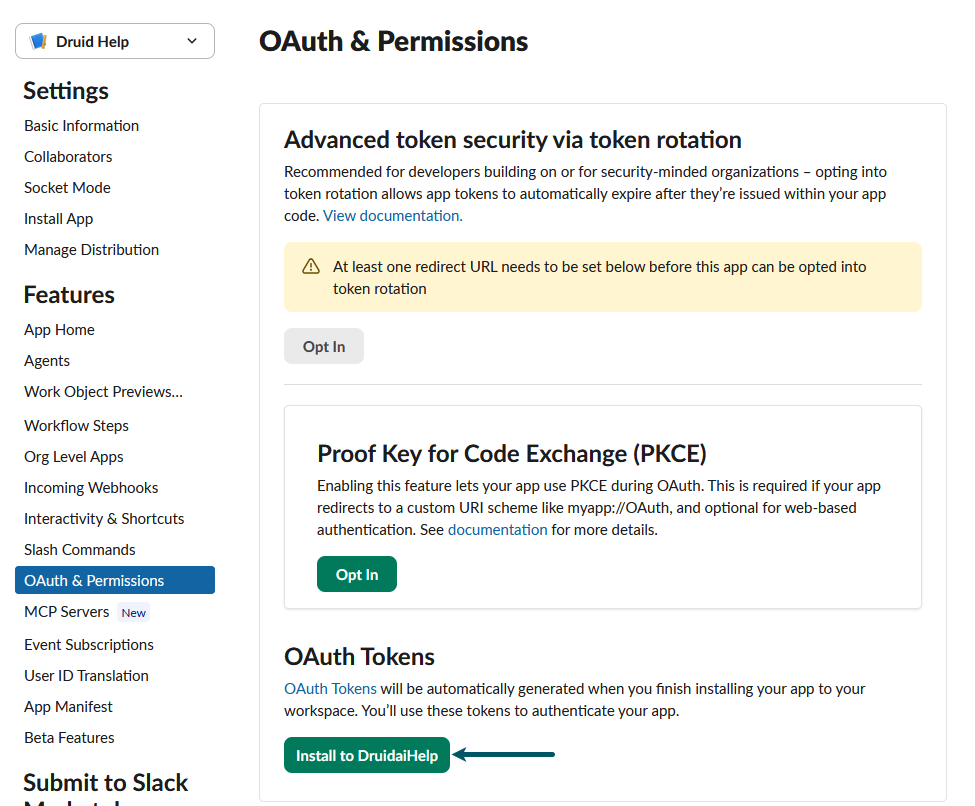
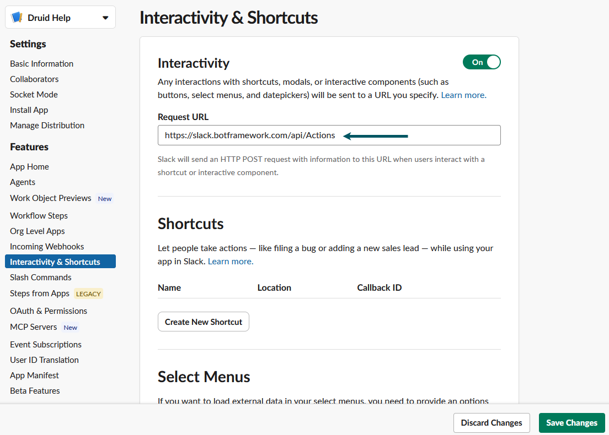
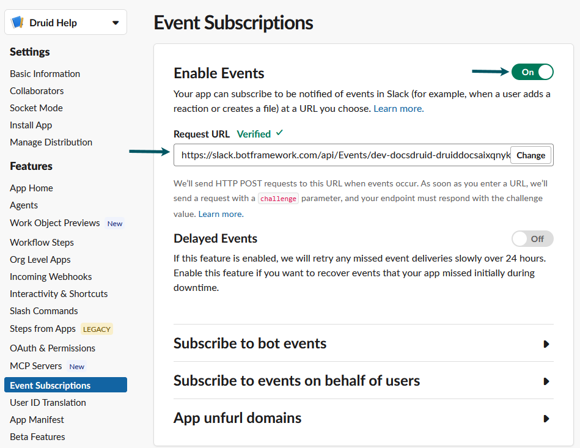
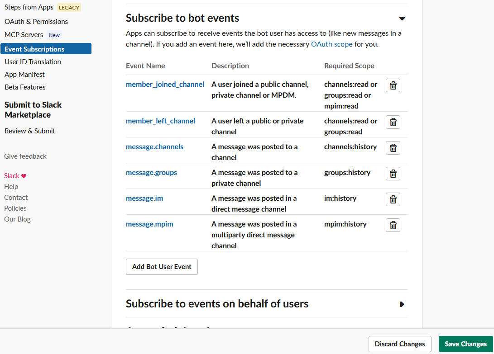

Integrating your AI Agent with Slack enables users to interact with your agent directly within their daily Slack channels, groups, and direct messages. By deploying your AI Agent to Slack, you can automate workspace workflows, answer user queries, and streamline team communication—all built once in the Druid Portal and deployed seamlessly.

This guide walks you through configuring a Slack application, retrieving API credentials, and linking your AI Agent to your Slack workspace.


**NOTE:** Slack channel integration is not supported for Druid on-premises deployments.


## Prerequisites

- You built and published an AI Agent.
- You have a Slack account.

## Integration procedure

To integrate an AI Agent with Slack, follow these steps:

### Step 1: Create a Slack application for your AI Agent

1. In your browser, sign in [Slack](https://slack.com/signin#/signin).
2. Navigate to [Your Apps](https://api.slack.com/apps) panel.

3. Click **Create New App** or **Create an App** (if you have no other apps). A pop-up appears.
4. Choose how you want to configure your app scopes and settings.

We choose to configure from scratch (blank app). If you choose to configure from an app manifest, skip step 5.

A new pop-up appears.

5. In the **App Name** field, enter the name of your Slack application.
6. From the **Workspace** drop-down, select the name of your development team. If you are not already a member of a Development Slack Team, [create or join one](https://slack.com/intl/en-ro/).

7. Click **Create**. The OAuth & Permissions page appears.If your app needs special scopes, follow step 2.

### Step 2. (Optional) Add special scopes and generate Bot User OAuth Token

A Slack app capabilities and permissions are governed by the scopes it requests.

If your Slack app needs special scopes, which require Bot OAuth Token (which will be used in Druid in Slack channel configuration), for example to transmit Microsoft files, you need to define the specific bot token scopes and generate OAuth Token for Your Workspace.

To do so, follow these steps:

1. Scroll down to the **Scopes** section and under Bot Token Scopes, click the **Add an OAuth scope** button.
2. Select the desired scope(s) (e.g., files:read).

   
3. Scroll up to section **OAuth Tokens** and click the **Install to <your workspace>** button.

4. Allow the app to access your workspace.

5. Copy the **Bot User OAuth Token** that was automatically filled in, .


**IMPORTANT!** If you add new Bot Token Scopes to the app, you scroll up to section OAuth Tokens for Your Workspace and click **Reinstall to <workspace>** in order for the new scopes to have effect. The **Bot User OAuth Token** remains unchanged.


### Step 3. Get the Slack app basic Information

1. On the **Settings** menu, click **Basic Information**.
2. Copy the **Client ID**, **Client Secret** and **Signing Secret**, you will need them at Step 4.

### Step 4. Activate the Slack channel in Druid Portal

1. In the Druid Portal go to your AI Agent settings.
2. Click the **Channels** tab, then search for **Slack** and click on the channel card.
3. Enter the **Client Id**, **Client Secret** and **Signing Secret** of your Slack app, the one copied at [Step 3](#Client_ID%2C_Client_Secret_and_Signing_Secret).
4. (Optional!) If you want your AI Agent to perform actions that require Bot OAuth Token, in the **Bot User OAuth Token** field, enter the value copied from Slack app at [Step 2](#Step_2).

5. Optionally, customize channel display settings as follows:
   - **Alias**: Enter a clear, business-friendly display name (e.g., Interactive Messaging). This value is stored in**[[ChatUser]].ChannelDisplayName**, which appears in reporting tools like AI Agent Summary dashboard - Engagement KPIs and can also be referenced in flow business logic.
   - **Description**: Enter a brief description. This is particularly helpful when using an alias, as it helps identify the channel's specific purpose within the Druid Portal.
   - **Channel Icon**: Upload a custom icon to display on the channel card within the Druid Portal.
6. Click **Publish** to activate the channel. The channel activation might take up to 1 minute.
7. When the channel is enabled, click on the channel card.

8. The **OAuth & Permissions Redirect URL**, **Event Subscription Request URL** and **Interactivity Request URL** fields are automatically filled in. Copy the three values, you will need them at Step 5.

After the channel’s activation, the following fields are available in Druid:

- **[[ChatUser]].ChannelId** = "slack"
- **[[ChatUser]].UserId** - Stores an unique identifier of the Slack user account.
- **[[ChatUser]].ChannelDisplayName** - Stores the Alias which is used in AI Agent Summary Dashboard > Engagement KPIs > Channel chart.

### Step 5. Configure your Slack app

#### Add a new redirect URL

1. In [Slack](https://slack.com/signin#/signin), navigate to [Your Apps](https://api.slack.com/apps) panel and click on your app.
2. On the **Features** menu, click **OAuth & Permissions** and scroll down to section **Redirect URLs**.
3. Click **Add new Redirect URL**.
4. In the box, enter the **OAuth & Permissions Redirect URL** copied from the Druid Portal (at [Step 4](#Step_4)).
5. Click **Add**, then click **Save URLs**.

#### Set up the app interactivity in messages

1. On the **Features** menu, click **Interactivity & Shortcuts** and tap on **Interactivity**.

**Info:** If **Socket Mode** is enabled, disable it and set up the Request URL for your app. The Socket Modes is intended for internal apps that are in development or need to be deployed behind a firewall.


2. In the **Request URL** field, enter the following URL: https://slack.botframework.com/api/Actions. This is the Interactivity Request URL automatically generated in Druid after you published the Slack channel. The value is generic for all AI Agents.

3. Click **Save Changes**.

#### Subscribe to Bot Events

By subscribing to bot events, your app will be notified of user activities at the URL you specify.

Follow these steps to subscribe to six specific bot events:

1. On the Features menu, click **Event Subscriptions**.
2. Tap on **Enable Events**.
3. In Request URL, enter the **Event Subscription Request URL** copied from the Druid Portal (at [Step 2](#Event_Subscription_Request_URL)).

4. Click on **Subscribe to bot events**.
5. Click **Add Bot User Event**, then search for and select these six event types:

- member\_joined\_channel
- member\_left\_channel
- message.channels
- message.groups
- message.im
- message.mpim

6. Save the changes.

As you add events in Slack, it lists the scopes you need to request. The scopes you need will depend on the events you subscribe to and how you intend to respond to them. For Slack supported scopes, refer to [Scopes and permissions](https://api.slack.com/scopes). See also [Understanding OAuth scopes for AI Agents](https://api.slack.com/tutorials/understanding-oauth-scopes-bot).


**IMPORTANT!** If you set up special scopes on the app which use Bot User Oauth Token, after you subscribe to events, the following message appears at the top of the page: "You’ve changed the permission scopes your app uses. Please **reinstall your app** for these changes to take effect (and if your app is listed in the Slack App Directory, you’ll need to resubmit it as well)".
For Bot events subscriptions to take effect, in that message click the **reinstall your app** link. **Allow** the Slack app to access your workspace.



#### Allow Messages & Slash Commands

Enable direct messaging and slash command functionality in your Slack app so users can interact with your Druid AI Agent directly from the **Messages** tab.

1. On the **Features** menu, click **App Home**.
2. Scroll down to the **Show Tabs** section.
3. Under **Messages Tab**, select the **Allow users to send Slash commands and messages from the messages tab** checkbox.

### Step 6. Add app to Slack workspace

1. On the Features menu, click **OAuth & Permissions**.
2. Under the OAuth Tokens section, click **Reinstall to <workspace>**.

3. Allow the Slack app to access your Slack workspace.

Based on your workspace configuration, an additional confirmation of the AI Agent Slack integration might be needed:

1. In the Druid Portal, go to your AI Agent setting and click the **Channels** tab.
2. Search for **Slack** and click on the channel card.
3. Click the Slack logo at the top-left of the modal.
4. Sign in to your Slack workspace.
5. Check what your AI Agent will be able to view and do, then click **Allow**.

## Talk to the AI Agent in Slack channels

To talk to the AI Agent in a Slack channel, you need to add the AI Agent to the channel:

1. Select the Slack Channel.
2. Right-click on it and select **Channel details** > **View channel details**.

3. Click the **Agents & apps** tab.
4. Click **Add agent or app**.

5. Select the Slack app you created to the AI Agent integration.

6. Close the modal.

To interact with the AI Agent in a Slack channel, start your message with **@**<AI Agent name> to ask the AI Agent something. This will create a thread within the channel where you can continue the conversation.

Each thread has a unique conversation ID in Druid that stores the thread conversation in the Conversation History.


**NOTE:** When a user initiates a conversation with the AI Agent, the Welcome flow will be automatically triggered. Regardless of the user's subscription status to the AI Agent channel, the welcome message will be promptly sent to the user, ensuring a seamless and engaging interaction experience.

