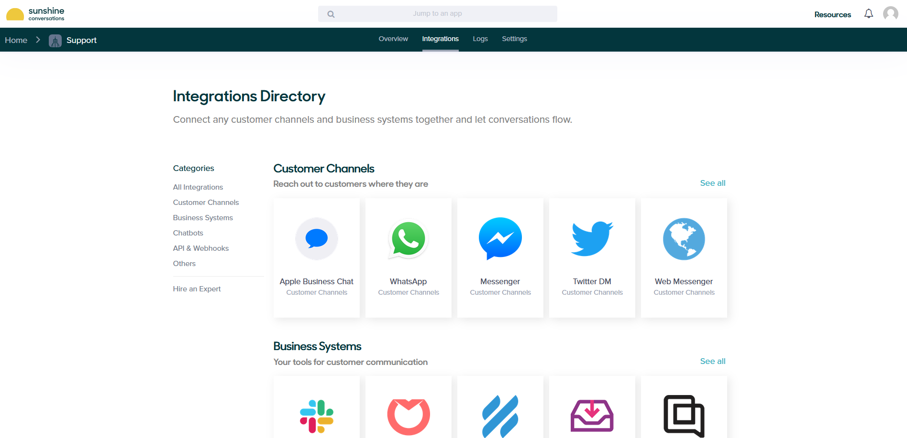
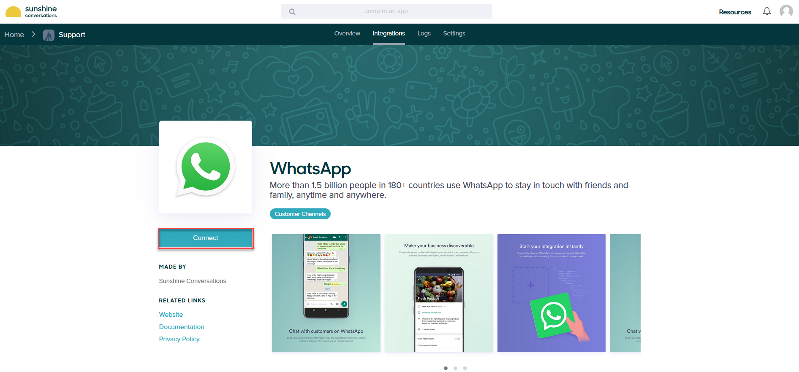

---
layout:
  title:
    visible: false
---

# Sunshine (Old Sunshine Conversations apps)

The Druid Portal allows you to create the AI Agent once and deploy it to Sunshine Conversations apps in the WhatsApp channel.

This section describes how to integrate a AI Agent with old Sunshine Conversations app for WhatsApp in a sandbox environment.

**Prerequisites**:

- You built and published an AI Agent.
- You have an account on [Sunshine Conversations platform](https://app.smooch.io/login). If you haven't got one, create it.
- For DRUID on premise deployments, make sure that you provide access to/from the necessary messaging endpoints as follows:

|  |  |
| --- | --- |
| Outbound | See details here: [https://docs.smooch.io/guide/regions/](https://docs.smooch.io/guide/regions/). |
| Inbound | DRUID.BotApp |

## Step 1. Create Sunshine Conversation App

1. Log into Sunshine Conversations platform and click the **Create new Sunshine Conversations** app button.

2. Enter the name of the Sunshine Conversations app and click the **Create App** button.

Your app overview page appears.

3. Click the **Connect channels** button.

The Integrations page appears.

> **NOTE:** While Sunshine Conversations allows integrations with multiple applications, Druid currently supports only the integration via the WhatsApp channel.

4. Click **WhatsApp**. The WhatsApp channel integration page appears.
5. Click the **Connect** button.

The WhatsApp integration mode page appears.

> **Info:** If you want to activate the channel in a production environment, click the **Production** tab and follow the on-screen instructions.

6. Click **Activate Sandbox**. The Sandbox Settings appear on the page.

7. Join the Sandbox by either sending 'modern mockingbird' to +1 (438) 476-3261 in WhatsApp or by scanning the QR code provided on the screen. After you successfully scan the QR code and send the message, your phone number appears in the Sandbox Settings section.

## Step 2: Enable Webhooks

> **Info:** Before enabling a webhook in Sunshine, go to Druid Portal, select the AI Agent, go to the Sunshine channel and copy the **Webhook Inbound URL**, you will need it in Sunshine.
>
> 

To enable the AI Agent webhook in Sunshine Conversations platform, follow these steps:

1. At the top of the page, click the **Integrations** tab.
2. Scroll down to the API & Webhooks section and click **Webhooks**. The Webhooks page appears.
3. Click the **Connect** button on the left.

4. Click the **Create a webhook** button.

The Create a webhook page appears.

5. In the **Webhook URL** field, paste the **Webhook Inbound URL** you copied from Druid.
6. Tick **Conversation message** as **Basic Triggers** and click the **Create webhook** button.

A webhook is created for the target Druid Webhook Inbound URL.

## Step 3. Get webhook and app details from Sunshine Conversations

From the Webhooks page, copy the value of the Secret.

At the top of the page, click the **Settings** tab. Create new API Key. Copy the **App ID**, the API key **ID** and **Secret**.

## Step 4. Activate the Sunshine channel in Druid

1. Log in the Druid Portal and from the main menu, select your AI Agent. The AI Agent configuration page appears by default on the **Details** tab.
2. Click the **Channels** tab, then click **Sunshine Platform (by Zendesk)**. The Sunshine Platform (by Zendesk) Info section expands.
3. Enter the **App ID**, Webhook Secret, the API key ID and Secret you copied in the Sunshine Conversations platform and in the **Sunshine URL** field, enter [https://app.smooch.io](https://app.smooch.io/).
4. Click the **Publish** button. The channel activation might take up to 1 minute.

After the channel’s activation, the following fields are available in DRUID:

- **[[ChatUser]].ChannelId** = "zendesk"
- **[[ChatUser]].UserId** - Stores the unique identifier of the Sunshine user account.

## Step 5. Talk to your AI Agent

You can talk to the AI Agent in WhatsApp by sending messages to the phone number associated with the WhatsApp channel in the Sunshine Conversations Platform (the one in WhatsApp settings).

