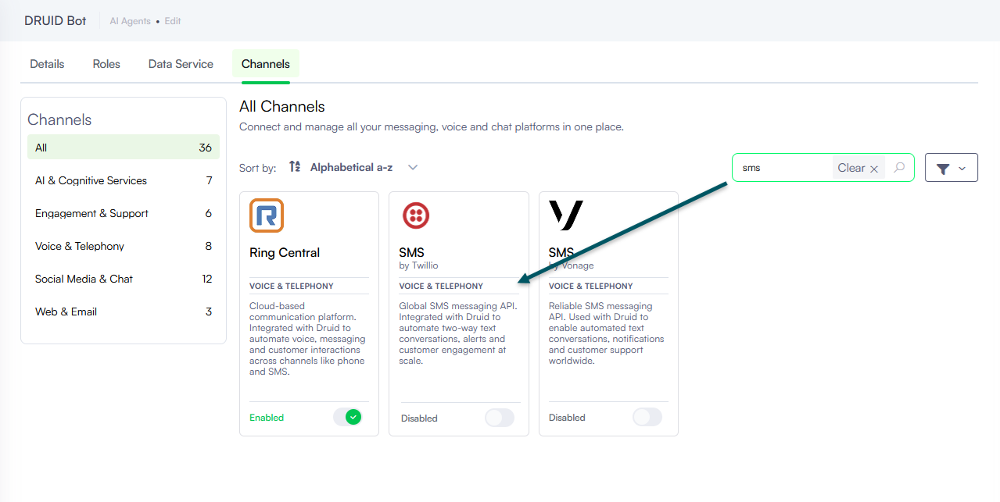

<a id="TwilioSMS"></a>


Integrate Druid AI Agents with Twilio SMS to enable customers to start and conduct conversations with AI Agents through standard SMS text messaging.


**NOTE:** Twillio SMS channel integration is not available in Druid on premise deployments; you cannot activate the channel.



**IMPORTANT!** During initial user interaction, the Welcome flow triggers automatically. The intent prediction for the first user message is bypassed to ensure a consistent onboarding message.


<a id="Prerequisites"></a>

## Prerequisites

Before configuring the Twilio SMS channel, ensure the following requirements are met:

- A valid Twilio account (Trial or Paid) with permissions to manage phone numbers and TwiML applications. If you are new to Twilio [create a free account](http://www.twilio.com/) now. You can review the [features and limitations of a free Twilio account](https://www.twilio.com/docs/usage/tutorials/how-to-use-your-free-trial-account).
- An active, published AI Agent built within the Druid Portal.

<a id="Integrationprocedure"></a>

## Integration procedure

To integrate an AI Agent with Twillio SMS, follow these steps:

<a id="Step1ConfigureaTwilioPhoneNumber"></a>

### Step 1. Configure a Twilio Phone Number

Log into the [Twilio Console](https://twilio.com/console) and obtain or select an SMS-enabled phone number:

- **Trial Accounts**: Click **Get a Twilio phone number** on the console dashboard to generate an active phone number automatically.


A phone number becomes automatically active for the AI Agent to use.


- **Paid Accounts**: Navigate to **Phone Numbers** > **Manage** > **Buy a number**. Filter by country, select SMS under capabilities, and choose an available phone number. If you’d like to request a number from your region, you can enter your area code in the **Number** field. Click the **Search** button to see what numbers are available, and then click **Buy** for the number that you like from the results.


Complete the purchase and close the dialog.

<a id="Step2RetrieveTwilioAccountDetails"></a>

### <a id="Step"></a>Step 2. Retrieve Twilio Account Details

1. In the Twilio Console dashboard, scroll down to the Account Info section.
2. Copy and securely store the following values as you need them to configure the channel in the Druid Portal:

- Account SID
- Auth Token
- Twilio Phone Number (My Twillio phone number)


<a id="Step3ActivatetheTwillioSMSchannelintheDruidPortal"></a>

### Step 3. Activate the Twillio SMS channel in the Druid Portal

1. In the Druid Portal go to your AI Agent settings.
2. Click the **Channels** tab, then search for **SMS** and click on the **SMS (by Twillio)** card.



The channel configuration modal appears.

3. Enter the **Phone number**, **Account SID**, and **Access Token** (Auth Token) retrieved from the Twilio Console.
4. Turn on the **Enable operational message status endpoint** toggle to receive real-time message delivery status callbacks from Twilio. This allows DRUID to log whether outbound messages were successfully delivered, queued, or failed.
5. Optionally, customize channel display settings as follows:

- **Alias**: Enter a clear, business-friendly display name (e.g., Interactive Messaging). This value is stored in**[[ChatUser]].ChannelDisplayName**, which appears in reporting tools like AI Agent Summary dashboard - Engagement KPIs and can also be referenced in flow business logic.
- **Description**: Enter a brief description. This is particularly helpful when using an alias, as it helps identify the channel's specific purpose within the Druid Portal.
- **Channel Icon**: Upload a custom icon to display on the channel card within the Druid Portal.

6. Click **Publish** to activate the channel.

After the channel activates, the following fields are available in Druid:

- **[[ChatUser]].ChannelId** = “sms”. It identifies the channel.
- **[[ChatUser]].Phone** – Stores the user’s phone number.
- **[[ChatUser]].CalleePhoneNumber** – Stores the AI Agent phone number.
- **[[ChatUser]].ChannelDisplayName** - Stores the Alias which is used in AI Agent Summary Dashboard > Engagement KPIs > Channel chart.

<a id="Step4CreateaTwiMLApp"></a>

### Step 4. Create a TwiML App

1. Return to the Twilio Console.
2. Navigate to **Phone Numbers** > **Manage** > **TwiML apps**.
3. Click **Create new TwiML App**.
4. Enter a friendly app name (for example, DRUID App).
5. Under **Messaging Configuration**, enter the following endpoint in the **Request URL** field:

**Request URL**

```
https://sms.botframework.com/api/sms
```


6. Click **Create**.

<a id="Step5ConfiguretheTwiMLApponyourTwilioPhoneNumber"></a>

### Step 5. Configure the TwiML App on your Twilio Phone Number

1. Navigate to **Phone Numbers** > **Manage** > **Active numbers** and select the active phone number.
2. Scroll to **Messaging Configuration.**
3. Set **Configure with to TwiML app**.
4. Set **TwiML App** to the application created in Step 4.


5. Click **Save configuration**.


**NOTE:** When a user initiates a conversation with the AI Agent, the Welcome flow will be automatically triggered. Regardless of the user's subscription status to the AI Agent channel, the welcome message will be promptly sent to the user, ensuring a seamless and engaging interaction experience.

