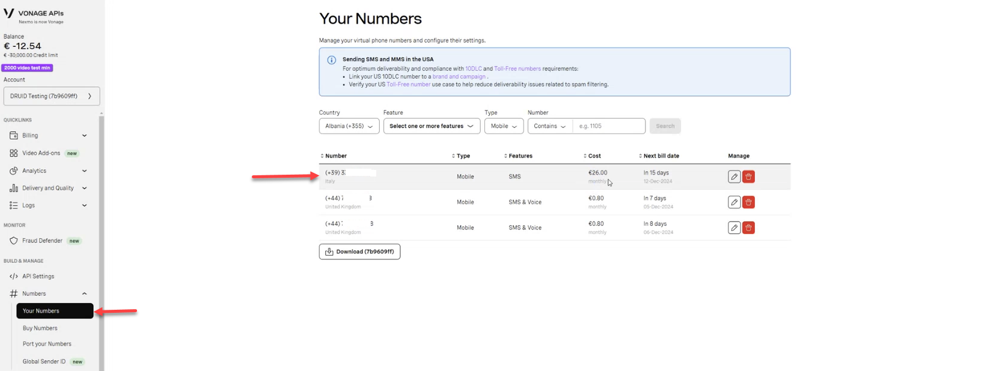

---
layout:
  title:
    visible: false
---

# Vonage SMS

Vonage SMS is a messaging service provided by Vonage, a global communication platform. It allows businesses to send and receive SMS (Short Message Service) messages to and from their customers. Vonage SMS is often used for notifications, two-factor authentication (2FA), customer support, marketing campaigns, and other forms of business communication.

By integrating Vonage SMS with DRUID, you can enhance your customer communication with automated and intelligent SMS-driven workflows.

## Prerequisites

- You built and published a AI Agent.
- You have a Vonage account.
- Create a Vonage application by following the steps outlined in the [Vonage documentation](https://developer.vonage.com/en/messages/code-snippets/create-an-application).

To integrate DRUID with Vonage SMS, follow these:

## Step 1. Get the webhook URLs from the Druid Portal

Go to the AI Agent details page and click on the **Channels** tab. Then, click the **SMS (by Vonage)** section header. Copy the **Inbound SMS Webhook** and **Delivery Status Webhook**, as you’ll need them to configure your Vonage application.

## Step 2. Configure your Vonage application and and get the app details

To integrate Vonage SMS with DRUID, you need to configure a Vonage application. This involves setting up a phone number for SMS, adding webhook URLs from the Druid Portal, and retrieving API credentials. Follow the steps below to complete the setup:

1. Log in to the [Vonage Portal](https://dashboard.nexmo.com/).
2. In the **BUILD & MANAGE** menu, click **Numbers**, then select **Your Numbers**.
3. Add a phone number for SMS.

4. Note down the phone number, as you’ll need it to configure the channel in the Druid Portal.
5. In the **BUILD & MANAGE** menu, click **API Settings**.
6. Set the app webhooks using the **Inbound SMS Webhook** and **Delivery Status Webhook** URLs you copied from the Druid Portal.

7. Copy the **API key** and **API secret**, as these will also be required to configure the channel in the Druid Portal.
8. Save your settings.

## Step 3. Activate the Vonage SMS channel in DRUID

To activate the Vonage SMS channel, follow these steps:

1. In the Druid Portal, navigate to the **SMS (by Vonage)** configuration section.
2. Enter the **Phone number** (without the "+" sign), along with the **API key** and **API secret** you copied from Vonage.
3. Click the **Publish** button to activate the channel.

After the channel’s activation, the following fields are available in DRUID:

- **[[ChatUser]].ChannelId** = "vonage-sms"
- **[[ChatUser]].UserId** - Stores the user's phone number in international format.
