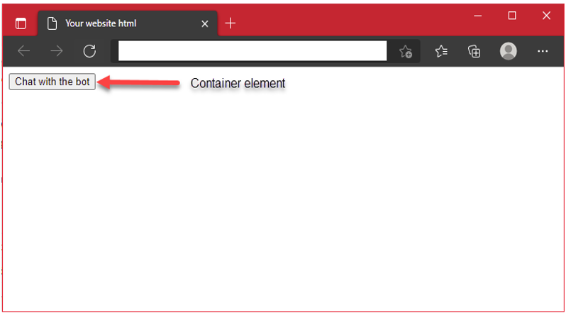
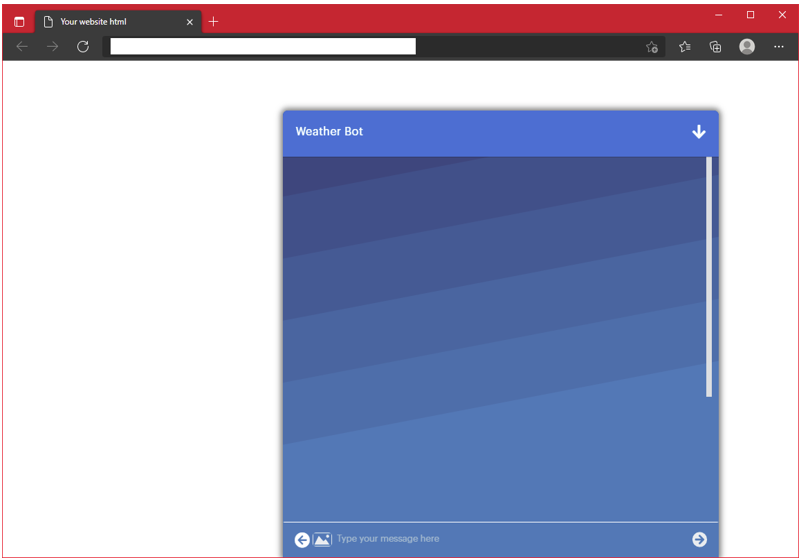
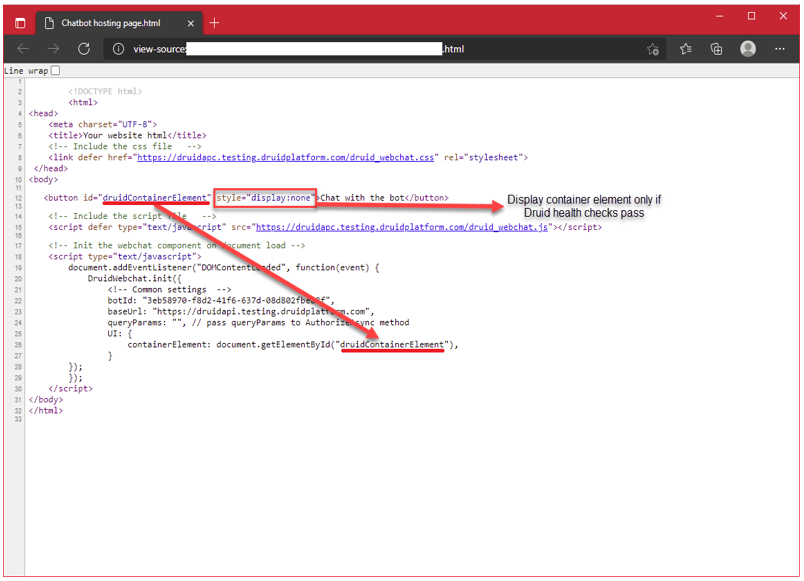
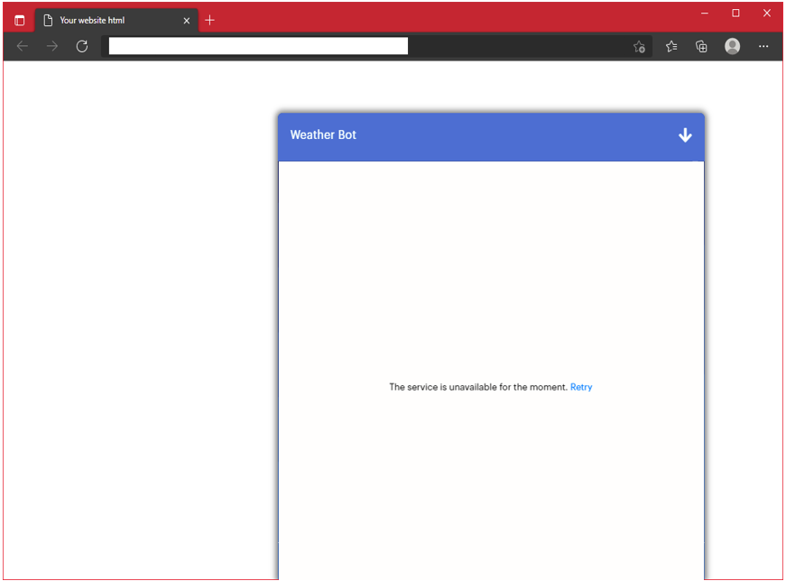

Druid visibility settings enable you easily control if you want to show the chat widget and when you want to show it. You can choose between disabling the chat widget icon and having it hidden if technical issues occur with the Druid AI Platform or with the external services integrated with your AI Agent.

Druid also provides you with the possibility to show friendly messages to users in ongoing conversations if issues occur in the web chat widget functionality.

## Chat Widget Visibility on the Hosting Page

Druid allows you to hide the chat widget on the web page hosting it, by setting a web snippet parameter directly in the Druid Portal.

### Use cases

- You have a large number of visitors on a Black Friday and not enough agents to handle all chats. You choose to hide the chat widget on the hosting page on Black Friday and show it again later.
- You don’t want to show the chat widget because you used it for a special marketing campaign that has ended.
- Upgrades in the AI Agent conversation design and integrations.
- Any other business related reasons.

### Hiding the chat widget directly from the Portal

To hide the chat widget, follow these steps:

1. Go to the AI Agent details page and click on the **Theme** section header.
2. Scroll down to the **Webchat Snippet** JSON field and click the **Customize webchat** button.
3. Go to **General** > **Common** parameters and select Disable webchat (isDisabled).

4. Save the changes.

If users are in an ongoing conversation with the AI Agent, the conversation continues. The chat snippet will disappear from the hosting page on page refresh or when next accessing it.

## Incident Management in Web chat

There are situations when the web page hosting the chat widget cannot download the webchat.js and webchat.css resources or it cannot access Druid backend services. In these cases, we recommend you to perform a health check to provide backend systems health status to the client chat widgets.

### Use cases

- When issues occur downloading the web snippet resources or access to Druid backend services fails, you want to hide on the hosting page the element, which on click starts the chat.
- When Druid connectivity errors occur or Druid backend services become unavailable during an ongoing conversation, you want to show a friendly message to the user in the chat.

### Perform health checks

There are various types of UI elements you can use on the web-hosting page to start the chat on click (a button, an image, an icon, a link, etc.). To provide Druid backend systems health status to the client chat widgets and show the element that starts the chat window on click only if the health checks pass (there are no issues with Druid services and resources loading), on your web-hosting page edit the element to include `style="display:none"`.

#### Example

In the source code of the web page hosting my chat widget, I have a button with the label “Chat with the AI Agent”.

On button (container element) click, the chat window will appear.

Update the button to be visible only of Druid health security checks pass.

`<button id="DruidContainerElement" style="display:none">Chat with the AI Agent</button>`

The element containing the web widget (in my case, a button) will be visible on the hosting page only if Druid backend systems health status passes the checks; otherwise, it’s hidden by default.

### Show friendly messages when Druid connectivity issues occur

Druid provides you with the possibility to offer chat clients friendly messages when chat widget encounters connectivity problems with backend systems.

To set friendly messages, follow these steps:

1. Go to the AI Agent details page and click the **Channels** tab.
2. Search for 'Webchat' and click on the channel card.
3. Click the **Customize webchat** button.
4. In the modal, click the **Json Viewer** tab.

5. Copy the json and paste it in a text editor.
6. Add the following two parameters and set their value to 'true'

- `"failedToLoadMessage": "your message goes here",` (enter the friendly message to be shown to users over the chat window)
- `"loadingOverlayActive": true,`

7. Copy the json and paste it in the configuration modal.
8. Save the webchat configuration.

If users are in an ongoing conversation with the AI Agent and the Druid connectivity issues occur, the friendly message set in the **Webchat Snippet** field displays to in the chat.

