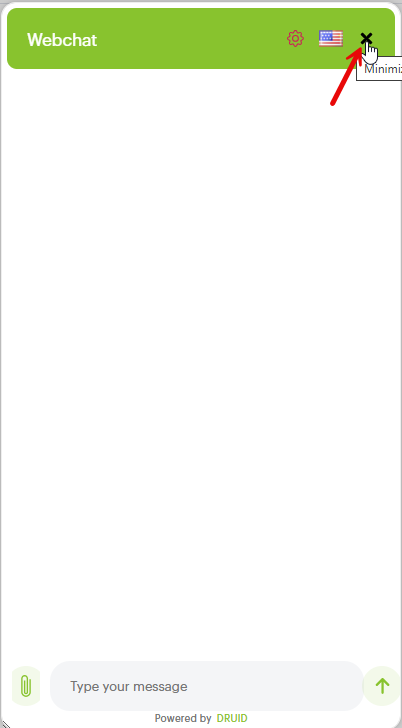
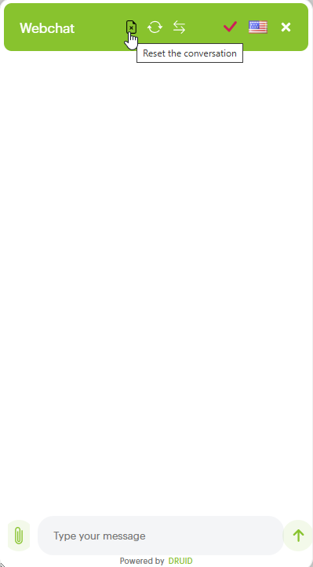
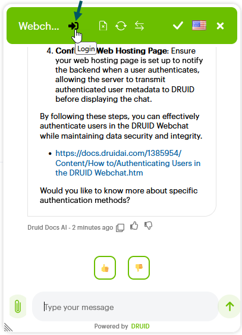

# WebChat Common Styling and Behavior

The webchat customization UI allows extensive configuration of styling and behavior parameters for AI Agents using Bot Framework v4.

Druid provides you with a straightforward configuration of the webchat snippet for AI Agents using bot framework v4. Clicking the **Customize webchat** opens the Customize Your Webchat UI editor, which allows extensive customization of the webchat styling and behavior parameters.


### Themes

The interface introduces visual themes as the primary foundation for layout and visual styling:

* **Light Theme**. A crisp, clean interface optimized for bright environments, offering high contrast and maximum readability.
* **Dark Theme**. A sleek visual layout designed for modern aesthetics, reduced screen glare, and low-light environments.


**Info:** **Light** and **Dark** themes are available starting with Druid 9.30. With this release, your current webchat configuration becomes the **Legacy** theme by default.


 

You can switch between **Light**, **Dark**, or **Legacy** themes at any time to update parameter default values according to the selected visual style.

Key visual and functional enhancements include full support for agentic reasoning workflows, a redesigned header, a relocated voice input icon positioned inline with the user text area, enhanced hero cards, and an improved action button layout for file uploads and emojis.

This section describes the parameters grouped per category and where applicable per subcategory (accessible from the Editor's left menu(s)).

### Agentic Reasoning and Messaging <a href="#agentic" id="agentic"></a>

The Agentic Reasoning and Messaging parameters customize how the chat displays structured AI Agent actions, decision-making steps, and specialized message formats. Adjusting these parameters provides clear visual distinction for automated logic workflows, interactive components, and conversational updates throughout the chat.


**Info:** These parameters are available starting with Druid 9.30.


#### Greetings Message

The Greetings Message controls the visual styling of the first message sent by the AI Agent when a user opens the chat (configured on the Welcome flow).

 

| Subcategory | Parameter                                       | Description                                                                                                                                                                                                                                                                                                                                                                                                                                                                                                                                                                                                                                                                                                                                                                                                                                                                       |
| ----------- | ----------------------------------------------- | --------------------------------------------------------------------------------------------------------------------------------------------------------------------------------------------------------------------------------------------------------------------------------------------------------------------------------------------------------------------------------------------------------------------------------------------------------------------------------------------------------------------------------------------------------------------------------------------------------------------------------------------------------------------------------------------------------------------------------------------------------------------------------------------------------------------------------------------------------------------------------- |
| Common      | Text Color (or Gradient) (greetingMessageColor) | Sets the text color or linear gradient applied to the greeting message content.                                                                                                                                                                                                                                                                                                                                                                                                                                                                                                                                                                                                                                                                                                                                                                                                   |
|             | Background (greetingMessageBackground)          | Defines the background color for the greeting message container.                                                                                                                                                                                                                                                                                                                                                                                                                                                                                                                                                                                                                                                                                                                                                                                                                  |
|             | Border Radius (greetingMessageBorderRadius)     | Specifies the corner radius for the greeting message box in pixels.                                                                                                                                                                                                                                                                                                                                                                                                                                                                                                                                                                                                                                                                                                                                                                                                               |
|             | Padding (greetingMessagePadding)                | Controls the internal spacing around the greeting message text.                                                                                                                                                                                                                                                                                                                                                                                                                                                                                                                                                                                                                                                                                                                                                                                                                   |
|             | Margin (greetingMessageMargin)                  | Sets the outer margin spacing surrounding the greeting message block.                                                                                                                                                                                                                                                                                                                                                                                                                                                                                                                                                                                                                                                                                                                                                                                                             |
|             | Font Size (greetingMessageFontSize)             | Defines the font size of the greeting message text in pixels.                                                                                                                                                                                                                                                                                                                                                                                                                                                                                                                                                                                                                                                                                                                                                                                                                     |
|             | Font Weight (greetingMessageFontWeight)         | Adjusts the text boldness for the greeting message (e.g., 500).                                                                                                                                                                                                                                                                                                                                                                                                                                                                                                                                                                                                                                                                                                                                                                                                                   |
|             | Animation (greetingMessageAnimation)            | Applies an entrance animation style to the greeting message display.                                                                                                                                                                                                                                                                                                                                                                                                                                                                                                                                                                                                                                                                                                                                                                                                              |
| Icons       | Icon                                            | Defines an optional SVG graphic that can be embedded into the welcome message. Enter the raw SVG code into this field. **NOTE:** To display the icon in the chat, you must include the `${icon}` placeholder (with a space before and after) in the Welcome flow message text. **Welcome message example** `greeting-message:                                      {                                     "elements": [                                     {                                     "type": "text",                                     "text": "Hi  ${icon}, I can help with symptoms, appointments , or your care plan. What's going on today? are you ok, is the sky blue? what is your sign"                                     }                                     ]                                 }` .png>) |

#### Informative Message

**Informative messages** display real-time status updates and temporary progress indicators while the AI Agent processes a request (for example, "Checking tomorrow's availability..."). Unlike reasoning messages—which detail the full multi-step decision-making process—informative messages provide short, single-line operational feedback during active processing.

 

| Subcategory | Parameter                                          | Description                                                                                                            |
| ----------- | -------------------------------------------------- | ---------------------------------------------------------------------------------------------------------------------- |
| Common      | Text Color (or Gradient) (informativeMessageColor) | Sets the text color or linear gradient applied to informative messages.                                                |
|             | Background (informativeMessageBackground)          | Defines the background color for the informative message container.                                                    |
|             | Border Radius (informativeMessageBorderRadius)     | Specifies the corner curvature for the informative message container in pixels.                                        |
|             | Padding (informativeMessagePadding)                | Controls the internal spacing inside the informative message container.                                                |
|             | Margin (informativeMessageMargin)                  | Sets the outer margin spacing surrounding the informative message block.                                               |
|             | Font Size (informativeMessageFontSize)             | Defines the font size of the informative message text in pixels.                                                       |
|             | Font Weight (informativeMessageFontWeight)         | Adjusts the text boldness for the informative message (e.g., 600).                                                     |
| Icons       | Icon (informativeMessageIcon)                      | Defines an optional SVG graphic displayed next to the status message. Enter the raw SVG code directly into this field. |

To add an informative message to a flow, add a step, click on **General**, and enter the configuration code based on your needs into the **Step message** field.

**Informative message example**

```
informative-message: {
    "elements": [
        {
            "type": "text",
            "text": "Checking tomorrow’s availability...",
            "style": {}
        }
    ]
}
```

#### 

#### Reasoning Message

Reasoning messages visually outline the AI Agent step-by-step decision-making process during complex tasks. They provide real-time transparency into multi-step logic workflows by displaying completed, active, and pending execution steps.

 

| Subcategory | Parameter                                              | Description                                                                                                       |
| ----------- | ------------------------------------------------------ | ----------------------------------------------------------------------------------------------------------------- |
| Common      | Accent Color (reasoningCardAccentColor)                | Sets the highlight color used for active progress elements, such as step status icons and accents.                |
|             | Background Color (reasoningCardBackgroundColor)        | Defines the fill color for the main reasoning card container using a hex code and opacity percentage.             |
|             | Border Radius (reasoningCardBorderRadius)              | Specifies the corner radius for the reasoning card container (for example, 12px).                                 |
|             | Text Color (reasoningCardTextColor)                    | Sets the primary text color for reasoning headers and active step text.                                           |
|             | Secondary Text Color (reasoningCardSecondaryTextColor) | Sets the text color for secondary details, step counters (e.g., "3 of 4 steps"), and inactive or completed steps. |
|             | Border Color (reasoningCardBorderColor)                | Defines the border color of the reasoning card container using a hex code and opacity percentage.                 |

To add reasoning messages to a flow, add a step, click on General, and enter the configuration code based on your needs into the **Step message** field.

**Reasoning messages example**

```
reasoning-message:
{
    "correlationId": "reasoning-demo-1",
    "steps": [
        {
            "label": "Checking your symptoms.",
            "state": "active"
        },
        {
            "label": "Reviewing your care plan and allergies",
            "state": "pending"
        },
        {
            "label": "Looking up available primary-care slots",
            "state": "pending"
        },
        {
            "label": "Preparing recommendation",
            "state": "pending"
        }
    ]
}
```


### General Settings & Cookie Management

| Subcategory | Parameter                                                           | Description                                                                                                                                                                                                                                                                                                                                                             |
| ----------- | ------------------------------------------------------------------- | ----------------------------------------------------------------------------------------------------------------------------------------------------------------------------------------------------------------------------------------------------------------------------------------------------------------------------------------------------------------------- |
| Common      | Disable webchat (isDisabled)                                        | When enabled this property disables the webchat bubble from where the snippet is embedded.                                                                                                                                                                                                                                                                              |
|             | queryParams (queryParams)                                           | Query parameters provide a powerful way to inject external data directly into the user's conversation context. Enter these parameters in the following format: `?param1=value&param2=value`. To access a specific parameter value within your conversation flows, you must create corresponding string fields in the QueryParams entity that match the parameter names. |
|             | Background Traffic Enabled (backgroundTrafficEnabled)               | When set to **true**, the webchat control sends telemetry information to the Druid AI Platform. Telemetry information includes the time stamp when a message was sent or received.                                                                                                                                                                                      |
|             | authorizationUrl                                                    | This is the path name of the base url used for authorization.                                                                                                                                                                                                                                                                                                           |
|             | authorizationBaseUrl                                                | Use it when you want to set a base url used for authorization.                                                                                                                                                                                                                                                                                                          |
|             | Calls withCredentials (withCredentials)                             | The XMLHttpRequest.withCredentials property is a Boolean value that indicates whether or not cross-site Access-Control requests should be made using credentials such as cookies, authorization headers or TLS client certificates. For more information, see [Mozilla documentation](https://developer.mozilla.org/en-US/docs/Web/API/XMLHttpRequest/withCredentials). |
|             | Authorization call withCredentials (withCredentials\_authorization) |                                                                                                                                                                                                                                                                                                                                                                         |
|             | Enable Notifications (notificationsEnabled)                         | Sends a sound notification when a new message is received in the chat.                                                                                                                                                                                                                                                                                                  |
|             | Other Services Endpoint Index (otherServicesEndpointIndex)          | Used for on premise installation. 0= returns default endpoint, 1...n=other configurations (for ex: intranet DruidApi).                                                                                                                                                                                                                                                  |
|             | heartBeatUrl                                                        | Heartbeat endpoint , on every message sent by the user, a keep alive user's session is sent to the heartBeatUrl (e.g., Druid myaccount).                                                                                                                                                                                                                                |
| Cookies     | conversationTokenEnabled (conversationTokenEnabled)                 | Saves the conversation token in browser cookie to remember the user when returning in webchat.                                                                                                                                                                                                                                                                          |
|             | druidCookiesExpirationInDays (druidCookiesExpirationInDays)         | Allows setting up the cookie expiry in days or fractional in minutes.                                                                                                                                                                                                                                                                                                   |
|             | conversationToken\_namePrefix (conversationToken\_namePrefix)       | Saves the conversation token in browser cookie to remember the user when returning in webchat, adding a prefix to the conversation token.                                                                                                                                                                                                                               |
|             | druidWebChatIsOpenedEnabled (druidWebChatIsOpenedEnabled)           | Automatically keeps expands the webchat control.                                                                                                                                                                                                                                                                                                                        |
|             | druidWebChatIsOpened\_namePrefix (druidWebChatIsOpened\_namePrefix) | Automatically expands the webchat control. It is useful to set up a prefix if multiple AI Agent snippets are hosted in a single web page, in order to distinguish them.                                                                                                                                                                                                 |
|             | druidCookieConsent (druidCookieConsentEnabled)                      | Enable it whenever you need to retrieve from users their consent regarding the cookies.                                                                                                                                                                                                                                                                                 |
|             | cookieDomain (cookieDomain)                                         | Domain' attribute signifies the domain for which the cookie is valid and can be submitted with every request for this domain or its subdomains. If this attribute is not specified, then the hostname of the originating server is used as the default value.                                                                                                           |

### Layout & Header

| Subcategory | Parameter                                                           | Description                                                                                                                                                                                                                                                                                                                |
| ----------- | ------------------------------------------------------------------- | -------------------------------------------------------------------------------------------------------------------------------------------------------------------------------------------------------------------------------------------------------------------------------------------------------------------------- |
| Common      | Auto Expand (autoExpandEnabled)                                     | Keeps the chat snippet expanded.                                                                                                                                                                                                                                                                                           |
|             | Auto Expand on Desktop only (autoExpandEnabledOnlyOnDesktop)        | When enabled, the chat snippet is always expanded when a user opens the page on a desktop, offering a more immediate conversational experience, while maintaining the collapsed view on mobile devices.                                                                                                                    |
|             | Show default Close Button (closeButtonEnabled)                      | When enabled, it adds a specific icon for closing chat snippet.                                                                                                                                                                                                                                                            |
|             | Fullscreen Mode (fullScreenMode)                                    | When enabled, the web chat will expand to full-screen mode, minimizing distractions and maximizing the conversation area. **NOTE:** This settings has no effect when opening the chat within the Druid Portal.                                                                                                             |
|             | Show "Powered by Druid" (showPoweredBy)                             | When enabled, include the text 'Powered by Druid' at the bottom of the webchat.                                                                                                                                                                                                                                            |
|             | Wrap AI Agent activities with classes (activityWrapperClassEnabled) | Controls whether CSS classes are added to AI Agent message elements for enhanced styling and customization.                                                                                                                                                                                                                |
|             | Chat Height (height)                                                | The height of the collapsed web chat widget.                                                                                                                                                                                                                                                                               |
|             | Chat Width (width)                                                  | The width of the collapsed web chat widget.                                                                                                                                                                                                                                                                                |
|             | Chat Minimum Width (minWidth)                                       | The min width of the collapsed web chat widget.                                                                                                                                                                                                                                                                            |
|             | Position (left/right) (position)                                    | The web chat’s position relative to the bottom of the page. Values: left, right.                                                                                                                                                                                                                                           |
|             | Float (floatRight)                                                  | The distance between the widget and the browser's right border, expressed in percentage of the screen width.                                                                                                                                                                                                               |
|             | Bottom (bottom)                                                     | The distance between the widget and bottom of the screen.                                                                                                                                                                                                                                                                  |
|             | Top (top)                                                           | The distance between the widget and top of the screen.                                                                                                                                                                                                                                                                     |
| Chat Box    | Border Radius (chatBoxBorderRadius)                                 | The border-radius property defines the radius of the chat snippet top corners.                                                                                                                                                                                                                                             |
|             | Bottom Radius (chatBoxBottomRadius)                                 | The border-radius property defines the radius of the chat snippet bottom corners.                                                                                                                                                                                                                                          |
|             | Border Color (chatBoxBorderColor)                                   | The border color property is used to set the border color of the chat snippet.                                                                                                                                                                                                                                             |
|             | Link Color (transcriptLinkColor)                                    | Sets a color to the hyperlinks displayed in the chat. Default color is blue                                                                                                                                                                                                                                                |
|             | Border Size (chatBoxBorderSize)                                     | The border size property defines the thickness of the chat snippet border.                                                                                                                                                                                                                                                 |
|             | Enable Resize (resizableEnabled)                                    | Controls whether users can manually resize the expanded web chat window.                                                                                                                                                                                                                                                   |
|             | Auto Scroll (autoScrollSnapOnPage)                                  | By default, the parameter is set to "true", meaning that the focus is set on the first message sent by the AI Agent and users need to scroll down in the snippet to see subsequent messages. Set the value "false" to set the snippet focus on the last message sent by the AI Agent and not on the first one.             |
| Header      | Text Color (headerTextColor)                                        | Sets the color of the header text.                                                                                                                                                                                                                                                                                         |
|             | Hover Text Color (headerTextColorOnHover)                           | Sets the color for hover of the header buttons.                                                                                                                                                                                                                                                                            |
|             | Focus Button Color (headerButtonColorOnFocus)                       | Sets the color of the chat header buttons only when they are actively being clicked.                                                                                                                                                                                      |
|             | Bottom Border Radius (headerBottomBorderRadius)                     | The bottom border-radius property defines the radius of the AI Agent snippet bottom header corners.                                                                                                                                                                                                                        |
|             | Outer Padding (headerOuterPadding)                                  | The header outer padding  property defines the outer padding of the header.                                                                                                                                                                                                                                                |
|             | Background Color (headerBackground)                                 | Sets the background color for the header.                                                                                                                                                                                                                                                                                  |
|             | Show Close Button (showCloseButton)                                 | Controls the visibility of the '**X**' button that closes the chat window.                                                                                                                                                                                                       |
|             | Show Change Side Button (showChangeSideButton)                      | Controls the visibility of the button that allows users (on desktop) to switch the chat window's position from one side of the screen to the other (e.g., from right to left). The **Switch side** button appears in the chat header once you click the **Settings** icon.  |
|             | Show Language Selector Button (showLanguageSelector)                | Controls the visibility of the icon that allows users to change the active chat language.                                                                                                                                                                               |
|             | Header - Show Avatar (showAvatar)                                   | Controls the visibility of the AI Agent profile picture within the chat header.                                                                                                                                                                                                                                            |
|             | Show Voice Input Selector (showVoiceInputSelector)                  | Controls the visibility of the button that allows users to switch from voice input to text for sending messages. This button will only appear if voice speech capabilities are enabled and configured for the AI Agent.                                                    |
|             | Header - Show Reload Button (showReload)                            | Controls the visibility of the button that reloads the current conversation without starting a new session. The button appears in the chat header once you click the **Settings** icon. .png>)                                                                                     |
|             | Header - Show Reset Button (showReset)                              | Controls the visibility of the button that starts a new, clean conversation by resetting the current session context. The button appears in the chat header once you click the **Settings** icon.                                                                                   |

### Hero Cards

Hero card styling controls the visual structure and layout of interactive content cards displayed in the chat stream. Configuring these parameters allows precise customization of card containers, text hierarchy, and action buttons to create consistent, brand-aligned choices for users.


| Subcategory | Parameter                                                     | Description                                                                                  |
| ----------- | ------------------------------------------------------------- | -------------------------------------------------------------------------------------------- |
| Common      | Enable Avatar (enableHeroCardAvatar)                          | Enables or disables the avatar display next to hero cards.                                   |
|             | Border Radius (heroCardBorderRadius)                          | Sets the corner radius for hero cards in pixels.                                             |
|             | Border Color (heroCardBorderColor)                            | Defines the border color of hero cards using a hex code and opacity percentage.              |
|             | Border Size (heroCardBorderSize)                              | Specifies the border thickness for hero cards in pixels.                                     |
|             | Inner Padding (heroCardInnerPadding)                          | Adjusts the internal spacing inside hero cards in pixels.                                    |
|             | Title Text Size (heroCardTitleTextSize)                       | Sets the font size of the hero card title text in pixels.                                    |
|             | Title Text Color (heroCardTitleTextColor)                     | Defines the color of the hero card title text using a hex code and opacity percentage.       |
|             | Description Text Color (heroCardDescriptionTextColor)         | Defines the color of the hero card description text using a hex code and opacity percentage. |
| Buttons     | Buttons Border Color (heroCardButtonsBorderColor)             | Sets the border color for buttons embedded within hero cards.                                |
|             | Buttons Border Size (heroCardButtonsBorderSize)               | Specifies the border thickness for hero card buttons in pixels.                              |
|             | Buttons Color (heroCardButtonsColor)                          | Defines the background color of hero card buttons.                                           |
|             | Buttons Color On Focus (heroCardButtonsColorOnFocus)          | Sets the background color of hero card buttons when focused.                                 |
|             | Buttons Color On Hover (heroCardButtonsColorOnHover)          | Sets the background color of hero card buttons when hovered over by the cursor.              |
|             | Buttons Text Color (heroCardButtonsTextColor)                 | Defines the default text color for hero card buttons.                                        |
|             | Buttons Text Color On Focus (heroCardButtonsTextColorOnFocus) | Sets the text color for hero card buttons when focused.                                      |
|             | Buttons Text Color On Hover (heroCardButtonsTextColorOnHover) | Sets the text color for hero card buttons when hovered over by the cursor.                   |

### Color & Paddings

| Subcategory      | Parameter                          | Description                                                                                          |
| ---------------- | ---------------------------------- | ---------------------------------------------------------------------------------------------------- |
| Color & Paddings | Chat Title (chatTitle)             | Sets the webchat title.                                                                              |
|                  | Accent (accent)                    | Sets the color accent for the AI Agent snippet.                                                      |
|                  | Background Color (backgroundColor) | Sets the background color for the AI Agent snippet.                                                  |
|                  | Padding Regular (paddingRegular)   | Sets the padding for AI Agent messages.                                                              |
|                  | Subtle (subtle)                    | Sets the color for subtles in the AI Agent snippet (username, AI Agent name, timestamp, attach file) |

### Fonts

| Subcategory | Parameter                                              | Description                                                                                                                                                                                                                              |
| ----------- | ------------------------------------------------------ | ---------------------------------------------------------------------------------------------------------------------------------------------------------------------------------------------------------------------------------------- |
| Fonts       | Font Size Small (fontSizeSmall)                        | Sets the font size for username, AI Agent name and timestamp for each message sent and received by the AI Agent.                                                                                                                         |
|             | Monospace Font (monospaceFont)                         | A monospaced font, also called a fixed-pitch, fixed-width, or non-proportional font, is a font whose letters and characters each occupy the same amount of horizontal space. This font is used for error messages displayed in the chat. |
|             | Primary Font (primaryFont)                             | Sets the primary font type used in both messages sent by the user and AI Agent.                                                                                                                                                          |
|             | Root Font Size (rootFontSize)                          | Sets the font-size of the root element for each element in the AI Agent snippet.                                                                                                                                                         |
|             | Transcript Font Size (transcriptFontSize)              | Set the font size of the transcript.                                                                                                                                                                                                     |
|             | Header Font Size (headerFontSize)                      | Sets the font-size for each element in the AI Agent snippet header.                                                                                                                                                                      |
|             | SendBox Font Size (sendBoxFontSize)                    | Sets the font-sizes in the text box for the text written by the user.                                                                                                                                                                    |
|             | Line Height - in REM (lineHeight)                      | Sets the line height of the messages in the AI Agent snippet. Possible values (normal, number, length, initial, inherit)                                                                                                                 |
|             | Message Activity Word Break (messageActivityWordBreak) | This property specifies how words should break when reaching the end of a line. Possible values (normal, break-all, break-word, keep all)                                                                                                |

### Buttons

| Subcategory | Parameter                                                 | Description                                                                                                                                                                                                                                                                                                                                                                                                                                                                                                                                                                                                                                   |
| ----------- | --------------------------------------------------------- | --------------------------------------------------------------------------------------------------------------------------------------------------------------------------------------------------------------------------------------------------------------------------------------------------------------------------------------------------------------------------------------------------------------------------------------------------------------------------------------------------------------------------------------------------------------------------------------------------------------------------------------------- |
| Layout      | Padding (buttonsPadding)                                  | Sets the buttons padding in the conversational flow  (e.g. hero card , choices, thumbnail).                                                                                                                                                                                                                                                                                                                                                                                                                                                                                                                                                   |
|             | Border Radius (buttonsBorderRadius)                       | Sets the border radius of the buttons from the conversational flow (e.g. hero card , choices, thumbnail).                                                                                                                                                                                                                                                                                                                                                                                                                                                                                                                                     |
|             | Text Color (buttonsTextColor)                             | Sets the text color from the buttons in the conversational flow  (e.g. hero card , choices, thumbnail).                                                                                                                                                                                                                                                                                                                                                                                                                                                                                                                                       |
|             | Border Color (buttonsBorderColor)                         | Sets the border color of the buttons from the conversational flow  (e.g. hero card , choices, thumbnail).                                                                                                                                                                                                                                                                                                                                                                                                                                                                                                                                     |
|             | Background Color (buttonsBackgroundColor)                 | Sets the background color of the buttons in the conversational flow  (e.g. hero card , choices, thumbnail).                                                                                                                                                                                                                                                                                                                                                                                                                                                                                                                                   |
|             | Hover Background Color (buttonsBackgroundColorOnHover)    | Sets the background color of the hover when going over the buttons in the conversational flow  (e.g. hero card , choices, thumbnail).                                                                                                                                                                                                                                                                                                                                                                                                                                                                                                         |
|             | Hover Text Color (buttonsTextColorOnHover)                | Sets the text color that appears on hover on  buttons in the conversational flow  (e.g. hero card , choices, thumbnail).                                                                                                                                                                                                                                                                                                                                                                                                                                                                                                                      |
|             | Hover Border Color (buttonsBorderColorOnHover)            | Sets the text color of the buttons border that appear when hover on buttons in the conversational flow (e.g. hero card , choices, thumbnail).                                                                                                                                                                                                                                                                                                                                                                                                                                                                                                 |
| Icons       | Context menu icon (v2\_contextMenu\_icon)                 | Sets the icon for the context menu. Only .svg file format (svg code) is supported.  **Context menu icon example** `<svg stroke="currentColor" fill="currentColor" height="24" width="24" stroke-width="0" viewBox="0 0 16 16" height="1em" width="1em" xmlns=" http://www.w3.org/2000/svg"><path d="M8.707 1.5a1 1 0 0 0-1.414 0L.646 8.146a.5.5 0 0 0 .708.708L8 2.207l6.646 6.647a.5.5 0 0 0 .708-.708L13 5.793V2.5a.5.5 0 0 0-.5-.5h-1a.5.5 0 0 0-.5.5v1.293L8.707 1.5Z"></path><path d="m8 3.293 6 6V13.5a1.5 1.5 0 0 1-1.5 1.5h-9A1.5 1.5 0 0 1 2 13.5V9.293l6-6Z"></path></svg>` |
|             | Minimize icon (v2\_minimize\_icon)                        | Sets the minimize icon for the context menu. Only .svg file format (svg code) is supported.                                                                                                                                                                                                                                                                                                                                                                                                                                                                                           |
|             | Expand chat icon (v2\_containerElement\_expand\_icon)     | The icon shown when the AI Agent snippet is collapsed. Users click on it to expand and open the web chat. Only .svg file format (svg code) is supported.                                                                                                                                                                                                                                                                                                                                                                                                                        |
|             | Collapse chat icon (v2\_containerElement\_collapse\_icon) | **NOTE:** Using this feature requires setting the common parameters **Show default Close Button (closeButtonEnabled)** (section Layout > Common) and **Show Close Button (showCloseButton)** (section Layout > Header) to true. The icon shown at the bottom of the chat snippet when it is expanded. Users click on it to collapse the web chat snippet. Only .svg file format (svg code) is supported.  The default collapse web chat icon is shown in the figure below.                                            |

### Chat Bubble

|                     |                                              |                                                                             |
| ------------------- | -------------------------------------------- | --------------------------------------------------------------------------- |
| Subcategory         | Parameter                                    | Description                                                                 |
| AI AgentChat Bubble | Background (bubbleBackground)                | Sets the background color of the messages sent by the AI Agent.             |
|                     | Text Color (bubbleTextColor)                 | Sets the text color of the messages sent by the AI Agent.                   |
|                     | Border Color (bubbleBorderColor)             | Sets the border color of the messages sent by the AI Agent.                 |
|                     | Border Radius (bubbleBorderRadius)           | Sets the border radius of the messages sent by the AI Agent.                |
|                     | Border Style (bubbleBorderStyle)             | Sets the border style of the messages sent by the AI Agent.                 |
|                     | Border Width (bubbleBorderWidth)             | Sets the border width of the messages sent by the AI Agent.                 |
|                     | Nub Size (bubbleNubSize)                     | Sets the numb size of the messages sent by the AI Agent.                    |
|                     | Nub Offset (bubbleNubOffset)                 | Sets the numb direction (top, bottom) of the messages sent by the AI Agent. |
| User Chat Bubble    | Background (bubbleFromUserBackground)        | Sets the background color of the messages sent by the user.                 |
|                     | Text Color (bubbleFromUserTextColor)         | Sets the text color of the messages sent by the user.                       |
|                     | Border Color (bubbleFromUserBorderColor)     | Sets the border color of the messages sent by the user.                     |
|                     | Border Radius (bubbleFromUserBorderRadius)   | Sets the border radius of the messages sent by the user.                    |
|                     | Border Style (bubbleFromUserBorderStyle)     | Sets the border style of the messages sent by the user.                     |
|                     | Border Width (bubbleFromUserBorderWidth)     | Sets the border width of the messages sent by the user.                     |
|                     | Nub Size (bubbleFromUserNubSize)             | Sets the numb size of the messages sent by the user.                        |
|                     | Nub Offset (bubbleFromUserNubOffset)         | Sets the numb direction (top, bottom) of the messages sent by the user.     |
| Layout              | Image Height (bubbleImageHeight)             | Sets the height of the text boxes sent by the AI Agent and user.            |
|                     | Max Width (bubbleMaxWidth)                   | Sets the max width of the text boxes sent by the AI Agent and user.         |
|                     | Min Height (bubbleMinHeight)                 | Sets the min height of the text boxes sent by the AI Agent and user.        |
|                     | Min Width (bubbleMinWidth)                   | Sets the min width of the text boxes sent by the AI Agent and user.         |
| Avatar Settings     | Avatar Border Radius (avatarBorderRadius)    | Sets the border radius of the AI Agent avatar.                              |
|                     | Avatar Size (avatarSize)                     | Sets the size of the AI Agent avatar.                                       |
| AI Agent Avatar     | Background Color (botAvatarBackgroundColor)  | Sets the background color of the AI Agent avatar.                           |
|                     | Image (botAvatarImage)                       | Fill in the url of your AI Agent avatar (png, jpg, etc.).                   |
| User Avatar         | Background Color (userAvatarBackgroundColor) | Sets the background color of the users avatar.                              |
|                     | Image (userAvatarImage)                      | Fill in the url of your user avatar. Expected format should be png, jpg.    |

### Connectivity UI

| Subcategory             | Parameter                                   | Description                                                                                                              |
| ----------------------- | ------------------------------------------- | ------------------------------------------------------------------------------------------------------------------------ |
| Slow Connection Timeout | Slow Connection After (slowConnectionAfter) | Sets after how much time expressed in milliseconds the slow connectivity message to appear. Default value is 15 seconds. |

### Send Box

| Subcategory   | Parameter                                                           | Description                                                                                                                                                                                                |
| ------------- | ------------------------------------------------------------------- | ---------------------------------------------------------------------------------------------------------------------------------------------------------------------------------------------------------- |
| Layout        | Height (sendBoxHeight)                                              | Sets the height of the entire send box.                                                                                                                                                                    |
|               | Max Height (sendBoxMaxHeight)                                       | Sets the max height of the input when the sendbox input is multilined.                                                                                                                                     |
|               | Padding Left and Right (DruidSendBoxPaddingLeftRight)               | Sets the left padding of the entire send box.                                                                                                                                                              |
|               | Padding Top (DruidSendBoxPaddingTop)                                | Sets the top padding of the entire send box.                                                                                                                                                               |
|               | Padding Left and Right (DruidSendBoxPaddingLeftRight)               | Sets the same padding to both left and right side of the entire send box.                                                                                                                                  |
|               | Padding Bottom (DruidSendBoxPaddingBottom)                          | Sets the bottom padding of the entire send box.                                                                                                                                                            |
|               | Inner padding (DruidSendBoxTextBoxPadding)                          | Sets the inner padding for the inner box "Type your message".                                                                                                                                              |
|               | Inner padding Left and Right (DruidSendBoxInnerPaddingLeftRight)    | Sets the same padding to both left and right side of the inner box "Type your message".                                                                                                                    |
|               | Inner padding Top and Bottom (DruidSendBoxInnerPaddingTopBottom)    | Sets the top and bottom padding of the inner box "Type your message".                                                                                                                                      |
|               | Hide Send Box (hideDruidSendBox)                                    | When this property is checked , it will hide the entire send box.                                                                                                                                          |
|               | Hide Upload Button (hideUploadButton)                               | When this property is checked , it will hide the upload file button from the send box unless the flow step if of the File Upload.                                                                          |
|               | Enable replying to messages (replyToMessageEnabled)                 | If enabled, it allows helpdesk agents engaged in a conversation with a user to reply any user message in the Active conversation section.                                                                  |
|               | Text Wrap (sendBoxTextWrap)                                         | When this property  is checked , it allows the user's text to be continued to the next line when the side of the typing box is reached.                                                                    |
| Colors        | Text Color (sendBoxTextColor)                                       | Sets the color of the users text message as you type.                                                                                                                                                      |
|               | Background Color (sendBoxBackground)                                | Sets the background color of the entire send box.                                                                                                                                                          |
|               | Disabled Text Color (sendBoxDisabledTextColor)                      | When you enable on a flow step the property "Block User Input", setting this text color will change the color of the  'Type your message here' from the send box when the input from the user is disabled. |
|               | Placeholder Color (sendBoxPlaceholderColor)                         | Sets the text color of the placeholder from the send box. Right now the message displayed is "Type your message"                                                                                           |
| Button Colors | Default (sendBoxButtonColor)                                        | Sets the color of the send box buttons such as contextual menu, attach file and send icon.                                                                                                                 |
|               | On Disabled (sendBoxButtonColorOnDisabled)                          | Sets the color of the buttons from the send box when they are disabled.                                                                                                                                    |
|               | On Focus (sendBoxButtonColorOnFocus)                                | Sets the color of the buttons from the send box when they are on focus.                                                                                                                                    |
|               | On Hover (sendBoxButtonColorOnHover)                                | Sets the hover color of the buttons from the send box such as contextual menu, attach file and send icon.                                                                                                  |
|               | Microphone Button Color On Dictate (microphoneButtonColorOnDictate) | The color of the microphone button (from the sendbox) when dictate (listening) is active.                                                                                                                  |

### Suggested Actions

| Subcategory       | Parameter                                                       | Description                                                                                                                                                                                                                                             |
| ----------------- | --------------------------------------------------------------- | ------------------------------------------------------------------------------------------------------------------------------------------------------------------------------------------------------------------------------------------------------- |
| Colors            | Background Color (suggestedActionBackground)                    | Changes the button background display color for the flow steps of type choice.                                                                                                                                                                          |
|                   | Color (suggestedActionTextColor)                                | Changes the hover background color for the flow steps of type choice.                                                                                                                                                                                   |
|                   | Text Color (Disabled) (suggestedActionDisabledTextColor)        | Sets the text color of the choice buttons when this flow step has the property "Block user Input" active.                                                                                                                                               |
|                   | Background Color (Disabled) (suggestedActionDisabledBackground) | Sets the background color of the choice buttons when this flow step has the property "Block user Input" active.                                                                                                                                         |
| Border            | Border (suggestedActionBorderColor)                             | Sets the border color of the choice buttons when they appear in conversation.                                                                                                                                                                           |
|                   | Radius (suggestedActionBorderRadius)                            | Sets the border radius of the choice buttons when they appear in conversation.                                                                                                                                                                          |
|                   | Style (suggestedActionBorderStyle)                              | Sets the border style of the choice buttons that appear in the conversation. E.g., You may set the border line for all choice buttons to be dotted.                                                                                                     |
|                   | Width (suggestedActionBorderWidth)                              | Sets the width of the border for each choice button that appears in conversation.                                                                                                                                                                       |
| Border (Disabled) | Border (suggestedActionDisabledBorderColor)                     | Sets the border color of the choice buttons when on the flow step the property "Block User Input" is enabled.                                                                                                                                           |
|                   | Color (suggestedActionDisabledBackground)                       | Sets the background color of the choice buttons when on the flow step the property "Block User Input" is enabled.                                                                                                                                       |
|                   | Style (suggestedActionDisabledBorderStyle)                      | Sets the border style of the choice buttons that appear in the conversation when on the flow step the property "Block User Input", is enabled. E.g., You may set the borderline for all choice buttons to be dotted when block user input is available. |
|                   | Width (suggestedActionDisabledBorderWidth)                      | Sets the width of the border for each choice button that appears in conversation, when on the flow step the property "Block User Input" is enabled.                                                                                                     |
| Layout            | Height (suggestedActionHeight)                                  | Sets the height of the choice buttons.                                                                                                                                                                                                                  |
|                   | Layout (suggestedActionLayout)                                  | Sets the layout of the choice buttons. Possible values are flow, carousel, stacked.                                                                                                                                                                     |
| Carousel Flipper  | Box Width (suggestedActionsCarouselFlipperBoxWidth)             | Sets the width of the container in which the choice buttons appear, and the suggestedActionLayout is set to carousel.                                                                                                                                   |
|                   | Size (suggestedActionsCarouselFlipperSize)                      | Sets the size of the container in which the choice buttons appear, and the suggestedActionLayout is set to carousel.                                                                                                                                    |
| Container         | Max Height (suggestedActionsStackedHeight)                      | Sets the height of the container, which has the property suggestedActionLayout set to stacked.                                                                                                                                                          |

### Timestamp and Status

| Subcategory | Parameter                                                        | Description                                                                                                                                                                                                                                                     |
| ----------- | ---------------------------------------------------------------- | --------------------------------------------------------------------------------------------------------------------------------------------------------------------------------------------------------------------------------------------------------------- |
| Timestamp   | Group Timestamp (groupTimestamp)                                 | When this option is disabled the time stamp that appears under each status message sent by the AI Agent or by the user, will be hidden. The default value is set to true.                                                                                       |
|             | Send Timeout (sendTimeout)                                       | Set it in milliseconds and it will trigger after how much time you receive the send failed status of the message. For example, you can receive this message when you lose your internet connection or service is down, etc.                                     |
|             | Send Timeout for Attachments (sendTimeoutForAttachments)         | Set it in milliseconds and it will trigger after how much time you receive the send failed status on the flow steps where is required a file upload. For example, you can receive this message when you loose your internet connection or service is down, etc. |
|             | Color (timestampColor)                                           | Sets the color of the time stamp text.                                                                                                                                                                                                                          |
|             | Format (timestampFormat)                                         | Sets the format of the time stamp. Possible values can be **relative** or **absolute** (the full time of the message is displayed).                                                                                                                             |
|             | Custom Timestamp Format (customTimestampFormat)                  | Sets the format of the timestamp. E.g., **DD.MM.YYYY HH:mm**.                                                                                                                                                                                                   |
| Status      | Status Read Color (activityStatusReadColor)                      | Below each message sent and read by the user or by the AI Agent and in line with the time stamp, an activity status message appears like a bubble. Setting the color for this option will change the color of the bubble status message.                        |
|             | Status AI Agent Name (activityStatusBotName)                     | Sets the name under the messages sent by the AI Agent. Default value is the bot name.                                                                                                                                                                           |
|             | Show AI Agent Name (activityStatusShowBotName)                   | If you check this option, under the messages sent by the AI Agent will also appear the AI Agent name. If this option is unchecked, only the timestamp will appear under the messages sent by the AI Agent.                                                      |
|             | Status User Name (activityStatusUserName)                        | Sets the username under the messages sent by the user. Default value is "User".                                                                                                                                                                                 |
|             | Show User Name (activityStatusShowUserName)                      | If you check this option, under the messages sent by the user will also appear the username. If this option is unchecked, only the timestamp will appear under the messages sent by the user.                                                                   |
|             | Show Actions for AI Agent Messages (botActivitiesActionsEnabled) | Enables interactive actions, such as copy AI Agent message, thumbs-up and thumbs-down feedback, on AI Agent messages in web chat.                                                                                                                               |

### Toast UI

| Subcategory     | Parameter                                      | Description                                                                                                                                                |
| --------------- | ---------------------------------------------- | ---------------------------------------------------------------------------------------------------------------------------------------------------------- |
| Toaster Layout  | Hide Toaster (hideToaster)                     | If you check this option, all alert messages sent by default by  the AI Agent such as inactivity status or connectivity issues will be hidden in the chat. |
|                 | Height (toasterHeight)                         | Sets the height of the toaster box message.                                                                                                                |
|                 | Max Height (toasterMaxHeight)                  | Sets the max height of the toaster box message.                                                                                                            |
| Toaster Styling | Font Size (toastFontSize)                      | Sets the font size of the messages that appear at different statuses on the toaster.                                                                       |
|                 | Icon Width (toastIconWidth)                    | Sets the icon width for each status that appears on the toaste (alert, exclamation mark, etc).                                                             |
|                 | Separator Color (toastSeparatorColor)          | Sets the color of the separator between consecutive toast messages.                                                                                        |
|                 | Text Padding (toastTextPadding)                | Sets the padding of the text that appears in the toast.                                                                                                    |
| Error           | Color (toastErrorColor)                        | When the error message is raised by the AI Agent, you can customize the color of the text error message.                                                   |
|                 | Background Color (toastErrorBackgroundColor)   | When the error message is raised by the AI Agent, you can customize the background color on which the error message appears.                               |
| Info            | Color (toastInfoColor)                         | When the info message is raised by the AI Agent, you can customize the color of the text info message.                                                     |
|                 | Background Color (toastInfoBackgroundColor)    | When the info message is raised by the AI Agent, you can customize the background color on which the info message appears.                                 |
| Success         | Color (toastSuccessColor)                      | When the success message is raised by the AI Agent, you can customize the color of the text success message.                                               |
|                 | Background Color (toastSuccessBackgroundColor) | When the success message is raised by the AI Agent, you can customize the background color on which the success message appears.                           |
| Warn            | Color (toastWarnColor)                         | When the warn message is raised by the AI Agent, you can customize the color of the warn success message.                                                  |
|                 | Background Color (toastWarnBackgroundColor)    | When the warn message is raised by the AI Agent, you can customize the background color on which the warn message appears.                                 |

### Transcript Overlay Buttons

| Subcategory           | Parameter                                                   | Description                                                                                                    |
| --------------------- | ----------------------------------------------------------- | -------------------------------------------------------------------------------------------------------------- |
| Button: Default       | Color (transcriptOverlayButtonColor)                        | The text color of the buttons that appear at overlay (e.g. more messages).                                     |
|                       | Background Color (transcriptOverlayButtonBackground)        | The background color of the buttons that appear at overlay (e.g. more messages).                               |
| Button: On Focus      | Color (transcriptOverlayButtonColorOnFocus)                 | The text color of the buttons that appear on focus.                                                            |
|                       | Background Color (transcriptOverlayButtonBackgroundOnFocus) | The background color of the buttons that appear on focus.                                                      |
| Button: On Hover      | Color (transcriptOverlayButtonColorOnHover)                 | The text color of the buttons that appear on hover.                                                            |
|                       | Background Color (transcriptOverlayButtonBackgroundOnHover) | The background color of the buttons that appear on hover.                                                      |
| Button: Scroll to end | Behavior (scrollToEndButtonBehavior)                        | Sets the behavior of the scroll to end button. For example from here you can disable the scroll to end button. |
|                       | Button Font Size (scrollToEndButtonFontSize)                | Sets the font size of the scroll to end button.                                                                |

### Miscellaneous

| Subcategory   | Parameter                                | Description                                                                                            |
| ------------- | ---------------------------------------- | ------------------------------------------------------------------------------------------------------ |
| Miscellaneous | Rich Card Wrap Title (richCardWrapTitle) | Used for cards (e.g. hero, thumbnail) where is set long text in Title area and it needs to be wrapped. |
|               | Disable Typing Animation                 | Disables the dots displayed when a helpdesk agent is typing in the chat.                               |
|               | Show typing name                         | During Live Chat sessions, replaces the standard typing indicator dots with the agent's name.          |

### Custom Styling

| Subcategory                          | Parameter | Description                   |
| ------------------------------------ | --------- | ----------------------------- |
| Druid StyleSet (customDruidStyleSet) | css file  | Include here your custom CSS. |

### Authentication

For users accessing the web chat from inside the Druid Portal, the conversation can be authenticated automatically. The **Login** and **Logout** icons are always present in the chat header, ensuring seamless Portal user authentication.





**NOTE:** This option is available only in the Druid Portal chat widget; it is not available in chat widgets hosted in custom pages.


### Advanced Options

This section provides you with advanced chat settings. For advanced settings, use the default template from the editor. If you need help settings up chat advanced parameters, get in touch with [Druid Support](mailto:support@druidai.com).
