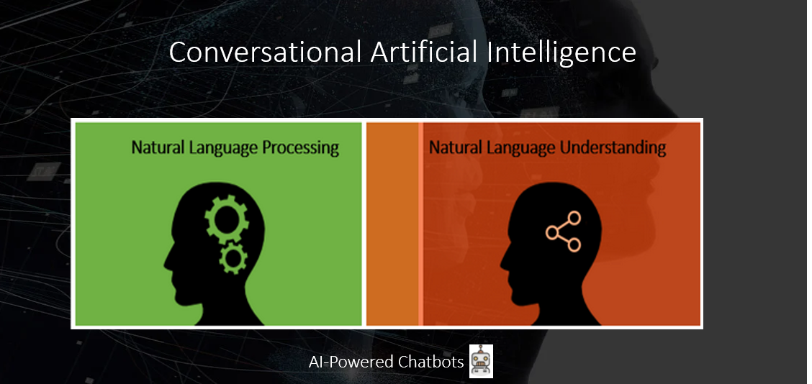
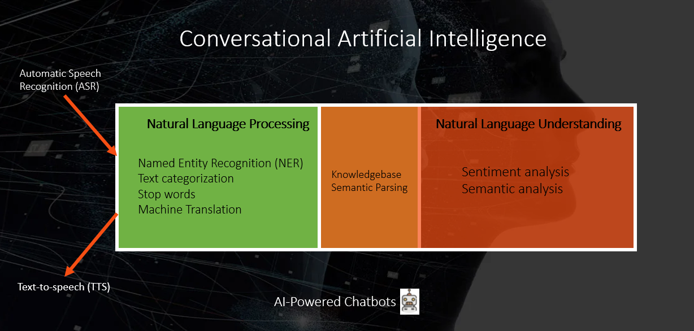

---
layout:
  title:
    visible: false
---

# Conversational AI

AI Agents use Conversational Artificial Intelligence (Conversational AI) to improve the customer/user experience. They mimic human conversations through the user journey using contextual information to deliver relevant messages to users and they assist your Support Center Helpdesk Agents during live conversations with the clients.

AI Agents identify the underlying intent behind user’s utterance and deliver a response or perform a task that matches the intent.

authors can create AI Agents that tailor their conversations with users based on the content they access on a website. Imagine a prospect client interested in purchasing a product who visits your company’s website. Your website hosts a AI Agent and the prospect clients start interacting with the AI Agent. The AI Agent might ask the visitor if they would like to find out more about a specific product; thus, right from the beginning, the AI Agent will deliver messages relevant to user’s interests, more likely increasing the chances that the visitor moves forward through the sales funnel.

Experienced authors can build AI-powered AI Agents that collect specific information during a conversation to provide better responses. They could further provide the transcript of a conversation between the AI Agent and the user to Helpdesk agents when engaging in a live chat with users. This reduces the time helpdesk agents would spend on finding out basic information about the client allowing them to focus on complex tasks the AI Agent cannot address. Not to mention it would increase both Support Center efficiency and the customer satisfaction.

In the AI Agents context, Conversational Artificial Intelligence encompasses two main concepts (basic language classification algorithms): Natural Language Processing (NLP) and Natural Language Understanding (NLU).

In this section you will learn what NLP and NLU are, the difference between the two concepts to help you choose the one that best suit your AI Agent needs.

## What is NLP?

**NLP** is a component of AI that enables AI Agents to interact with humans using natural language. It transforms utterances (user input / what the user says) into structured data, breaking text down into smaller data sets so that Machine Learning (ML) algorithms can analyze to find relationships among the various data sets and how they work together.

NLP enables AI Agents to identify the underlying intent/ question users might express in different ways using natural language. For example, when the user wants to find out the bank account balance:

- What is my account balance?
- How much money have I got in my account?

Users are inconsistent with their language making it difficult for authors to predict everything they say to the AI Agents and how they say it.

While NLP algorithms focus on what the user says, they do not focus on understanding what the user meant. This is where NLU enters the picture.

## What is NLU?

While NLP algorithms focus on what the user says, they do not focus on understanding what the user meant. This is where NLU enters the picture.

**NLU** is another component of AI, considered sometimes a subset of NLP, which enables AI Agents to interpret and understand what the user says. ML algorithms will recognize language specifics such as semantics, sentiment, intent and context and enable AI Agents to understand language subtleties. For example:

- What’s my bank account balance?
- The banks will be closed on Easter Monday.
- The municipality has installed many banks in the park.

With NLU, AI Agents can recognize many variations in which humans say the same things. For example, the question "what's the weather like outside?" can be asked in many ways: “What's the weather like out?”, “How's the weather?”, “ What's the weather like?”, etc.

NLU allows AI Agents to understand the conversation’s context and extract its meaning based on the context, enabling them to guide the users throughout the conversation.

## When to use NLP and when to use NLU?

If authors want to build a simple AI Agent that returns a series of predefined responses, they could use only NLP.

In natural language, what was spoken or written might not be what was meant, so if authors need to build a complex yet robust AI Agent capable of having sophisticated natural-sounding conversations with users, they need to use NLU as well.

By using NLU, the Conversational AI will recognize the language and semantics behind the AI Agent training phrases enabling the AI Agent to better understand what the user means throughout a conversation and properly respond the user.

Understanding the difference between NLP and NLU is important when building AI Agents as it might impact the way your AI Agent interprets what the user said and meant which might affect the quality of your AI Agent.

> **NOTE:** By default, DRUID uses NLP for language classification. If you want the Conversational AI to use a more complex language classification algorithm, enable NLU. For more information, see Natural Language Understanding.

## Automatic Speech Recognition (ASR) and Text-to-speech (TTS)

The NLP and automatic speech recognition (ASR) engines enable voice-driven conversations between humans and AI Agents. ASR is the cornerstone of the voice experience, allowing AI Agents to understand humans in their pure form of communication: speech.

DRUID delivers the speech-to-text (ASR) and text-to-speech (TTS) functionality by integrating Technology Partners. Users can talk to the AI Agents in their preferred voice channel: telephony, Teams, voice intranet page.

To support users worldwide, authors can activate the Voice channel and use the SDL service for real-time translation. This enables the AI Agent to playback the response in the user’s language.

For information about delivering DRUID voice AI Agents, see section Voice Channel.
