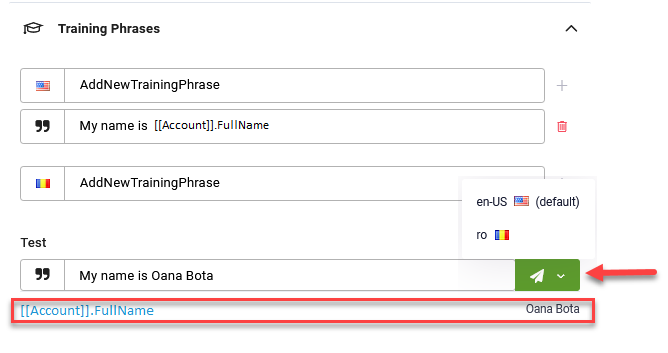

# Improving AI Agent NER

For DRUID version 1.67 and higher, you can improve the AI Agent NER by adding training phrases on flow steps with input mapping (prompt, choice, hero, thumbnail) enabling the AI Agent to extract specific information and store it in DRUID entities as part of intent recognition on a flow step level.

This feature is particularly useful for voice AI Agents because users have the tendency to respond with more than one word, which might be more than the AI Agent is expecting and that leads in general to invalid user input.

When executing flow steps with input mapping, the AI Agent uses NER to extract expected information from user input.

Based on the training phrases set on a flow step, the AI Agent creates an extraction model isolated and dedicated for that step and will use it whenever the conversation reaches that step.

### Step 1. Analyze how users express themselves when reaching a step with input mapping

On flow steps with input mapping, in Flow Designer, click the **Analytics** icon (), then click the **Step** tab and from the **Status** drop-down, select **InvalidInput**. Analyze the messages sent by users when reaching this step in the conversation (marked as invalid user input).

You can get a global overview on the invalid user input from the **Dashboard** > **NLU page** > **Invalid Inputs** section, clicking on the metric and further drilling down to flow analytics.

### Step 2. Add training phrases to address invalid inputs

Based on the analysis performed at step 1, you know how users respond and so you can add training phrases on the flow step to properly capture user input.

Click the **Settings** icon () to edit the selected flow step. Scroll-down and click **Training phrases**. Add the training phrases which will properly capture user input. Provide complete training phrases including sample value for entity you want to extract. From the training phrase select the word / sequence of words and click on the selection. In the Entity Extraction pop-up, click in the **Target Entity / Entity** field and select the entity you provided in **Input mapping** on the flow step, put a dot after the selected entity and select the field that will capture user input.

Click the **Save** button. The sample value will be highlighted (in green for entity and entity list and in blue for flat data type - integer, string, etc.) and marked with a label based on the selected entity type.


**NOTE:** Using sample values in training phrases is available in DRUID 5.12 and higher. This feature is backwards compatible, the training phrases with NER on flows and flow steps remain unchanged; however, we recommend you to update the training phrases with NER to provide sample values.


You have successfully added a training phrase that will help the AI Agent capture user input.

Add as many training phrases as need on the step based on your analysis.

You can test your training phrases (in desired AI Agent language) to see if the AI Agent properly extracts user input.

Save the step.
