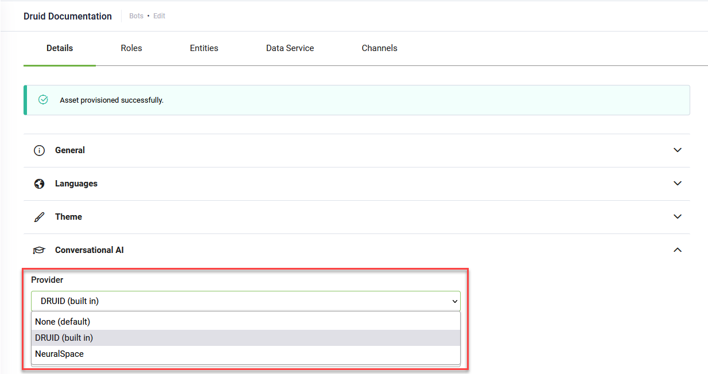

To select the NLP interpreter, in the AI Agent Details page, click the Conversational AI section header. The Conversational AI settings area expands.

Based on the model you want to use, from the **Provider** drop-down, select the NLP provider:

- **DRUID (built-in)** - DRUID proprietary NLP is set by default.
  DRUID proprietary NLP technology focuses on interpreting the user's intent to provide information contextually based on their behavior and preferences.
- **NeuralSpace** - Use the NeuralSpace NLP.
- **None** - Use the Knowledge Base model. The AI Agent will predict only within the Knowledge Base.

> **NOTE:**  Using NeuralSpace and the Knowledge Base model is available in DRUID 5.9 and higher.

## Using the DRUID NLP

DRUID NLP is comprised of all flows and QnAs. To optimize the NLP interpreter, set the AI Agent NLP parameters as described in the table below.

| Parameter | Description |
| --- | --- |
| Provider | **Druid (built-in)** – DRUID proprietary NLP. It is used by default. |
| MinScoreThreshold | The minimum threshold for matching utterance. A matching score below the minimum threshold does not trigger any flows. Recommended value: **30**. |
| TargetMatchScore | The target threshold for matching utterance. A matching score above the target score threshold is a high match and the AI Agent will provide the user with the relevant flow. A matching score between the **MinScoreThreshold** and the **TargetMatchScore** is a low match and the AI Agent will provide the user with a flow which might not be the most relevant one.  Recommended value: **60**. |
| EntityMinScoreThreshold | The minimum threshold for matching NER entities. The AI Agent will match the appropriate indexed value based on the matching score in a similar way as for the MinScoreThreshold.  Recommended value: **30**. |
| EntityTargetMatchScore | The target threshold for matching NER entities. The AI Agent will match the appropriate indexed value based on the matching score in a similar way as for the TargetMatchScore.  Recommended value: **60**. |
| Parameter – Value pair | Special parameters used to fine-tune the AI Agent NLP training model. For more information on these parameters, see [NLP Special Parameters](NLP%20Special%20Parameters.md). |
| Stop Words | Words that are filtered out before the natural language data (text) is processed. While AI Agents already have a [predefined list of stop words per language](StopWords/Druid_Default_StopWords.md) (the most common words used in a language), you can optimize the training model by manually adding new stop words.  For example, if you have a bidding AI Agent, you might want to exclude the word “bid” as the occurrence percentage for this word might be very high. |
| Test | Test the NLP model. Write the phrase you want to test (the intent), then click on Test and choose the corresponding language. The Conversational AI will return the matching flow (as it would do during a conversation), together with the matching score for that intent. It is a feedback tool for improving the NLP model. Testing functionality only works for trained models! |
| Enable auto train | If ticked, triggers the NLP model retraining after each flow update. For higher AI Agent performance, if your AI Agent has many flows, we recommend you to leave the check box unticked and train the model once using the Train button. |
| Train | Clicking the **Train** button triggers the NLP model training. The training model includes ALL training phrases defined on ALL flows associated with the respective AI Agent. After training the NLP model, the following information is available in the Train area:   - **LastTrainedOn** – the date and time when the model was last trained on. It has the following format: x days ago (YYYY-MM-DD HH:MM:SS). - **Status** – the status of the model training (Trained / Untrained). - **DownloadTrainErrors** – Downloads (in your default Download folder) a JSON file which contains the errors occurred (if any) during the last NLP model training. - **DownloadTrainLog** - Downloads (in your default Download folder) a JSON file which contains comprehensive training phrases data: status per training phrases, score for each utterance, etc. - **Training start time** - the date and time when the NLP model training started. It has the following format: YYYY-MM-DD HH:MM:SS. - **Duration** - how much time it took DRUID to train the AI Agent NLP model. It has the following format: HH:MM:SS. |

To fine-tune the NLP training model, set additional special [NLP parameters](NLP%20Special%20Parameters.md).

## Using the NeuralSpace NLP

#### Prerequisite

- You should have an activated account on the [NeuralSpace Platform](https://platform.neuralspace.ai/#/auth/signup).

#### Set up the NeuralSpace NLP

From the **Provider** drop-down, select **NeuralSpace**, then scroll down to the Parameters table and set the parameters described in the table below.

| Parameter | Description |
| --- | --- |
| NeuralSpace.AuthorizationToken | The NeuralSpace Platform authentication token. To get the authentication token, log into the NeuralSpace Platform and click the **Copy Auth Token** button at the top-right corner of the Dashboard.   |
| NeuralSpace.PlatformUrl | The URL of the NeuralSpace Platform if hosted on premises. The URL should be accessible from the Internet. |

## Using the Knowledge Base model

By default, when the Knowledge Base is used on the AI Agent (in the Dialogue management section, tap on **Use Knowledge Base** ), it will search through the Knowledge Base when the user input does not match with any of the existing flows.

To set the AI Agent to predict only within the Knowledge Base, in the Conversational AI section, from the **Provider** drop-down **None**.

## Related Topics

- [Defining the Intent](../4_Flows/Defining%20the%20Intent.md)
- [Knowledge Base](../Knowledgebase/Knowledgebase.md)
- [NLP Special Parameters](NLP%20Special%20Parameters.md)
