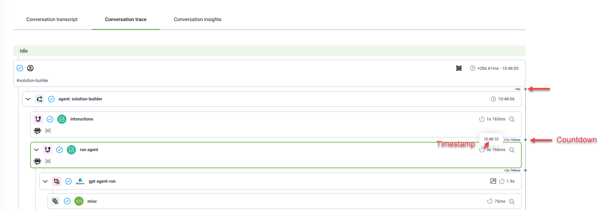
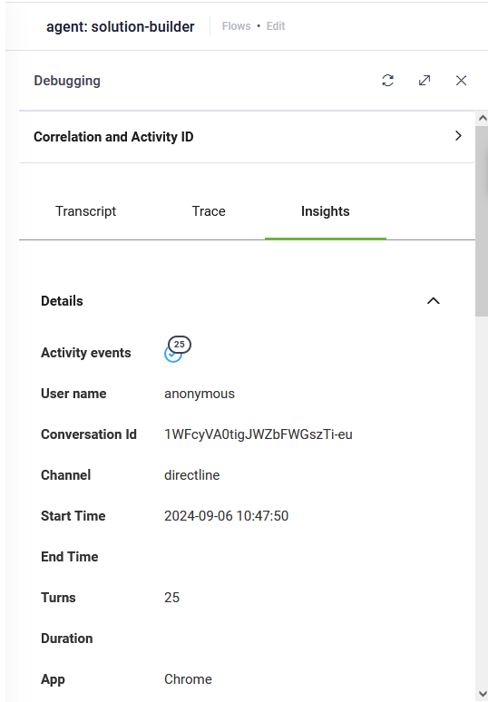

# Conversation Trace

Conversation Trace provides a granular, tree-structured view of every step an AI Agent follows during a user interaction. By visualizing both visible responses and "silent" background operations—such as Knowledge Base queries, system integration calls, and LLM prompt execution—Conversation Trace offers deep visibility into the AI Agent reasoning chain.

This tool serves a dual purpose within the Druid AI Platform:

* For **AI Governance**: It acts as the primary evidence chain, providing the transparency required to audit how decisions were made, how data was handled, and how hallucination prevention guardrails were applied.
* For **Data Analytics & Insights**: It serves as a high-precision optimization tool, allowing administrators to identify latency, troubleshoot flow logic, and refine AI Agent accuracy based on real-world execution data.


**NOTE:** Note: This feature is available in Druid 7.17 and higher and requires a Connector Host upgrade.


### Benefits of Conversation Trace

* **Full Traceability by Desig**n: Visualize the exact path the AI Agent takes to generate a response, including the specific knowledge chunks retrieved and the intent matching scores.
* **Visibility into Silent Actions**: Gain insight into actions the AI Agent takes behind the scenes, such as API calls or integrations, which are often crucial for diagnosing problems.
* **Explainable AI**: Deconstruct the logic of the AI Agentt to provide the "Proof of Trust" necessary for formal audits and compliance reviews.
* **Performance Debugging**: Access detailed timestamps for every flow step to identify bottlenecks and reduce response time gaps.
* **Seamless Optimization**: Transition directly from a trace log to the Flow designer to make real-time adjustments to AI Agentt behavior.


**NOTE:** Conversation Trace is not real-time. Data appears in the trace after a processing delay of approximately 20 seconds to 1 minute, depending on your environment.


### Key Features of Conversation Trace

* **Tree-View Visualization**: The trace presents a clear hierarchy of each step and flow, using dedicated icons and colors to distinguish between user inputs, AI Agent responses, and background system tasks.

* **Timestamps and Countdown**: Each step card displays the exact time taken for the AI Agent to transition between actions. A countdown begins immediately after the user question, allowing administrators to assess interaction timing and identify latency bottlenecks.

* **Total Runtime**: At the end of an interaction, you can view the total execution time. This metric is essential for optimizing response speeds and ensuring the AI Agent meets enterprise service-level agreements (SLAs).

* **Predict events**. For AI Agents using NLU or Knowledge Base components, the trace highlights Predict events. Clicking these events reveals the specific prediction source (e.g., a specific flow or knowledge base article) and the corresponding match score.

The predict events are available in DRUID 9.0 and higher.

### Accessing the Conversation Trace

To perform a governance audit or performance review for a specific session:

1. Navigate to **History & Logs** > **Conversation History**.
2. Select **Group by conversation** to view unified session logs.
3. Click the desired conversation to open the Conversation Transcript.
4. Click the **Conversation Trace** tab to view the technical execution path..

### AI Agent Debugging and Optimization

The Conversation Trace integrates directly with the Flow designer, allowing for seamless transitions between observability and system improvement.

#### Debugging Flow Steps

The Conversation Trace integrates seamlessly with the Flow diagram, allowing you to debug flow steps with ease:

1. In the **Conversation Trace**, click the **Details** icon next to a specific step.

2. Review the Flow log to see the raw data processed during that step. Click on the flow step to open the Flow debugging view in a new browser window.

The left pane contains debugging tools, and the right pane displays the flow diagram.

3. Click on the **Trace** tab to view the conversation trace. The trace focuses on the flow step you selected, and highlights the specific path taken with green arrows, allowing you to verify if the logic executed as intended.

The conversation trace helps you analyze:

* Whether the steps executed successfully.
* Timestamps and countdowns for each flow step and integration.
* Detailed logs for flow steps and integrations, accessible by clicking the corresponding **Details** icon.

.png>)

#### Improving AI Agent Accuracy

Once an issue is identified in the trace—such as a low-confidence intent match or an incorrect knowledge retrieval—you can adjust the system configuration immediately:

* Update Flow Logic: Adjust step configurations in the flow editor to fix logic gaps.
* Refine Knowledge Base Grounding: Use the trace insights to identify if the AI Agent retrieved irrelevant knowledge chunks and update the source documentation accordingly.
* Verify System Integrations: Check the detail logs for API calls to ensure data payloads are correctly formatted and received.

To update flow logic, use the Flow diagram mode for more detailed information, then adjust the flow step configurations in the right-side editor to fit your needs.

Once you identify issues or areas for improvement, you can easily update flow steps. Follow these steps:

1. Open the chat window by clicking the chat icon in the **Actions** menu.
2. Type user messages and wait 20 seconds to 1 minute, depending on your Druid environment.
3. Click the refresh icon in the Debugging tools pane.
4. Click the desired step to see the flow in the Flow diagram.
5. Close the chat window.
6. Make the necessary flow steps updates.
7. Continue reviewing the conversation trace and the flow diagram.

### Conversation Insights

For a high-level summary of the interaction beyond the technical trace, click the **Insights** tab in the **Debugging** pane. This provides an overview of the conversation, including data from the ChatActivityData entity and a list of activity events triggered during the session.

