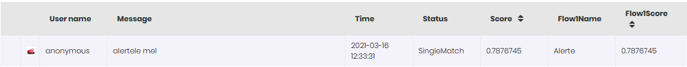

# NLU Activity History

The NLU Activity History feature provides you with insights on how the NLP engine was used in a conversation: how much the NLP engine was used and the NLP scores. Analyzing the NLU Activity History helps you identify the messages with a low NLP score and add the user messages as flow training phrases on the flows where the score was low. This enables you to further fine-tune the AI Agent ML model.

To access the NLU Activity History, on the main menu, click **History & Logs** > **NLU Activity History**. The NLU Activity History page appears which provides you with extensive filtering options.

Selecting a AI Agent is mandatory to view the NLU activity history. The other filtering options are optional and you can use them as best suits your needs. Select the desired filtering options and at the top-right corner of the page, click the **Refresh** button. The table displays all user messages matching the filtering criteria with the NLP match scores and the flows where the match is done.

The table below describes the table columns.

| Column     | Description                                                                                                                                                                                                                                                                                                                                                                                                                                                                                                                                         |
| ---------- | --------------------------------------------------------------------------------------------------------------------------------------------------------------------------------------------------------------------------------------------------------------------------------------------------------------------------------------------------------------------------------------------------------------------------------------------------------------------------------------------------------------------------------------------------- |
| Channel    | The icon in the first column indicates the channel used by the user to chat with the AI Agent. In the figure above, the channel used is web.                                                                                                                                                                                                                                                                                                                                                                                                        |
| User name  | The name of the user who chatted with the AI Agent.                                                                                                                                                                                                                                                                                                                                                                                                                                                                                                 |
| Time       | The date and duration of the chat conversation.                                                                                                                                                                                                                                                                                                                                                                                                                                                                                                     |
| Status     | Indicates the match type for a user message: - **ExactMatch** - the user message (intent) matches the utterance on a flow. The match is not done via the NLP engine. - **NoMatch** – the NLP engine does not find any matches. - **SingleMatch** – the NLP engine finds a match (partial match) on a single flow. - **MultipleMatch** – the NLP engine finds utterance matches on multiple flows.                                                                                                                                                   |
| Score      | The score for matching what the user says with utterances defined on flows. Based on the Status, the following scores as shown: - ExactMatch - score **1**. - NoMatch – score **0**. - SingleMatch – NLP match score. The score of the NLP engine for matching the user message with a single flow utterance.   - MultipleMatch – highest NLP match score. The highest score of the NLP engine for matching the user message with flow utterrance. |
| Flow1Name  | The name of the flow with the highest NLP score (if status is MultipleMatch) or if the Status is ExactMatch, the name of the flow which has the utterance matching what the user message. For ExactMatch, the NLP engine does nothing, it's not involved in matching what the user says.                                                                                                                                                                                                                                                            |
| Flow1Score | The NLP score if there is                                                                                                                                                                                                                                                                                                                                                                                                                                                                                                                           |
| Flow2Name  | **Only if Status is MultipleMatch!** If the NLP engine matches the user message with the utterance on two or more than two flows, the name of the flow with the second NLP match score.                                                                                                                                                                                                                                                                                                                                                             |
| Flow2Score | **Only if Status is MultipleMatch!** The NLP match score of the second flow which has the utterance matching the user message.                                                                                                                                                                                                                                                                                                                                                                                                                      |
| Flow3Name  | **Only if Status is MultipleMatch!** If the NLP engine matches the user message with the utterance on three or more flows, the name of the flow with the third NLP match score.                                                                                                                                                                                                                                                                                                                                                                     |
| Flow3Score | The NLP match score of the third flow which has the utterance matching the user message.                                                                                                                                                                                                                                                                                                                                                                                                                                                            |
