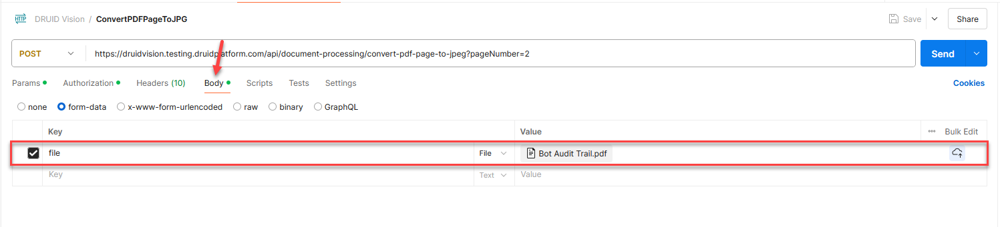

---
layout:
  title:
    visible: false
---

# Convert PDF Page to JPEG

This Vision endpoint allows you to convert individual PDF pages into .jpeg format, enabling you to send images to GPT-4.o, which cannot perform OCR directly from PDF files.

> **IMPORTANT!**  If you need to convert multiple PDF pages, you must make a separate API request for each page you want to convert.

> **NOTE:**  To use this Druid Vision service, you must have at least one Identity Vision API service enabled for your tenant. If not, please contact [Druid Tech Support](<mailto:support@druidai.com?subject=Request: Activate Druid Vision service IdentityCard>).

## Request

|  |  |
| --- | --- |
| Method | POST |
| API Resource URL (Endpoint) | \*.druidplatform.com/api/document-processing/convert-pdf-page-to-jpeg |
| Params | Enter the **pageNumber** parameter and specify the PDF page number you want to convert to a .jpeg.   |
| Authorization | Select Bearer Token. If you already have a Druid Vision Token generated for an Identity API service in the Druid Portal, provide that token. For details on obtaining the token, refer to [Druid Vision](Druid%20Vision.md).  If you don't have a token, generate one using the Authentication endpoint from Webhooks. For more information, see [Webhooks](../Webhooks.md).   |
| Body | “file”: <attached document file> (file attachment)  Supported formats: pdf   |

## Response

The response returns the specified PDF page as a .jpeg file.

To capture the .jpeg file, use the **Download File** integration. You can then pass the file to GPT-4.o within your knowledge base-specific flows.

## Related Topics

- [Download File by REST API](../7_Integrations/Download%20file%20by%20REST%20API.md)
