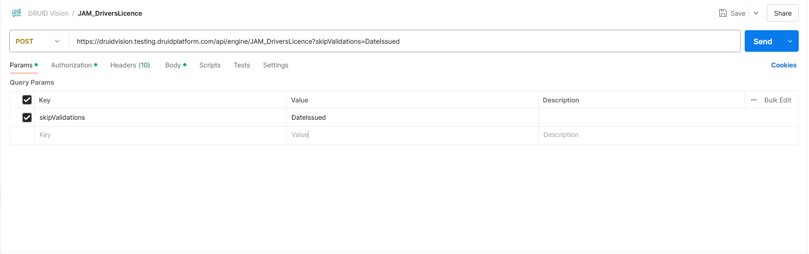

<a id="JamaicanDriverLicenseOCR"></a>


The Druid API engine performs OCR and data extraction from Jamaican driver licenses.

> **NOTE:**
>
> - In order to use this Druid Vision service, contact [Druid Tech Support](<mailto:support@druidai.com?subject=Request: Activate Druid Vision service JAM_DriversLicence>).
> - For any APIs that are used for testing purposes and not in a production environment, Druid CANNOT be held responsible for the security of the processed data under the General Data Protection Regulation (GDPR). We highly recommend you to use sample data and documents for all APIs in testing environments.

<a id="Request"></a>

## Request

|  |  |
| --- | --- |
| Method | POST |
| API Resource URL (Endpoint) | The endpoint of the Druid Vision **JAM\_DriversLicence** service. For information on how to get the endpoint, see [Druid Vision](Druid%20Vision.md). |
| Authorization | Select **Bearer Token** and provide the Druid Vision **Token**. For information on how to get the endpoint, see [Druid Vision](Druid%20Vision.md).   |
| Headers | Content-Type: “multipart/form-data”   |
| Body | “file”: <attached document file> (file attachment).  Supported formats: png, jpg, pdf.    If extraction fails due to issues like poor image quality, you can skip the **DateIssued** validation check by using the **skipValidations** parameter in the request body as shown in the image below.    **NOTE:** Skipping validations is available in DRUID 8.1 and higher. |

<a id="Response"></a>

## Response

**Response Example**

```
{
    "ResultId": "ee8bcab8-4b9a-49e5-aba9-215fe2403e19",
    "TemplateName": "JAM_DriversLicence",
    "Status": "Complete",
    "StatusReason": null,
    "Confidence": 0.91,
    "Data": {
        "Class": "GENERAL",
        "TRN": "100753086",
        "DateIssued": "2019-09-05",
        "Collectorate": "011 SPANISH TOWN",
        "ExpiryDate": "2024-08-16",
        "BirthDate": "1947-08-16",
        "Sex": "M",
        "Surname": "SEVILLE",
        "GivenName": "LOPEZ ELISHA",
        "Name": "LOPEZ ELISHA SEVILLE",
        "Face": 1.0,
        "AddrLine1": "IRISH TOWN",
        "AddrLine2": "ST. ANDREW",
        "Address": "IRISH TOWN ST. ANDREW",
        "Class.Confidence": 0.99,
        "TRN.Confidence": 1.0,
        "DateIssued.Confidence": 1.0,
        "Collectorate.Confidence": 0.98,
        "ExpiryDate.Confidence": 0.99,
        "BirthDate.Confidence": 1.0,
        "Sex.Confidence": 0.99,
        "Surname.Confidence": 0.99,
        "GivenName.Confidence": 0.99,
        "Name.Confidence": null,
        "Face.Confidence": 1.0,
        "AddrLine1.Confidence": 0.99,
        "AddrLine2.Confidence": 0.99,
        "Address.Confidence": null,
        "Smile": "0"
    },
    "ValidationResult": {
        "DateIssued": {
            "Status": "Valid"
        }
   }
}
```

The JAM\_Passport template performs the following validation:

- **DateIssued** – The status is “Invalid” if the document’s **DateIssued** field does not pass validation.

**Failed Validation Example**

```
{
    "ResultId": "8c24052b-1ec9-4598-9e7e-38ebd649df8c",
    "TemplateName": "JAM_DriversLicence",
    "Status": "Partial",
    "StatusReason": null,
    "Confidence": 0.88,
    "Data": {
        "Address": "OTH FL CO-OPERATIVE ST. LUCIA AVENUE",
        "Address.Confidence": null,
        "AddrLine1": "OTH FL CO-OPERATIVE",
        "AddrLine1.Confidence": 0.68,
        "AddrLine2": "ST. LUCIA AVENUE",
        "AddrLine2.Confidence": 0.97,
        "BirthDate": "0000-00-00",
        "BirthDate.Confidence": 0.99,
        "Class": "GENERAL",
        "Class.Confidence": 1,
        "Collectorate": "000 ST. ANDREW",
        "Collectorate.Confidence": 0.99,
        "DateIssued": "0000-00-00",
        "DateIssued.Confidence": 0.99,
        "ExpiryDate": "0000-00-00",
        "ExpiryDate.Confidence": 0.99,
        "Face": 1,
        "Face.Confidence": 1,
        "GivenName": "DAVIS",
        "GivenName.Confidence": 0.99,
        "Name": "DAVIS RACHEL",
        "Name.Confidence": null,
        "Sex": "M",
        "Sex.Confidence": 1,
        "Smile": "0",
        "Surname": "RACHEL",
        "Surname.Confidence": 1,
        "TRN": "000000000",
        "TRN.Confidence": 0.99
    },
    "ValidationResult": {
        "DateIssued": {
            "Status": "Invalid",
            "Description": "Missing [DateIssued] field in result data"
        }
    }
}
```
