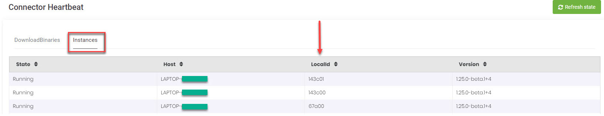

# Druid Connector Host High Availability

DRUID allows you to deploy the Druid Connector Host in a high availability (HA) scenario, enabling load balancing by running multiple Connector Host instances in parallel for your tenant. If you are using multiple Connector Host instances, they automatically sync their configuration, operate concurrently, and can independently handle specific requests.

For this setup, all Connector Host instances must connect to the same shared Conversation History Database and shared network drive for file storage. These components must be accessible to all virtual machines (VMs) where the Connector Hosts are installed.


**NOTE:** DRUID provides high availability only for the Connector Host instances. It does not offer high availability for the shared Conversation History Database or the shared network drive for file storage. To ensure HA for these components, you can implement specific non-DRUID mechanisms.


To install Connector Host in the high availability scenario, follow these steps:

### Step 1. Install the connector Host on premise on multiple machines

Install the Druid Connector Host on multiple machines following the installation procedure.


**NOTE:** For the high availability setup, all Connector Host instances must connect to the same shared Conversation History Database and to the same shared network drive for file storage. These components must be accessible to all virtual machines (VMs) where the Connector Hosts are installed.


Make sure that on _Step 4: Configure the Druid Connector Host_ described in the installation procedure, you configure for all connector hosts the connection to the same shared network file storage and to the same shared Conversation History DB as described below.

For each Connector Host instance, configure the Document Generator parameters as follows:

1. In the **FileStorageFolder** parameter, specify the path to the shared network disk storage where user-uploaded files or files generated by the AI Agent will be stored.
2. In the **TemplateFolder** parameter, provide the path to the location where the document templates will be stored.

For each Connector Host instance, in the Conversation History DB section, enter the unique address of the database resource in the **Server** field. This can be the address of the database server or, if the database is set up in a high availability (HA) configuration, the address of the server cluster.

### Step 2. Start each Connector Instance

Start the Windows Service for each connector instance, as you would do for the a single instance set-up.


**IMPORTANT!** Each instance generates a self signature based on the machine name (where it is installed), the user name (under which it runs) and the folder location (where the connector resources are installed). It is mandatory that the self signature is unique for each of the connector instances; therefore, at least one of the 3 values must be different for each instance. If you cannot change the machine name and the user name cannot be changed, we recommend you to use an unique folder name for each installation.


To check that all instances are running and that they have an unique signature, in the Druid Portal, from the **All Settings** menu, click > **Connector Heartbeat**. The Connector Heartbeat page appears by default on the DownloadBinaries tab. Click the **Instances** tab. In the Instances table, you should have as many entries as the number of running instances and **LocalId** should be unique for each instance.

