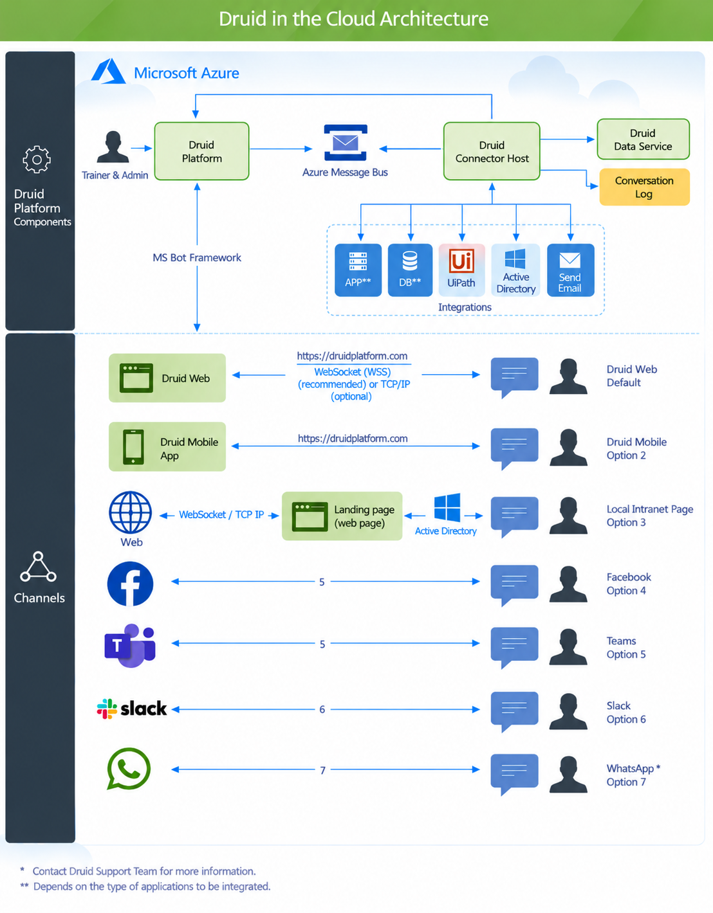
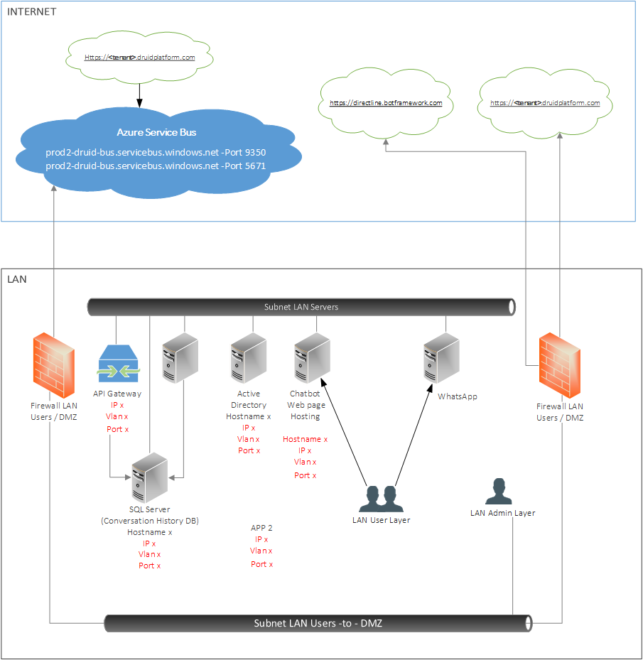
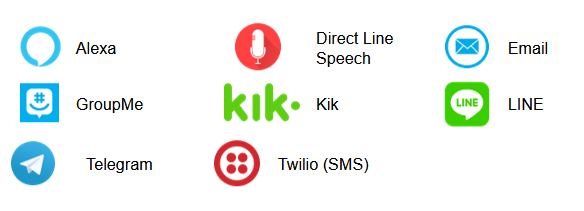

All Druid solution components are hosted in Microsoft Azure and managed by Druid. With a Druid subscription, we mind the maintenance and updates while you focus on your business.

> **NOTE:** Integration with your local applications is possible only if the respective applications provide API through the Internet.

## Deployment Architecture

The following diagram shows the main components of the Druid AI Platform from the deployment perspective.

Each Druid environment is hosted in an Azure Cloud data center located in a specific region, as follows:

| DRUID Environment | Azure Cloud Region |
| --- | --- |
| PROD EU | West Europe |
| PROD US | East US |
| PROD AU | Australia East |

DRUID provides SaaS from these Azure Cloud regions, with geo-redundant backup storage for added data protection.

### Druid Components

#### Druid AI Platform

The Druid AI Platform is a cloud-based solution, hosted in Microsoft Azure. It includes all the components required to setup and run the AI Agents. The Druid AI Platform is a multi-tenant deployment, hosted by Druid.

#### Druid Connector Host

The Druid Connector Host provides integration between AI Agents and other applications, services, or databases.

#### Druid Data Service

The Druid DataService serves as Druid's data storage solution, preserving Druid entity records created and managed within the Druid Platform. This storage simplifies record authoring for authors, who can use these records for Named Entity Recognition (NER) training and various other contexts.

#### Web Channel

The Web Channel (Druid Portal or local AI Agent web pages) and the Druid Mobile app communicates with the AI Agents using the TCP/IP protocol.

### Data Flow

In a Druid-hosted deployment, the data flow is the following:

1. The data requests / response between the Druid Conversation Engine and internal systems is transferred using Azure Service Bus. Druid AI Platform and the Druid Connector Host place the messages into service bus, including the data from connected apps. The messages are encrypted by using AMQPS and/or HTTPS protocols.
2. The Druid Connector Host handles the calls to connected apps, via ODBC or REST API, which are specific to your implementation.
3. The Druid Connector Host also handles the calls to the Druid APIs: Trigger Conversation Flow and Read Metadata.
4. The conversation messages are saved into the Conversation History database.
5. The chat sessions (flow of messages between AI Agent and end users) are available in various channels.

Figure: Logical Architecture

Figure: Physical Architecture

## Authentication

The Druid AI Platform provides you with extensive authentication methods.

**Local authentication**, connect to Druidplatform.com with user credentials (username and password) stored within Druid AI Platform. You can provision users directly into the Druid Portal and assign users security roles based on which they are granted access to specific functionality. For higher security, you can set up two-factor authentication for provisioned users.

The platform supports Single Sign-On (SSO). You can integrate with Active Directory for authentication & authorization purposes and host the AI Agent on the website or on your intranet configured with Windows Authentication. You can also integrate with your internal solution to automatically provision users and their associated roles.

You can authenticate the users chatting with your AI Agent asking specific questions and checking the provided information with the Druid back-end systems. You can also use authentication for other channels like: Teams, Facebook or WhatsApp when the user is chatting with the AI Agent for the first time.

Usually, the AI Agents for your employees uses Active Directory integration, MS Teams or Slack. The AI Agents for external users, customers and partners, use local Druid two-factor authentication.

## Integrations

Druid can quickly connect with any Core Banking, CRM, ERP, BI, HCM through REST, SOAP, Web services, APIs, MQs, SQL connections. If applications do not expose interfaces, the conversational platform can be integrated with RPA - UiPath. ​

For more information on Druid integrations, see [Integrations](../7_Integrations/Enterprise%20Connectors.md).​

## Channels

Multi-channel deployment is supported by Druid and offers a wide range of digital channels in multiple languages so you can reach your customers wherever they like to be, in their natural digital way. With Druid conversational platform you will deliver the experience your customers and employees expect.​

- External channels: Mobile App, Web, WhatsApp, Facebook Messenger etc.​
- Internal channels: Microsoft Teams, Intranet, Slack.​

Cross-channel interaction is also available. In addition to standard channels mentioned before, Druid offers support for other channels:

## Related Topics

- [Channels](../Channels/Channels.md)
- [Enterprise Connectors](../7_Integrations/Enterprise%20Connectors.md)
- [Handling Authentication](../How%20to/Handling%20Authentication.md)
