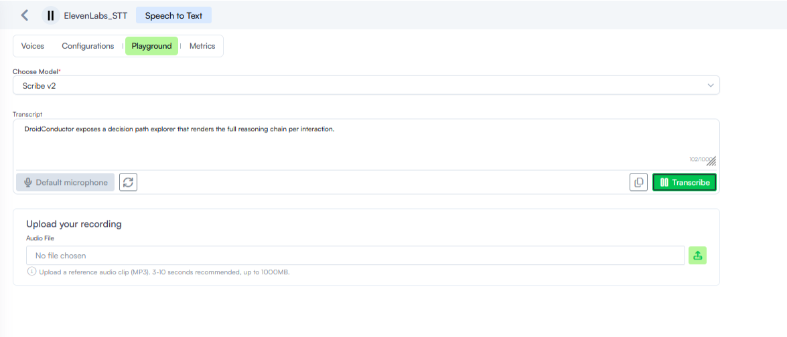

# Playground

The **Playground** provides an interactive testing environment to evaluate your ElevenLabs speech resources directly within the Druid Portal. The available options change depending on whether you are accessing an STT (Speech-to-Text) or TTS (Text-to-Speech) resource.

### STT Playground

The STT Playground provides an interactive testing environment to evaluate real-time transcription performance and model accuracy using live microphone input or pre-recorded audio files.

To test STT transcription, follow these steps:

1. Preview your ElevenLabs STT resource and click the **Playground** tab.
2. Choose the active STT transcription engine (such as Scribe v2) from the **Choose Model** dropdown.


**NOTE:** Only the Scribe v2 model is available.


3. Provide audio input:

* **Live recording**. Select your preferred microphone if you have multiple on your device, then click **Transcribe**. View real-time outputs in the Transcript box, which tracks character counts up to 1,000 characters.

Click **Transcribe** again to stop recording.

* **File upload**. Upload reference audio files in MP3 format. Recommended audio files should be between 3 and 10 seconds, supporting file sizes up to 1000MB. Use the delete icon to remove a file or click **Transcribe audio file** to process the file.

## TTS Playground

The TTS Playground provides tools to convert written scripts into synthesized voice audio, fine-tune generation parameters, use pronunciation dictionaries, and review test iterations.

To test voice configurations and compare test iterations:

1. Preview your ElevenLabs TTS resource and click the **Playground** tab.
2. Choose the active speech synthesis model (such as Eleven v4) from the **Choose Model** dropdown.
3. Configure generation settings:
4. Select the target voice profile from the **Voice** dropdown.
5. Select the output **Language**.
6. Enter the script you want to synthesize into the **Text** field or click one of the **Suggested Prompts**. A maximum of 5000 characters is allowed.
7. Adjust the available voice properties under **Voice Settings** according to your requirements. While **Seed** is a platform-specific parameter, the others are specific to the selected model. When specified, **Speed** is used to attempt deterministic sampling for reproducible audio outputs across repeated requests, noting that determinism is not guaranteed.
8. Configure pronunciation (optional). Enter your **Pronunciation Dictionary ID** and **Version ID** to apply custom XML lexicon rules. For more information about Pronunciation dictionaries, see [ElevenLabs documentation](https://elevenlabs.io/docs/eleven-agents/customization/voice/pronunciation-dictionary).
9. Click **Generate** to synthesize the complete audio file before playback, or click **Stream** to initiate progressive, low-latency audio chunk generation.
10. Review generation history. When you perform multiple configuration tests sequentially, inspect previous iterations by reviewing the **History** section in the right-hand panel to compare past outputs, inspect prior parameters, and replay previous audio tests.

