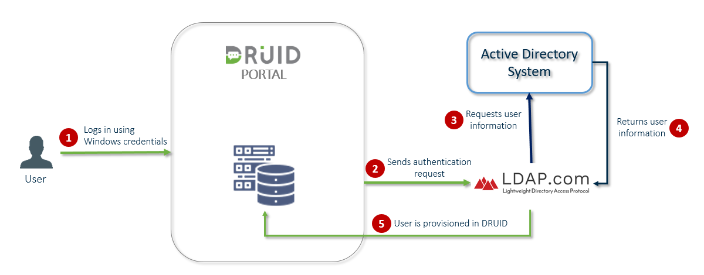

The Lightweight Directory Access Protocol (LDAP) makes it possible for DRUID to query user information from the Active Directory.

By using LDAP authentication on your DRUID tenant you ensure that all your Active Directory (AD) users logging into the Druid Portal with their AD account credentials (Windows credentials) are automatically provisioned in DRUID at their first login and are being granted with the default security roles.

The figure below provides an overview of how Druid Portal authentication with Active Directory via LDAP works.

## Prerequisites

- You have an Active Directory user with elevated privileges to view Active Directory users and access to the following attributes: "mail", "sAMAccountName", "name", "displayName", "userPrincipalName".
- You have a Druid Portal admin account.

This section is for Druid Portal administrators in charge of managing Portal users.

## Steps 1. Set up roles for automatically provisioned users


**IMPORTANT!**  All AD users provisioned in Druid Portal through LDAP will be automatically assigned with the roles set as **Default**.


To set up default role(s) to be assigned to automatically provisioned users, from the **Administration** menu, click **Roles**. Edit the desired role(s) by selecting **Default**.

Whenever new users log in Druid Portal for the first time, they will be assigned with the default role(s).

## Steps 2. Set up Druid Portal authentication with Active Directory via LDAP

To set up Druid Portal authentication with Active Directory via LDAP, in Druid Portal, from the **Administration** menu, click **Settings** and in the Settings page, click the **External Login Settings** tab.

In the LDAP Settings area, select **Enable LDAP Authentication**. Set the LDAP details described in the table below.

| Setting | Description |
| --- | --- |
| Domain name | The server address or name where the Active Directory service is running.  DRUID supports both LDAP and Secure LDAP (LDAPS) via the standard ports (port 389 for LDAP and 636 for LDAPS), therefore in the **Domain name** field, provide the domain name using the following syntax:   - When using LDAP:   LDAP://<domain name> - When using LDAPS:   LDAPS://<domain name>   If you use custom ports to connect via LDAP/LDAPS, provide the port number as well by using the following syntax:   - When using LDAP:   LDAP://<domain name>:<port> - When using LDAPS:   LDAPS://<domain name>:<port> |
| Distinguished Name | The Active Directory search base root. An unique identifier that describes location the location where the user information is within the information tree.  For example: DC=druid,DC=ad,DC=test |
| User name | - The credentials of the Active Directory user who has elevated privileges to view Active Directory users and access to the following attributes: "mail", "sAMAccountName", "name", "displayName", "userPrincipalName". |
| Password |  |
| Query | The LDAP query that will be used to search within Active Directory for specific user information to authenticate users.  For example: (&(objectClass=User)(sAMAccountName=druid-adtest-admin)). |

Save the settings by clicking the **Save all** button at the top-right corner of the page.

### Test the AD connection

To test the AD connection, go to the Test area. Enter the username in the **User** field, and the **Query** field will automatically populate based on the query from the LDAP Settings area.

In the **Attributes** field, specify the user identity attributes (AD attributes) you want to retrieve. For example: `mail,sAMAccountName,name,displayName,userPrincipalName,distinguishedName,sn,givenName,memberOf`.

Click **Save all**, then click **Test** .

## Step 3. Provision users from Active Directory (Optional)


**NOTE:** Provisioning users from Active Directory is available in DRUID 8.3 and higher.


### Prerequisites

- You have users assigned to AD groups.
- In your OIDC application, configure the token by specifying the claims you want in the tokens sent to DRUID. Based on your OIDC provider, special configurations might be required for OIDC to get the name of the AD groups. To find out more, we recommend you to consult your OIDC provider documentation.

The next section provides as example the prerequisites for Azure AD.

### Azure AD Prerequisites

In Microsoft Azure AD configuration page, under the **Manage** menu, click **Token Configuration** and add a group claim. Configure the group claim as follows:

- Select **Groups assigned to the application**. Due to the group number limit in the token, this option is mandatory for Azure AD.
- For Azure AD, for all token properties (ID, Access, SAML), select **Group ID**.

- For Azure hybrid AD, for all token properties (ID, Access, SAML), select **sAMAccountName**.

The "sam\_account\_name" property is automatically added in the application’s Manifest under the Optional claims schema.

- To get the name of the AD groups for Azure AD, in the Azure AD application, on the **Manage** menu, click on **Manifest** and in the manifest (JSON field) under the Optional claims schema, add the property “cloud\_displayname”.

- Select the groups assigned to the application. In Azure AD, From the Enterprise applications list, select the application. On the **Manage** menu, click **Users and groups** and select the group(s) you want to add to the application. If you have no groups here, add them first and then select the ones you want to send to DRUID.

To learn more about group claims configuration, see [Microsoft documentation](https://learn.microsoft.com/en-us/azure/active-directory/develop/active-directory-optional-claims).

### Provision users from AD

To provision users from AD groups they are members of, in DRUID, you have to map the AD groups to DRUID security roles.

In Druid Portal, from the **Administration** menu, click **Settings** and in the Settings page, click the **External Login Settings** tab. Scroll -down to section Single Sign on group roles mapping.

Enter the name of the AD group (the name of the group as defined in Active Directory) and from the drop down select the DRUID role(s) you want to assign to users who will be provisioned from that AD group. Click the **Add** button.

Map DRUID roles to as many AD groups as you want making sure that you provide the exact name of the group as defined in Active Directory.

A new user provisioned in DRUID will be assigned with the reunion of associated DRUID roles for all AD groups that user is member of. For example, if a user is member of two AD groups (Druid MFA and Druid Microsoft 365) and the two AD groups are mapped to three DRUID roles in the Single Sign on group roles mapping table, the user will be assigned all DRUID roles from the mapping table.

If the user is member of an AD group for which there is no DRUID role mapped, at provisioning, the user will be assigned the role(s) set as **Default**, if there are any defined; otherwise the user will be provisioned without any role associated and the administrator will have to manually assign a DRUID role for that user.


**IMPORTANT!** The mapping of the AD groups to DRUID security roles is validated and updated at every user login and it is updated based on the changes done in Active Directory, if any. For example, if in Active Directory a user has been moved from an AD group to another one, when the user logs in DRUID, the mapping of the AD groups to DRUID security roles is validated and the user will be assigned with the DRUID role(s)mapped for the new AD group the user is member of (if any).


## Step 4. Allow user registration and activate new accounts

DRUID provides built-in functionality to manage user registrations. To allow new users to register themselves to the Druid Portal, on the Settings page, in the Form-Based Registration area, select **Allow users to register to the system**.

By default, new users are inactive and unable to log in until their DRUID administrator manually activates their accounts.

To activate new self-registered users, select **New registered users are active by default**.


**Info:** If your company policies requires using a captcha on user registration and / or at log in, you can use security image question (captcha).


Save the changes. New users can now register themselves and access the Druid Portal.

## Step 5. Review provisioned users roles and privileges (ongoing task)

New users provisioned in DRUID are automatically assigned with the roles marked as default. As a Druid Portal administrator you might want to review the security roles assigned to users and make the proper changes based on business need to know (roles and privileges).
