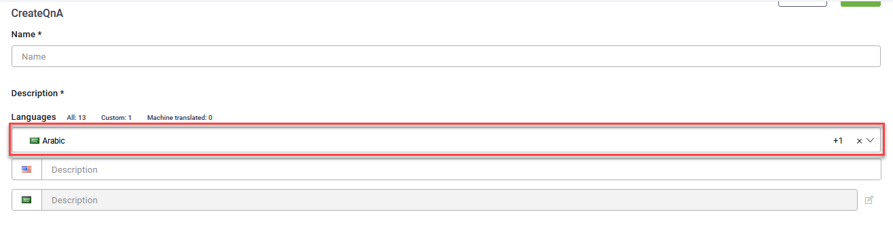
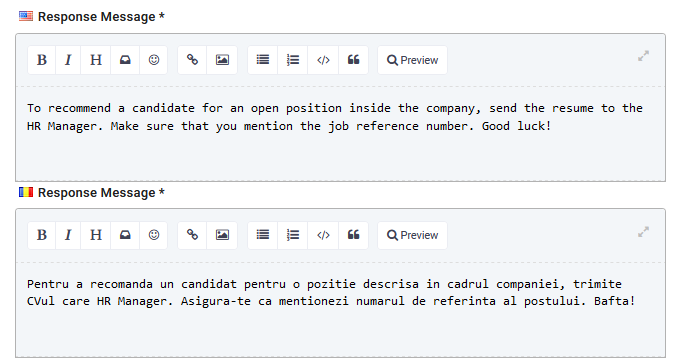

---
layout:
  title:
    visible: false
---

# Creating QnAs

A QnA is a question-answer pair. The answer responds to a simple question.

The QnA is a special type of conversational flow designed to simplify the business user experience when creating simple conversations. They are comprised of training phrases (primary and alternate questions) and a single step of type Message that delivers the response to the user (answer).

This section describes how to create KB articles.

## Prerequisite

- You need to have Knowledge Base Author security role, otherwise you will not see the QnA in solutions. If you don’t have this security role, get in touch with your Druid Portal administrator.

## Step 1. Test your primary question

> **NOTE:** Before adding a new QnA in the Druid Portal, you need to make sure that your primary question does not exist on the AI Agent (on QnA or Flows).

To test your primary question, access the QnA. In the **User says** field, enter your primary question.

Click the  icon and select the desired AI Agent language.

Druid searches the question against all intents that exist on the AI Agent (in the selected AI Agent language). If the primary questions is found on a QnA or flow, that means that the AI Agent already knows how to answer that question. Druid displays the search result(s) in either QnA OR Flows based on where Druid found the intent.

If the primary questions is found as intent on a flow(s) you see that it exists but as Knowledge Base author you do not have access to modify the identified flow(s).

> **NOTE:** To avoid creating duplicated understanding for the AI Agent, we recommend you to use another question.

A primary question passes the test when Druid finds no matches. Using this primary question, you can now create a QnA.

## Step 2. Create QnA

At the right-top side of the Questions and Answers page, click the **Create New QnA** button. The Create QnA page appears.

Provide the QnA details described in the table below.

| Field | Description |
| --- | --- |
| Name | The name of the QnA the DRUID platform uses in the backend . The field is mandatory. |
| Description | The QnA description. This field is mandatory. You can localize this field in the AI Agent languages. Provide description in the AI Agent languages displayed on the page.  **NOTE:** If the AI Agent understands more knowledgebase articles (QnAs) as being appropriate for the user question (intent), the AI Agent will display the description associated with the user’s question and give the user the possibility to choose the KB article.  **IMPORTANT!**  If you add the primary question in the Description field, you should add it in the Training Phrases as well.  Example:    [Authoring time translation](../2_AI%20Agents/Authoring%20Time%20Translation.md) is available for QnA description (if set on the AI Agent). To see QnA description in a specific language, select it from the **Languages** field.   |
| Category | For easier filtering and increased efficiency, Druid creates QnAs and breaks them down into categories.  Provide the desired category for your QnA. This field is mandatory. |
| Response Message | The answer to the user’s question. The message the AI Agent will respond to the user. The response is mandatory.  Provide the answer in all AI Agent languages displayed on the page.  Example:    **Authoring time translation** is available for QnA response message (if set on the AI Agent). To see QnA response in a specific language, select it from the **Languages** field. |
| Training Phrases | In this section, you add the primary questions and the desired alternate questions (if any). The questions are localizable, so add them in all AI Agent languages displayed on the screen. Enter question and click the add icon displayed inline ( ).  **NOTE:** The first question you add in the Training phrases section is marked as being the primary question; therefore, make sure that you first add the primary question and then subsequent alternate questions.  Example:    You can delete alternate questions by clicking the delete icon displayed inline. For consistency purposes, when deleting alternate questions, make sure to delete it in all AI Agent languages. |
| Requires Authentication | Select Authentication Required only if the QnA requires authentication. Useful if the AI Agent is talking to existing customers or employees. |

Click the **Save** button to save the KB article.

The Article appears under the specified category.

> **Info:** The Flows section lists all AI Agent intents and dialogs (including QnAs) enabling the AI Agent administrator easily troubleshoot intents when necessary. The QnA flows are marked with the specific label . The figure below provides an example.
>
> 

## Step 3. Train the AI Agent

To include all questions defined on the QnA flows associated with the respective AI Agent training model, you need to train the AI Agent. For that, go to the AI Agent details page, click the NLP section header, then click the **Train** button. The AI Agent NLP model will be trained to understand the questions as well.

## Related Topics

- [Authoring Time Translation](../2_AI%20Agents/Authoring%20Time%20Translation.md)
