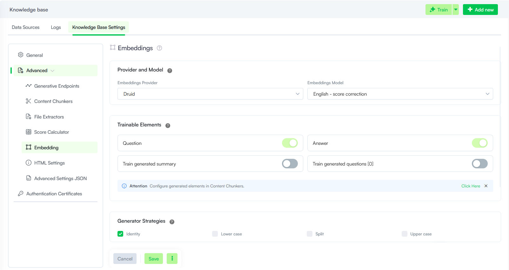

---
layout:
  title:
    visible: false
---

# Embeddings

The Embeddings section consolidates settings that control how the KB Engine prepares text for training and search. Here you configure which article fields are used for predictions, how text is normalized before embedding, and equivalent terms for keyword search (Synonym Sets).

These settings apply primarily to unstructured data sources (web, File Repository, SharePoint, Shared Drive, and custom data sources).

## Provider and Model

The LLM provider and the specific model used to generate vector embeddings for the Knowledge Base.

- **Provider**: Select **Druid** or one of the LLM providers currently activated on your tenant.
- **Model**: Select the machine learning model to be used for data vectorization.

## Trainable Elements

Trainable Elements define which specific parts of an article—such as the title, question, short description, or answer—the Knowledge Base Engine uses for predictions from unstructured data sources.

Each element can be enabled or disabled individually using its respective toggle switch, allowing for single or multi-element configurations. These preferences are set at the Knowledge Base and data source level, with granular overrides available at the node and leaf level.

> **NOTE:** Generated summary and generated questions are produced by the LLM content chunker. Configure generation options under **Advanced** > **Content Chunkers**. For more information, see [Content Chunkers](Content%20Chunkers.md).

| Parameter | Description |
| --- | --- |
| Question | Uses the question and title for predictions. |
| Answer | Uses the short description and answer for predictions. New AI Agents use both Question and Answer by default. |
| Train generated summary | Uses LLM-generated summaries for predictions when the LLM content chunker creates them during document processing.  Enabling this can increase chunking time but may improve match quality at prediction time.  **NOTE:** Requires **Generate summary** set to be selected in section [Content Chunkers](Content%20Chunkers.md), otherwise summaries are not generated. |
| Train generated questions | Uses LLM-generated questions for training when the LLM content chunker creates them. The number in the UI (for example, [0]) reflects how many questions are configured for training in the content chunker settings. For more information, see [Content Chunkers](Content%20Chunkers.md). |

## Generator Strategies

Generator Strategies control how text is formatted before embedding during KB training. Select the strategy that fits your content and search needs.

| Parameter | Description |
| --- | --- |
| Identity | Keeps the original text unchanged throughout training. This is the typical default when no transformation is required. |
| Lower case | Converts all text to lowercase for uniform case formatting. |
| Split | Splits paragraphs into individual sentences and applies sentence-level embeddings to improve comprehension and search accuracy. |
| Upper case | Converts all text to uppercase. Use when uppercase formatting is required for your content or downstream processing. |

## Synonym Sets

**Synonym Sets** let you group equivalent terms so the search can match user queries even when wording differs from your KB content. Each set lists related words or phrases (for example, in stock, available, ready to ship).

Matches on the exact query term score at 100%; matches on a synonym score at 80%, so synonyms broaden results without outweighing the user’s original words.

For more information, see [Synonyms Dictionary](Synonyms%20Dictionary.md).
