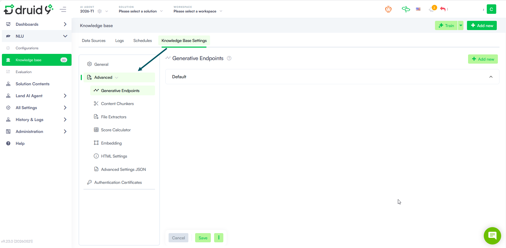

# KB Advanced Settings

The KB Advanced Settings let advanced authors fine-tune how the Knowledge Base engine processes, indexes, and retrieves content. These settings go beyond the defaults and give you control over AI model integrations, content extraction behavior, search algorithms, and low-level configuration — helping you optimize KB accuracy and performance for your specific use case.

To access the Advanced Settings, go to the Knowledge Base page, click the **Knowledge Base Settings** tab, and select **Advanced** from the left menu.

### Advanced Settings

The Advanced settings are organized into the following sections:

#### Generative Endpoints

Configure connections to large language model (LLM) providers. Generative endpoints are referenced by other advanced settings wherever an LLM is needed, such as Content Chunkers and Score Calculator.

#### Content Chunkers

Define how the KB engine segments document content into chunks for indexing and retrieval.

#### File Extractors

Select the extraction tool the KB engine uses for each supported file type. Different extractors offer different trade-offs between layout preservation, image handling, OCR support, and processing speed. Extractors can be configured globally here or overridden at the data source, node, or leaf level.

#### Score Calculator

Configure how the KB engine calculates the relevance score for search results. Each strategy defines the weight assigned to keyword (Text) search, semantic (Vector) search, and an optional reranker. You can define multiple strategies and select which one is active.

#### Embedding

Manage synonym sets used by the BM25 keyword search algorithm. Grouping related terms into synonym sets allows the KB engine to match user queries even when different wording is used — expanding search reach while keeping scoring accurate through weighted matching.

#### HTML Settings

Control how the KB engine handles HTML content during extraction.

#### Advanced Settings JSON

Directly edit the underlying JSON configuration for the KB engine. Use this field to add new elements to collections — such as generative endpoints or score calculator strategies — and to configure advanced feature flags not yet exposed in the UI. Modify with care: incorrect structural changes can cause extraction failures at runtime.

### Actions

These actions streamline your settings management by applying consistent advanced settings across your entire KB configuration with just one click.

#### Save & Close

Saves the current advanced settings and displays the KB page on the Data Sources tab.

#### Save to All

Saves the current advanced settings and applies them to all data sources.

#### Reset Advanced Settings

Resets the settings in the current section to their default values (e.g., clicking this on the Embeddings section will only reset Embeddings settings).

#### Cancel

Discards any unsaved changes and closes the panel.
