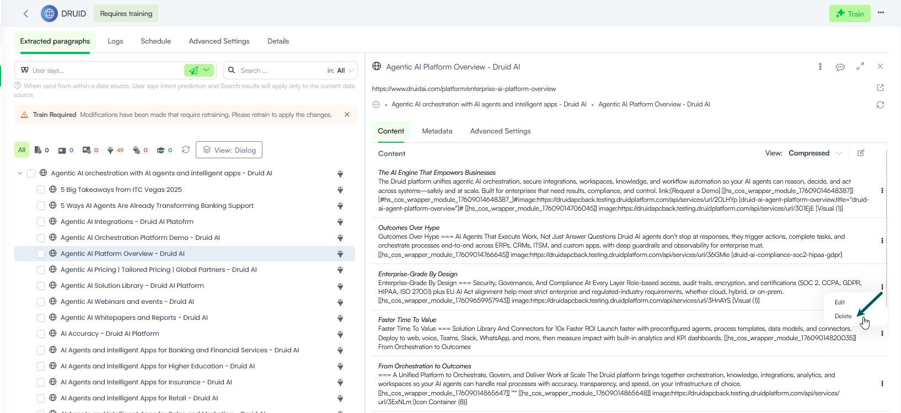

To ensure your Knowledge Base delivers high-quality, accurate answers during live interactions, you should periodically review, refine, and update extracted text paragraphs.

## Review Paragraphs

To review paragraphs in your data source:

1. Go to your data source.
2. Locate the node/leaf in the tree explorer.
> **Info:** To streamline your review workflow across large data sets, use the view layout toggle to switch from **Dialog** (Explorer View) to **Split** (Tree explorer and Content). For detailed instructions on layout options, see [Changing the Extracted Paragraphs View](Change%20the%20Extracted%20paragraphs%20View.md).

3. Compare the extracted paragraph directly against your source material to determine whether it requires structural cleanup, intent alignment, or deletion.

> **NOTE:** Any changes you do to extracted paragraphs requires data source retraining in order for the changes to take effect.

## Edit Extracted Paragraphs

To modify an extracted paragraph in your data source:

1. Locate the paragraph you want to update.
2. Click the Action menu next to the paragraph row and select **Edit**.

3. In the paragraph editor, update the paragraph and/or its title.

4. Click the **Save** icon.

> **NOTE:** You need to re-train your data source for this action to take place.

## Delete Extracted Paragraphs

If an extracted paragraph contains obsolete, redundant, or sensitive information:

1. Click the **Action** menu next to the paragraph and select **Delete**.

2. Confirm the deletion.

The paragraph will appear grayed out, indicating it is flagged for removal.

> **Info:** You can undo a deletion request before retraining by clicking the Action menu (...) next to the paragraph and selecting **Undo**.
>
> 

> **NOTE:** You need to re-train your data source for this action to take place.

## Retrain the Data Source

After making updates to your paragraphs, it is crucial to retrain your data source. Updating or deleting extracted paragraphs modifies the draft layer, but will not affect live AI Agent predictions until the data source is retrained.

To ensure the KB Engine recognizes these updates and provides accurate responses to user queries:

1. In the top-right corner of the data source page, click the **Action** menu.
2. Select **Retrain data source** (or click the **Train** button).

3. Wait for the training process to finish.

Once complete, your updated paragraphs will immediately be available for live predictions.
