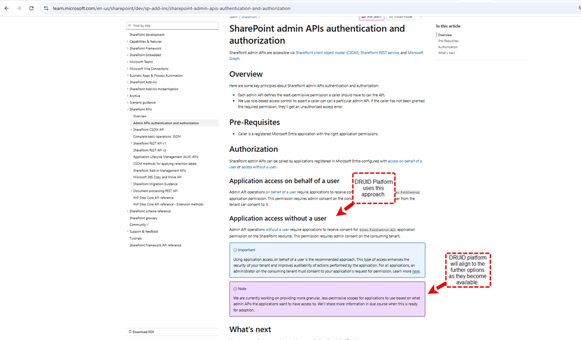
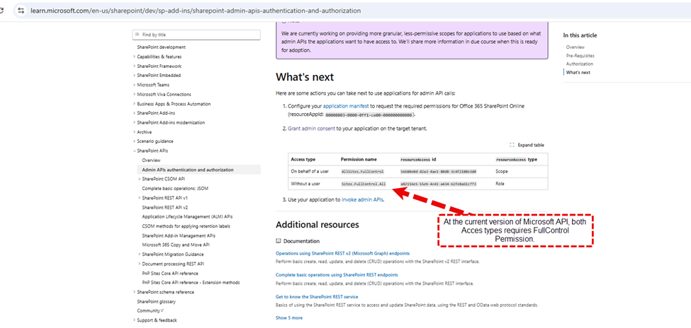

<a id="UserPermissionbasedContentFiltering"></a>


When using the Knowledge Base (KB) with a Large Language Model (LLM), you can refine the KB search results by performing a real-time permissions check for the current chat user against the referenced sources. This process is managed by the **KBCheckUserPermissions** internal action, which ensures the AI Agent only provides information that the user is authorized to view within the source system.

> **NOTE:** This feature currently supports SharePoint Online data sources exclusively.

<a id="PrerequisitesandAuthorization"></a>

## Prerequisites and Authorization

To enable user permission-based content filtering, the **KBCheckUserPermissions** internal action must be able to verify user access rights for the targeted SharePoint Online data source.

> **IMPORTANT!** The Druid AI Platform calls the **GetUserEffectivePermissions** method of the SharePoint REST API, and only this method, to check the user permissions on the cited documents, at conversation time. As per [Microsoft documentation](https://learn.microsoft.com/en-us/sharepoint/dev/sp-add-ins/sharepoint-admin-apis-authentication-and-authorization), this method requires SharePoint **Sites.FullContrall.All** permission on the App Registration.
> The app registered in Microsoft Entra is configured with access without a user. Druid will adopt Microsoft's enhanced permission scopes for admin APIs as they become available.
>
> 
>
> 

<a id="FilterUserPermissionbasedContent"></a>

## Filter User Permission-based Content

The content filtering process is not automated; you must manually configure the KB Agent flow by adding the **KBCheckUserPermissions** internal action and defining the logic to verify and evaluate user access.

<a id="Step1AddtheInternalAction"></a>

### Step 1. Add the Internal Action

First, add the internal action to your KB Agent flow to identify the collection of Knowledge Base results returned by the intent and the user:

```
{
  "KBQnAItems": "[[Intent]].KBQnAItems",
  "UserIdentifier": "[[ChatUser]].DomainUserName"
}
```

<a id="Step2InstructthePermissionsCheckVerifyReadAccess"></a>

### Step 2. Instruct the Permissions Check (VerifyReadAccess)

The **[[Intent]].KBQnAItem[\*].VerifyReadAccess** field instructs the internal action on which specific KB search results to check. You can optimize latency by checking permissions only on cited sources rather than the entire result set.

Use as example this logic in a code extension to mark specific citations for verification:

**Sample code**

```
let objArguments = JSON.parse([[GPTFunction]].Arguments); 
if (objArguments!= null){ 
  intCitation1Id = objArguments.Citation1Id === null ? "": objArguments.Citation1Id; 
  intCitation2Id = objArguments.Citation2Id === null ? "": objArguments.Citation2Id; 
  intCitation3Id = objArguments.Citation3Id === null ? "": objArguments.Citation3Id; 
} 
else 
{ 
  [[GPT]].response = "Missing 'response' property from the Arguments of function " + [[GPT]].GPTFunction.Name +"."; 
} 

if (intCitation1Id != null && [[Intent]].KBQnAItems[intCitation1Id] != null) 
{ 
  [[Intent]].KBQnAItems[intCitation1Id].VerifyReadAccess = true 
} 
if (intCitation2Id != null && [[Intent]].KBQnAItems[intCitation2Id] != null) 
{ 
  [[Intent]].KBQnAItems[intCitation2Id].VerifyReadAccess = true 
} 
if (intCitation3Id != null && [[Intent]].KBQnAItems[intCitation3Id] != null) 
{ 
  [[Intent]].KBQnAItems[intCitation3Id].VerifyReadAccess = true 
}
```

<a id="Step3EvaluateResultsHasReadAccess"></a>

### Step 3. Evaluate Results (HasReadAccess)

The result of the check is provided in the **[[Intent]].KBQnAItems[i].HasReadAccess** field. You must then use this information to decide whether to share the content with the KB agent or remove the restricted records from the agent context.

**Sample code**

```
let strToolResponse=""; 
for (i=0;i<[[Intent]].KBQnAItems.Count;i++){ 
  if ([[Intent]].KBQnAItems[i].HasReadAccess == false){ 
    strToolResponse+=`The user does not have access to this document: '${[[Intent]].KBQnAItems[i].Url}'\r\n`; 
  } 
} 
if (strToolResponse=="") strToolResponse="The user has no security restriction on the available context."; 
else strToolResponse+="Trigger KB_response and tell the user 'I cannot give this information as per your security permissions.' Include the references to the Citation's you verified."
```

<a id="UserExperience"></a>

## User Experience

When a user lacks the necessary SharePoint permissions for a specific document, the AI Agent identifies the restricted access and informs the user that the content cannot be provided, ensuring data security within the chat interface.


<a id="KBAgentDashboard"></a>

## KB Agent Dashboard

You can use the KB Agent Dashboard to observe events where user questions could have been answered by documents for which the user lacks access. This data allows you to review the respective permissions in SharePoint and follow up with users.


