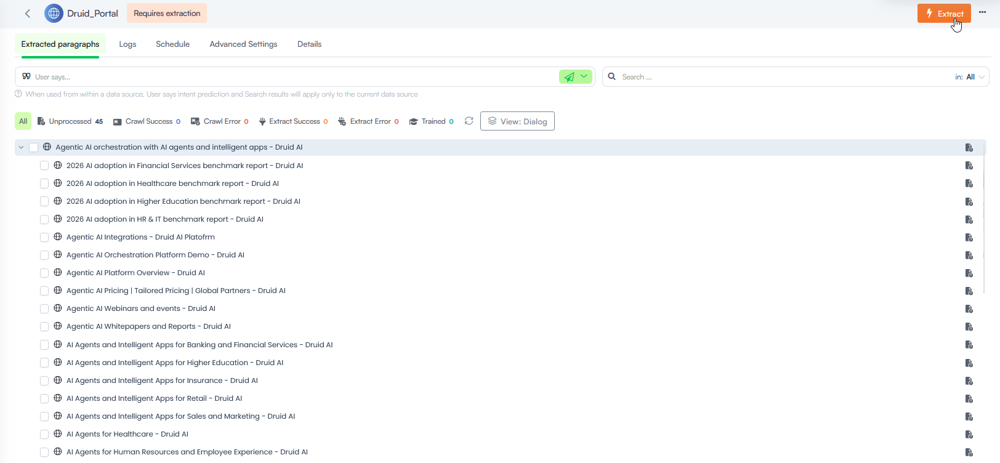

<a id="WebsiteDataSources"></a>


Website data sources, classified as unstructured data sources, allow you to extract and index content directly from web pages to power your AI Agent responses. By crawling public or authenticated websites, the system parses the HTML content, breaks it down into semantic paragraphs, and vectorizes it for Retrieval-Augmented Generation (RAG).

> **NOTE:** During website crawling, the system automatically discovers and extracts text from web pages and dynamic web formats—supporting file extensions such as .shtml, .asp, .aspx, and .jsp—as well as standard linked document files (including PDF, DOCX, and TXT). If your website hosts direct video files, the system can transcribe and index their audio track. For limits, transcription processes, and prerequisites, see [Extracting Data from Video Files](Extract%20Data%20from%20Video%20Files.md). Video extraction is only supported for files hosted directly on your domain and cannot extract embedded media from third-party platforms like YouTube or Vimeo.

By default, the extractor excludes content from a standard set of HTML elements (such as headers or footers) to ensure data quality. You can customize this behavior and manage how web content is processed by navigating to **Knowledge Base Settings** > **Advanced** > **HTML Settings.** For more information, see [HTML Settings](KB%20Settings/HTML%20Settings.md).

<a id="AddWebDatatotheKnowledgeBase"></a>

## Add Web Data to the Knowledge Base

To add content from a website, you must configure a website data source container that points to your target domain, then crawl and extract the data.

<a id="Step1Createthedatasource"></a>

### Step 1: Create the data source

To begin, follow the step-by-step instructions in [Data Source Creation](Data%20Source%20Creation.md). In the Add New Data Source modal, make the following settings:

1. From the **Type** dropdown, select **Website**.
2. Leave the **Crawl using HTTP requests** option selected if you want Druid to retrieve data directly from your servers using HTTP requests. This method works best for websites that don’t rely on JavaScript to display content.
> **NOTE:** If your website uses scripts to render content (for example, drop-down menus, tabs, or other dynamic elements), clear the **Crawl using HTTP requests** option. You can then configure the data source details by providing the JavaScript needed to render the HTML content.

3. To crawl a password-protected website, disable the **Crawl using HTTP requests** option, then provide your credentials and authentication page URL (**Login url**) in the designated fields. Alternatively, you can enter this information later in the data source Details tab.
> **NOTE:** Password-protected website crawling is available in technology preview starting with Druid 9.16.

4. Select **Include subdomains** if you want the Knowledge Base Engine to also retrieve data from subdomains of the provided URL.
5. In the **URL** field, enter the website URL starting with *https://*. E.g. *https://druidai.com*.
> **NOTE:** Druid supports data sources in the languages set for the AI Agent. These data sources will be used conversationally, matching the conversation language. An exception is made when an internal action is used; in this case, the KB Agent will predict in the data source set in internal action parameters, and that data source will be used regardless of its own language.

6. Click **Create** to save the data source.

The website data is added to the Knowledge Base and the data source page displays by default on the **Extracted paragraphs** tab, which will remain empty until you initiate the data ingestion.

<a id="Step2ConfigureAdvancedContentRenderingOptional"></a>

### <a id="Step"></a>Step 2. Configure Advanced Content Rendering (Optional)

If your website uses dynamic scripts, collapsible elements, or requires user authentication, you must configure additional settings before executing the crawl.

#### Crawling Dynamically Rendered Content (Playwright Scripts)

If your website renders content dynamically, you can provide a custom script to manipulate the page Document Object Model (DOM) after loading.

1. On the data source page, click the **Advanced Settings** tab.
2. In the **HTML Post Render Script** field, paste Playwright-compatible JavaScript.


This script runs directly in the headless browser after the page loads, ensuring all interactive elements (like expanding accordions or tab menus) are fully expanded and visible before Druid extracts the text.

> **Info:** If you do not have advanced JavaScript experience, you can use an AI tool to generate a Playwright-compatible JavaScript snippet designed to expand collapsible elements on your target URL.

3. Save your changes.

> **IMPORTANT!** Before crawling the data source, click the **Details** tab and make sure that **Crawl using HTTP requests** is clear.

#### Crawling Password-Protected Websites

To crawl a private portal or authenticated web environment:

1. On the data source page, click the **Details** tab.
2. Ensure the **Crawl using HTTP requests** option is cleared.
3. Provide your secure user credentials and the authentication page URL (Login URL) in the designated fields.


4. Save the changes.

If your website data source contains content that is rendered dynamically (for example, content displayed only after JavaScript execution such as drop-downs, tabs, or accordions), you can use a Playwright script to ensure all content is available for scraping.

<a id="Step3ExecutetheWebsiteCrawl"></a>

### Step 3. Execute the Website Crawl

> **IMPORTANT!** If your website blocks web crawling, you must whitelist the Druid crawl agents. To do this, update your **robots.txt** file in your website’s root directory and allow access for the following Druid crawl agents:
> **Elastic-Crawler** and **druidai-kb**.
>
> ```
> User-agent: Elastic-Crawler  
> Allow: 
> Sitemap: <your website or web page goes here - e.g., https://www.druidai.com>
>
> User-agent: druidai-kb  
> Allow: 
> Sitemap: <your website or web page goes here>
> ```

To crawl the website, click Crawl at the top-right corner of the page. In the **Start Crawling Parameters** modal, define the crawling parameters outlined below:

| Parameter | Description |
| --- | --- |
| Depth | Controls how far the system follows links from a page:   - 0 – Only the content of the current URL is crawled. - 1 – Includes content from links found on the current page. - 2+ – Continues following links from each subsequent page, up to the specified depth. |
| Throttle | The crawling speed, that is, the minimum number of seconds to wait between 2 consecutive crawling requests. |
| Use Site Maps | Select if you want the crawler to use the site map. If the website you entered does not have a site map, do not select this option. |
| Follow Links | Select if you want the crawler to visit all the hyperlinks in the retrieved web pages identified on the specified URL. |
| Crawl linked documents | Enable this option if you want the crawler to detect non-password-protected document assets available on the website. The crawler will identify only documents that match the file types supported by the KB Engine.  **IMPORTANT!** The crawler extracts document content from files with a maximum size of 20MB. Files exceeding this limit will not be processed. |


> **Info:** Based on the crawling parameters, it might take up to a few minutes for the crawling to complete.

As the crawler visits the link provided in the URL field, it will identify all the hyperlinks in the retrieved web pages and will add them to the list of URLs to visit.


> **NOTE:** If the URL provided when creating the data source redirects during crawling, the data source URL and all associated element URLs (nodes, pages) will be automatically updated to the redirected URL.

> **Info:** If the website includes links to other domains (different from the one specified in the website data source URL), those domains won’t be crawled automatically. To include them, add a new data source for each external domain you want to crawl. For more information, see [Crawl External Domains](#Crawl_External_Domains).

Once crawling is complete, the discovered site pages are loaded into the data source index in a simplified single-panel tree view by default, making it easier to browse.

You can exclude specific hyperlinks from the extraction process to prevent Druid from scraping unwanted sub-links.

<a id="Step4Excludelinksfromscrapingoptional"></a>

### Step 4. Exclude links from scraping (optional)

Before you start the extraction process, you can choose to exclude specific links from scraping. You can do this either:

- In bulk – by specifying multiple links at once.
- Manually – by excluding individual links one by one.

#### Exclude links from scraping in bulk

You can exclude multiple links from scraping in a website data source at once. This bulk exclusion option saves time by eliminating the need to remove links one by one.

To exclude links in bulk:

1. Click the **Details** tab.
2. In the **Exclude from scraping** area, turn on the **Advanced editing** toggle.
3. Enter the links you want to exclude as a JSON array, with each link enclosed in quotation marks. Example: `["https://example.com/page1", "https://example.com/page2"]`


4. Save the changes.

#### Manually exclude links from scraping

To manually exclude from scraping specific pages, click the dots next to the desired page and select **Exclude**. By excluding specific web pages, users can ensure that only relevant content is captured and added to the Knowledge Base.


The URLs excluded from scraping appear on the **Details** tab, in the **Exclude from scraping** area.


<a id="Step5Extractcontent"></a>

### Step 5. Extract content

To extract the raw text content from the indexed pages, click **Extract** at the top-right corner of the page.



> **NOTE:** The extraction might take a few seconds, depending on the number of links included in the scrapping.

<a id="Step6Trainthedatasource"></a>

### Step 6. Train the data source

After data extraction, it's crucial to train your data source. This ensures the KB Engine provides accurate responses to user queries. In the top right corner of the page, click **Train**.


<a id="CrawlExternalDomains"></a>

## <a id="Crawl_External_Domains"></a>Crawl External Domains

By default, Druid web crawler only crawls the domain specified in your initial website data source URL (and subdomains if selected). If your website contains links to other domains (external links), these domains will not be automatically crawled.

To include these external domains in your crawled data, you need to add them as separate website data sources.

To add a new website data source for an external domain:

1. Navigate to the KB website data source you are currently working with.
2. Click the **Details** tab.
3. Scroll down to the **External links** section. Here you will see a list of domains linked from your primary website.
4. Locate the domain for which you want to create a new data source and click the **Add** icon next to it.
5. The **Add new data source** modal opens.
6. Enter a descriptive **Name** for your new data source.
7. Click **Save**.

Once saved, this new data source will be created, and you can then initiate the crawling process for it independently.

> **NOTE:** Links to external domains like Social Media (e.g., Facebook, LinkedIn, etc.) and phone numbers are excluded from the External links section.

<a id="Troubleshootmissingcrawledlinks"></a>

## Troubleshoot missing crawled links

Website data sources provide clear error messages for links that were not successfully crawled, enabling you to swiftly pinpoint the underlying issues. This enhanced visibility helps you maintain the accuracy and completeness of your data sources.

To understand why specific links are missing from the data source:

1. In the tree explorer, place the mouse over the page you know links were not crawled, click the **Actions** menu and select **Page Info**.


2. In the Page Info page, click the **Extracted links** tab.


3. Review the information provided for each link. Error messages will highlight the specific reasons why a link was not crawled.

## Related Topics

- [Advanced Features and Optimization](Advanced%20Features%20and%20Optimization.md)
- [Data Management and Schedules](Data%20Management%20and%20Schedules.md)
