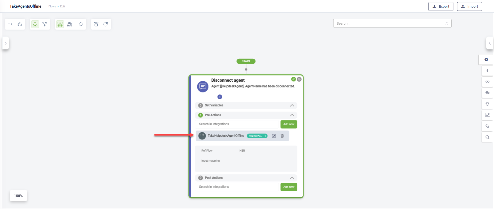
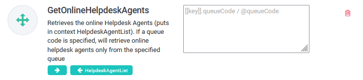

# Enabling Managers to Disconnect Helpdesk Agents

In some situations, helpdesk managers may need to disconnect agents from queues—for example, when agents forget to sign out, remain connected after their shift ends, or when resources need to be quickly reallocated.

As an AI Agent author, you can configure the AI Agent so that helpdesk managers can disconnect agents directly from the Live Dashboard.

### How to configure

To enable managers to take agents offline, whether or not they are connected to a live chat conversation, follow these steps:

1. Create a new flow with the **Special flow type**: **Take helpdesk agent offline flow**.

2. Insert a Message step.
3. In the **Step message** field, add a confirmation such as: \[\[HelpdeskAgent]].AgentName has been disconnected. If the helpdesk agents is engaged in a live chat, this message informs the user that the agent has been disconnected.

2. In the PreActions section of the step, add the internal action **TakeHelpdeskAgentOffline**.

3. Save the step.
4. Go to the AI Agent details page and click **Live Chat**.
5. Scroll down to the 'Special flows' area and from the **Take helpdesk agent offline flow** field, select the flow you just created.

5. Save the AI Agent.

Helpdesk managers can now take agents offline directly from the Live Dashboard.

### Druid Versions Prior to 9.5

For earlier versions, you can still provide the Helpdesk Managers with the option to disconnect agents from queue(s) by designing a more detailed flow with several steps:

1. Create a step of type Action which gets the list of online helpdesk agents and on the step, in the PostActions section, add the internal action **GetOnlineHelpdeskAgents**.

You can get the list of online agents from a specific queue by specifying the queue code in one of the following formats: \[\[Entity]].QueueCode, @queueCode, or " ". If you do not specify a queue code, you will get the list of all online agents.

2. Create a hero or choice step (with **@option** in the **Input mapping** field) which will return the list of online agents.

 

3. Add a step of type Message to take specific helpdesk agents offline. In the PreActions section of the flow step, add the internal action **TakeHelpdeskAgentOffline**. Provide a parameter based on the agents you want to disconnect:

* no parameter, if you want to take offline the agent found in the \[\[HelpdeskAgent]] entity.
* Queue code, if you want to take offline agents in the specified queue. You can provide the queue code using one of the following formats: \[\[Entity]].QueueCode, @queueCode, or " ".
* List of agents, if you want to take offline a specific list of agents. You can provide the list of agents as entity list using one of the following formats: **\[\[HelpdeskAgentList]]**, or **\[\[]].**.

You can add other flow steps to accommodate your needs.
