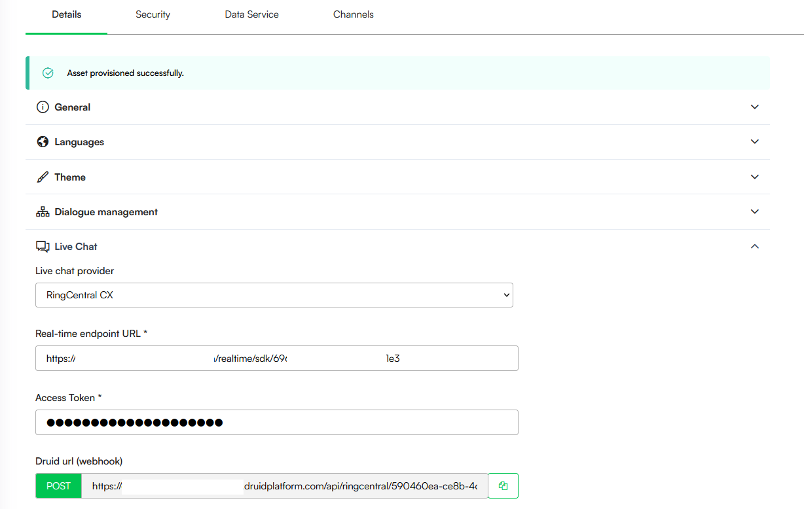

# RingCentral CX

You can allow your customers chat with the AI Agent and get support from your helpdesk agents who are using RingCentral CX.

### Prerequisites

* You have a RingCX environment and an admin account.
* Access in the Druid Portal to author AI Agents.
* A published AI Agent.

### Configuring the integration

The following steps outline how to establish a connection between Druid and RingCentral CX to enable live chat hand-offs.

#### Step 1: Retrieve Druid webhook URL and Webhook verification token <a href="#step_1" id="step_1"></a>

1. In the Druid Portal, go to your AI Agent settings.
2. Click **Live Chat**. The section expands.
3. From the **Live chat provider** dropdown, select **RingCentral CX**.
4. Copy the **Druid url (webhook)** generated in this section.
5. Generate a **Webhook verification token** and copy it.



**NOTE:** The **Webhook verification token** is available starting with Druid 9.19.


#### Step 2. Create a RingCX Digital Channel SDK <a href="#step_2" id="step_2"></a>

Create an SDK channel in RingCX following the official [RingCX documentation](https://support.ringcentral.com/article-v2/Engage-Digital-Channel-SDK-connection-settings-in-RingCX.html?brand=RingCentral\&product=RingCX\&language=en_US).

Use the following specific parameters for the Druid integration:

* **Base URI**: Paste the **Druid url (webhook)** copied in [Step 1](<RingCentral CX.md#Step_1>).
* **Verify signature**: Ensure this option is unselected.
* **API access token**: Copy the generated token; you will need this in the next steps.


* **Real-time Endpoint URL**: After saving the SDK, open it again and copy the **Real-time endpoint URL**.

#### Step 3. Create conversation end webhook in RingCentral CX <a href="#step" id="step"></a>

By default, RingCentral CX does not notify Druid when a conversation ends. Instead, the session remains active until it reaches the **Live chat conversation idle timeout mins** threshold.


**NOTE:** Conversation end support is available starting with Druid 9.19.


To notify Druid immediately when a live chat ends, log in to RingCentral CX Engage Digital, navigate to **Dev Tools** > **Webhooks**, and create a webhook with the following details:

| Field              | Description                                                                                                                  |
| ------------------ | ---------------------------------------------------------------------------------------------------------------------------- |
| Active             | Select this checkbox to enable the webhook.                                                                                  |
| API access token   | Enter the token generated for the RingCX Digital Channel SDK (copied in Step 2).                                             |
| URL                | Enter the **Druid url (webhook)** copied in Step 1.                                                                          |
| Name               | Enter a unique name to identify this webhook.                                                                                |
| Verification token | Enter the **Webhook verification token** copied in Step 1.                                                                   |
| Filtering          | Set the filtering strategy to **Selected channels**. From the **Channels** dropdown, select your RingCX Digital Channel SDK. |
| Subscriptions      | From the **Registered events** dropdown, select **intervention.closed**.                                                     |

.png>)

#### Step 4. Configure Druid for RingCentral CX

1. In the Druid Portal, go to your AI Agent settings.
2. Click **Live Chat**. The section expands.
3. From the **Live chat provider** dropdown, select **RingCentral CX**.
4. Enter the **Real-time endpoint URL** you copied from RingCentral at [Step 2](<RingCentral CX.md#Step_2>).
5. In the **Access Token** field, enter the **API access token** you copied at [Step 2](<RingCentral CX.md#Step_2>).



6. Save the AI Agent.

You can configure specialized conversational flows to improve the user experience during the hand-off process:

| Special Flow                           | Description                                                                                                                                                                                                                                                                                                                                                                                                                                                                                    |
| -------------------------------------- | ---------------------------------------------------------------------------------------------------------------------------------------------------------------------------------------------------------------------------------------------------------------------------------------------------------------------------------------------------------------------------------------------------------------------------------------------------------------------------------------------- |
| Live chat client disconnected flow     | Druid triggers this flow in the client’s conversation, after a live chat conversation ends. You can use it to capture client’s feedback about the live chat experience. This special flow is optional.                                                                                                                                                                                                                                                                                         |
| Live chat client waiting in queue flow | Druid triggers this flow in the client’s conversation every minute while the client is in the waiting queue. Use it to show the client’s position in the queue and estimated waiting time. As long as the client responds to any questions prompted from this flow, the client remains in the waiting queue (and the waiting queue timeout will be overridden), unless the flow configuration will take the client off the waiting queue, using the **TakeClientOffTheQueue** internal action. |

#### Step 5: Enable the Hand-off in Conversation Flows

To connect a user to a live agent, add a dedicated step to your conversation flow:

1. On the chosen flow step, navigate to the PreActions section.
2. Call the internal action: **ConnectToHelpdeskAgent**.

### Send the conversation transcript to RingCentral CX Agents

Most contact centers require agents to see the history of the interaction between the customer and the AI Agent.

1. **Capture the Transcript**: On the same flow step where you call **ConnectToHelpdeskAgent**, you must first call the internal action **GetConversationTranscript**.


**IMPORTANT!** You must call **GetConversationTranscript** in the PreActions section. If called in PostActions, the transcript will not be sent.



**Info:** You can call the **GetConversationTranscript** internal action on a previous step.


2. **Configure the Transfer**: In the **ConnectToHelpdeskAgent** internal action settings, settings, add the following JSON configuration:

```
{
  "SendConversationTranscript": true
}
```

3. Save the step.
