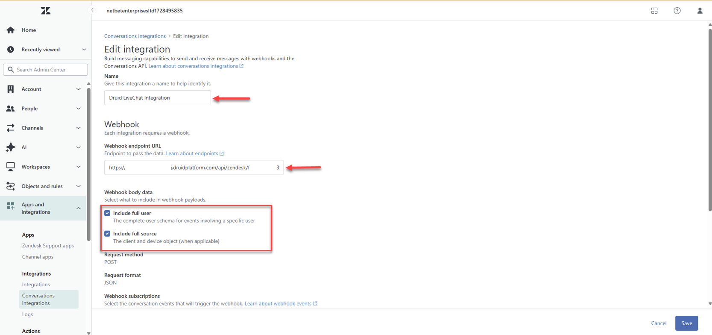
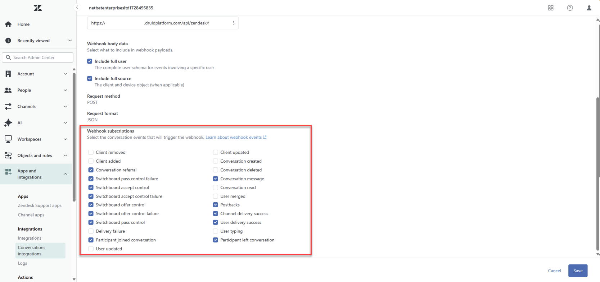

# Zendesk Live Chat

You can connect your AI Agent with Zendesk Contact Center to provide seamless support. This integration allows your customers to interact with a AI Agent and, if needed, get redirected to a live Zendesk agent. You can use either Zendesk widgets or DRUID channels (such as the DRUID web snippet).

### Prerequisites

* You set up the Zendesk Sunshine channel by following the instructions in the [Zendesk Sunshine](../Channels/Sunshine/Sunshine_Channel.md) topic.

### Use Zendesk Live Chat with Zendesk Widgets

Follow these steps to connect users interacting through Zendesk widgets (Zendesk messaging channels) with live agents in Zendesk:

1. Navigate to the AI Agent Details page and click on Live Chat.
2. From the **Live chat provider** drop-down, select **Zendesk Custom Widgets**.
3. In the **Integration** field, choose the desired Zendesk messaging channel.
4. Click **Configure and Activate**.


5. Save the AI Agent.

### Use Zendesk Live Chat with DRUID Channels


**NOTE:** This feature is available in DRUID version 8.19 and higher.


This setup connects users from DRUID channels — such as the DRUID web snippet or Direct Line — to Zendesk live agents.

#### Step 1: Get the DRUID Webhook URL

1. In the Druid Portal, go to the AI Agent Details page and click Live Chat.
2. From the **Live chat provider** drop-down, select **Zendesk – DRUID integration**.
3. Copy the **Druid url (webhook)** displayed on the screen.


#### Step 2: Create an Integration in Zendesk

1. In a new browser tab, log in to your Zendesk Admin Center with an admin account.
2. In the left-hand menu, select **Apps and Integrations** > **Conversations integrations**.
3. Click **Create integration**.


4. Enter a name for the integration to help identify it later.
5. In the **Webhook endpoint URL**, paste the **Druid url (webhook)** you copied earlier.
6. Enable the options to include full user and full source in the payload.



7. Under Webhook subscriptions, select the following:

* Conversation referral
* Switchboard pass control failure
* Switchboard accept control
* Switchboard accept control failure
* Switchboard offer control
* Switchboard offer control failure
* Switchboard pass control
* Participant left conversation
* Conversation message
* Postbacks
* Channel delivery success
* Participant joined conversation



8. Click **Save** to create the webhook.

#### Step 3: Retrieve the Webhook Secret

1. On the Conversations Integrations page, locate your integration.
2. Click the Actions button (⋮) next to the integration and choose **View details**.
3. Copy the **Shared secret** shown on the screen. You’ll use this in the DRUID configuration.

**Step 4: Finalize the Setup in DRUID**

1. Return to the AI Agent Details page in the Druid Portal.
2. In the Live Chat section, locate the Webhook Secret field.
3. In the **Webhook Secret** field, paste the shared secret you copied from Zendesk and click **Enable**.


4. Save the AI Agent.

### Send Contact Center Parameters

When passing control to Zendesk’s Agent Workspace you can include the following contact center parameters to populate ticket fields on the Zendesk ticket. Note that this feature is currently only available to customers using Agent Workspace

| Parameter                               | Data Type | Description                                                                      |
| --------------------------------------- | --------- | -------------------------------------------------------------------------------- |
| dataCapture.systemField.requester.name  | String    | The name of the client.                                                          |
| dataCapture.systemField.requester.email | String    | The email of the client.                                                         |
| dataCapture.systemField.group\_id       | Long      | The ID of the queue or the ID of the agent to which the client will be assigned. |

To send Contact Center parameters to Zendesk Live Chat, on the **ConnectToHelpdeskAgent** internal action, provide the desired parameters inside the `ContactCenterParameters` object in JSON format.


**NOTE:** The payload must follow a key-value format where both the key and value are strings. When using values from DRUID conversation context (entities, local variables) as parameter values, ensure they are enclosed in double quotes ("") to maintain valid JSON formatting.


**Example - Send Contact Center parameters**

```
{
   "ContactCenterParameters": {
     "dataCapture.systemField.requester.name": "[[ChatUser]].Name",
     "dataCapture.systemField.requester.email": "[[ChatUser]].Email",
     "dataCapture.systemField.group_id": "[[Entity]].QueueId" // recipient zendesk group
  }
}
```
